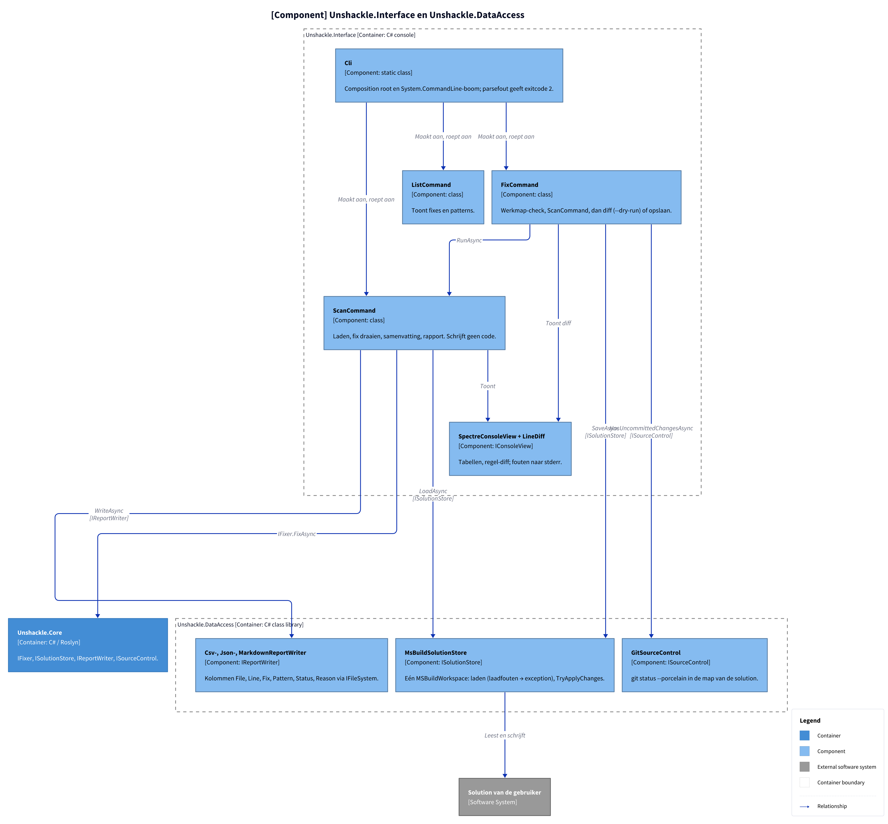

# Unshackle — projectinfo

Hoofddocument van de projectdocumentatie. Het overzicht en de C4-diagrammen staan hier; details staan in losse
documenten, en elk patroon heeft een eigen plan en verificatie (KingmaDoc) in `patterns/`.

## Documenten

| Document                                                 | Inhoud                                                               |
| -------------------------------------------------------- | -------------------------------------------------------------------- |
| [project.md](project.md)                                 | Idee, probleem, bestaande tools, CLI, voorbeelden, roadmap, risico's |
| [architectuur/projecten.md](architectuur/projecten.md)   | Projecten, afhankelijkheden, build-instellingen                      |
| [architectuur/core.md](architectuur/core.md)             | Fixer → Fix → Pattern, zoals ontworpen en zoals gebouwd, SOLID       |
| [architectuur/testen.md](architectuur/testen.md)         | Proofs, types zonder te builden, mocking, samples                    |
| [architectuur/rapportage.md](architectuur/rapportage.md) | Rapportformaten (nog niet gebouwd)                                   |
| [beslissingen.md](beslissingen.md)                       | Codestijl en wat nog beslist moet worden                             |
| [features/](features/end-to-end-keten-plan.md)           | KingmaDoc plan + verify per feature (niet-patroon), bv. [end-to-end-keten](features/end-to-end-keten-plan.md) ([verify](features/end-to-end-keten-verify.md)), [projectbestanden-migreren](features/projectbestanden-migreren-plan.md) ([verify](features/projectbestanden-migreren-verify.md)), [mediatr-fix](features/mediatr-fix-plan.md) ([verify](features/mediatr-fix-verify.md)), [gelijknamige-typen-swap](features/gelijknamige-typen-swap-plan.md) ([verify](features/gelijknamige-typen-swap-verify.md)) |

## C4 Context

**Figure 1.** Wie Unshackle gebruikt en waar het van afhangt.

<!-- kingmadoc:diagram img/README-1.d2 -->

| Element | Type | Rol |
| ------- | ---- | --- |
| Developer | Persoon | Draait de tool op zijn solution |
| Unshackle | Systeem | `src/`: `dotnet tool` met scan, fix, list |
| Solution van de gebruiker | Extern | `.sln`/`.slnx` die gelezen en herschreven wordt |
| MSBuild / .NET SDK | Extern | Laadt projecten en referenties |
| git | Extern | `fix` controleert of de werkmap schoon is |

## C4 Container

**Figure 2.** De projecten in `src/`. Het testproject staat er niet in.

<!-- kingmadoc:diagram img/README-2.d2 -->

| Container | Pad | Rol |
| --------- | --- | --- |
| Unshackle.Interface | `src/Unshackle.Interface/` | `dotnet tool` `unshackle`; composition root in `Cli.cs`, commands, console |
| Unshackle.Core | `src/Unshackle.Core/` | Fixer, fixes, patterns |
| Unshackle.DataAccess | `src/Unshackle.DataAccess/` | MSBuild laden/opslaan, rapporten (CSV/JSON/Markdown), git-status |

## C4 Component: Unshackle.Core

**Figure 3.** Onderdelen van Core, met de vijftien patterns die er nu zijn. Contracten en modellen staan in [modellen/klassen.md](modellen/klassen.md).

<!-- kingmadoc:diagram img/README-3.d2 -->

| Component | Pad | Rol |
| --------- | --- | --- |
| Fixer | `src/Unshackle.Core/Fixer.cs` | Zie [modellen/fix-flow.md](modellen/fix-flow.md) |
| UsingDirectives | `src/Unshackle.Core/UsingDirectives.cs` | Alleen usings op bovenste niveau |
| FluentAssertionsFix | `src/Unshackle.Core/Fixes/FluentAssertions/FluentAssertionsFix.cs` | Patterns in vaste volgorde |
| MediatRFix | `src/Unshackle.Core/Fixes/MediatR/MediatRFix.cs` | MediatR 12.5.0 → Mediator 3.0.2; patronen volgen (zie [features/mediatr-fix-plan.md](features/mediatr-fix-plan.md)) |
| FluentAssertionsSyntax | `src/Unshackle.Core/Fixes/FluentAssertions/FluentAssertionsSyntax.cs` | Gedeelde bouwstenen |
| Patterns (15) | `src/Unshackle.Core/Fixes/FluentAssertions/Patterns/` | Zie [modellen/patronen.md](modellen/patronen.md) |

## C4 Component: Unshackle.Interface en Unshackle.DataAccess

**Figure 4.** De keten van commando tot bestand. Exitcodes: 0 = ok (ook met Manual), 1 = laad- of schrijffout of vuile werkmap, 2 = ongeldige argumenten.

<!-- kingmadoc:diagram img/README-4.d2 -->

| Component | Pad | Rol |
| --------- | --- | --- |
| Cli | `src/Unshackle.Interface/Cli.cs` | Composition root, command-boom, parsefout → 2 |
| ScanCommand / FixCommand / ListCommand | `src/Unshackle.Interface/Commands/` | Zie [features/end-to-end-keten-plan.md](features/end-to-end-keten-plan.md) |
| SpectreConsoleView, LineDiff | `src/Unshackle.Interface/Output/` | Tabellen en regel-diff; fouten naar stderr |
| MsBuildSolutionStore | `src/Unshackle.DataAccess/Solutions/` | Laden en opslaan met één `MSBuildWorkspace` |
| Report writers | `src/Unshackle.DataAccess/Reports/` | CSV, JSON, Markdown |
| GitSourceControl | `src/Unshackle.DataAccess/SourceControl/` | `git status --porcelain` |

## Modellen

| Model | Document |
| ----- | -------- |
| UML-klassendiagram: contracten, modellen, I/O-contracten en implementaties | [modellen/klassen.md](modellen/klassen.md) |
| UML-sequence: `FixAsync` | [modellen/fix-flow.md](modellen/fix-flow.md) |
| UML-activity: Fixed of Manual | [modellen/pattern-beslissing.md](modellen/pattern-beslissing.md) |
| Overzicht van alle 15 patterns in vier groepen | [modellen/patronen.md](modellen/patronen.md) |

## Patronen

Elk patroon heeft een KingmaDoc-plan (vóór de bouw) en -verificatie (na de bouw) in `patterns/`.
Wachtrij en status: `claude/tasks/patroon-queue.md`.

| Patroon-ID | Plan | Modellen | Verificatie | Taak |
| --- | --- | --- | --- | --- |
| `fa.should-be`  | [plan](patterns/fa-should-be-plan.md)  | [modellen](patterns/fa-should-be-modellen.md) | [verify](patterns/fa-should-be-verify.md)  | TAAK-001 |
| `fa.have-count` | [plan](patterns/fa-have-count-plan.md) | [modellen](patterns/fa-have-count-modellen.md) | [verify](patterns/fa-have-count-verify.md) | TAAK-002 |
| `fa.be-true-false` | [plan](patterns/fa-be-true-false-plan.md) | [modellen](patterns/fa-be-true-false-modellen.md) | [verify](patterns/fa-be-true-false-verify.md) | TAAK-003 |
| `fa.be-null` | [plan](patterns/fa-be-null-plan.md) | [modellen](patterns/fa-be-null-modellen.md) | [verify](patterns/fa-be-null-verify.md) | TAAK-004 |
| `fa.be-empty` | [plan](patterns/fa-be-empty-plan.md) | [modellen](patterns/fa-be-empty-modellen.md) | [verify](patterns/fa-be-empty-verify.md) | TAAK-006 |
| `fa.contain` | [plan](patterns/fa-contain-plan.md) | [modellen](patterns/fa-contain-modellen.md) | [verify](patterns/fa-contain-verify.md) | TAAK-007 |
| `fa.contain-key` | [plan](patterns/fa-contain-key-plan.md) | [modellen](patterns/fa-contain-key-modellen.md) | [verify](patterns/fa-contain-key-verify.md) | TAAK-013 |
| `fa.throw` | [plan](patterns/fa-throw-plan.md) | [modellen](patterns/fa-throw-modellen.md) | [verify](patterns/fa-throw-verify.md) | TAAK-008 |
| `fa.throw-async` | [plan](patterns/fa-throw-async-plan.md) | [modellen](patterns/fa-throw-async-modellen.md) | [verify](patterns/fa-throw-async-verify.md) | TAAK-012 |
| `fa.not-throw` | [plan](patterns/fa-not-throw-plan.md) | [modellen](patterns/fa-not-throw-modellen.md) | [verify](patterns/fa-not-throw-verify.md) | TAAK-011 |
| `fa.be-equivalent-to-string` | [plan](patterns/fa-be-equivalent-to-string-plan.md) | [modellen](patterns/fa-be-equivalent-to-string-modellen.md) | [verify](patterns/fa-be-equivalent-to-string-verify.md) | TAAK-009 |
| `fa.be-equivalent-to-object` | [plan](patterns/fa-be-equivalent-to-object-plan.md) | [modellen](patterns/fa-be-equivalent-to-object-modellen.md) | [verify](patterns/fa-be-equivalent-to-object-verify.md) | TAAK-016 |
| `fa.be-greater-less` | [plan](patterns/fa-be-greater-less-plan.md) | [modellen](patterns/fa-be-greater-less-modellen.md) | [verify](patterns/fa-be-greater-less-verify.md) | TAAK-010 |
| `fa.only-contain` | [plan](patterns/fa-only-contain-plan.md) | [modellen](patterns/fa-only-contain-modellen.md) | [verify](patterns/fa-only-contain-verify.md) | TAAK-015 |
| `fa.all-satisfy` | [plan](patterns/fa-all-satisfy-plan.md) | [modellen](patterns/fa-all-satisfy-modellen.md) | [verify](patterns/fa-all-satisfy-verify.md) | TAAK-014 |
| `fa.assertion-scope` | [plan](patterns/fa-assertion-scope-plan.md) | [modellen](patterns/fa-assertion-scope-modellen.md) | [verify](patterns/fa-assertion-scope-verify.md) | TAAK-031 |
| `fa.not-be` | [plan](patterns/fa-not-be-plan.md) | [modellen](patterns/fa-not-be-modellen.md) | [verify](patterns/fa-not-be-verify.md) | TAAK-032 |

## Zie ook

- `claude/docs/INDEX.md` — index voor agents
- `claude/docs/patroon-loop.md` — hoe patronen gemaakt en gedocumenteerd worden
- `claude/docs/code-standaarden.md` — codestijl
