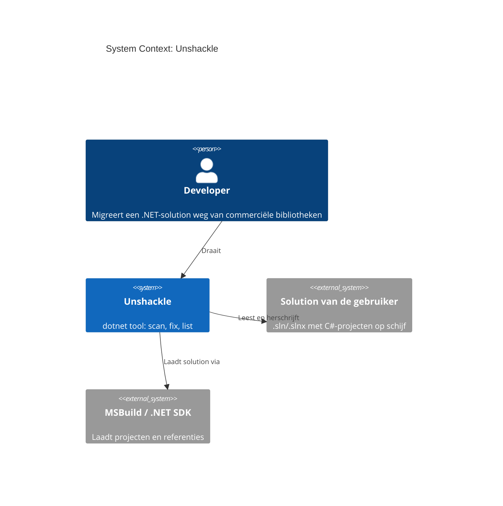
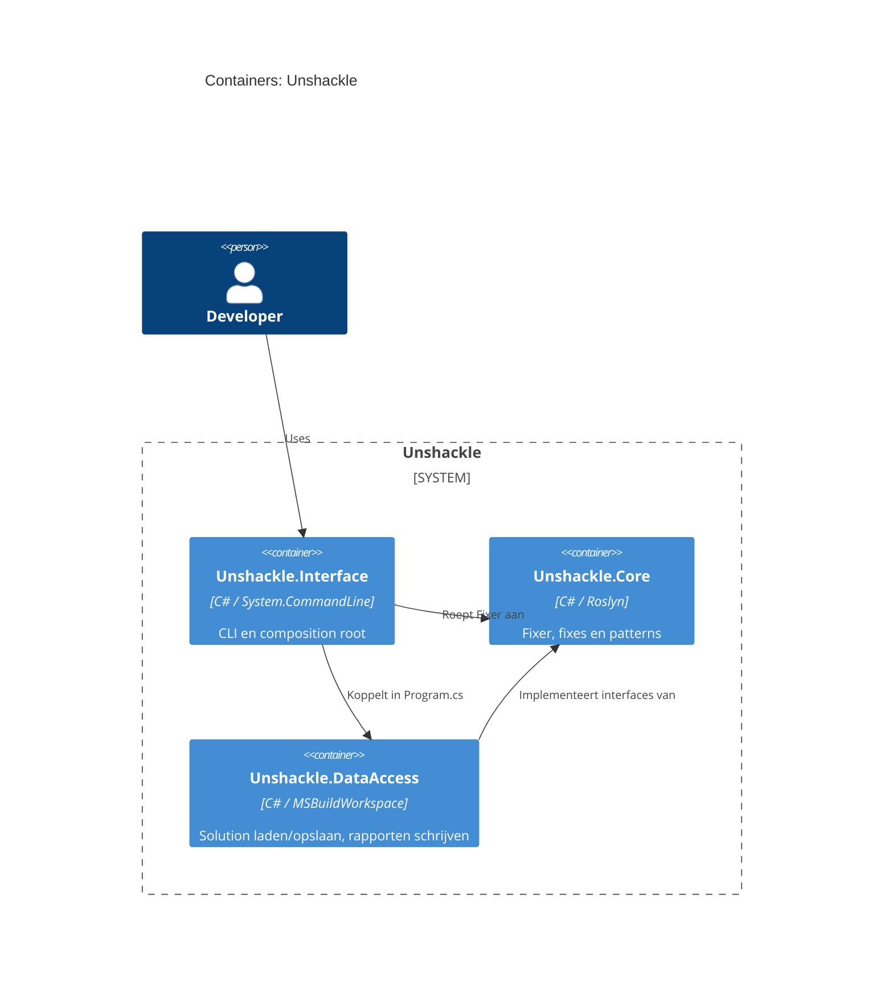
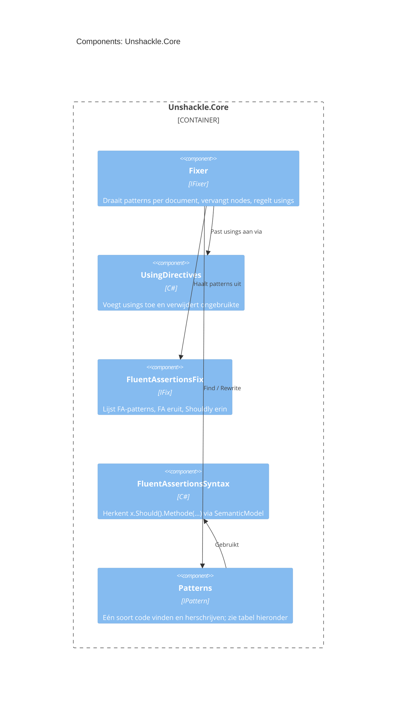

# Unshackle — projectinfo

Hoofddocument van de projectdocumentatie. Het overzicht en de C4-diagrammen staan hier; details staan in losse
documenten, en elk patroon heeft een eigen plan en verificatie (KingmaDoc) in `patterns/`.

## Documenten

| Document                                                 | Inhoud                                                               |
| -------------------------------------------------------- | -------------------------------------------------------------------- |
| [project.md](project.md)                                 | Idee, probleem, bestaande tools, CLI, voorbeelden, roadmap, risico's |
| [architectuur/projecten.md](architectuur/projecten.md)   | Projecten, afhankelijkheden, build-instellingen                      |
| [architectuur/core.md](architectuur/core.md)             | Fixer → Fix → Pattern, zoals ontworpen en zoals gebouwd, SOLID       |
| [architectuur/testen.md](architectuur/testen.md)         | Proofs, types zonder te builden, mocking, samples                    |
| [architectuur/rapportage.md](architectuur/rapportage.md) | Rapportformaten (nog niet gebouwd)                                   |
| [beslissingen.md](beslissingen.md)                       | Codestijl en wat nog beslist moet worden                             |

## C4 Context

Wie Unshackle gebruikt en waar het van afhangt.

## C4 Container

De projecten in `src/` _(uit de code; Interface en DataAccess zijn nog leeg)_.

## C4 Component: Unshackle.Core

_(uit de code, stand TAAK-002)_

## Patronen

Elk patroon heeft een KingmaDoc-plan (vóór de bouw) en -verificatie (na de bouw) in `patterns/`.
Wachtrij en status: `claude/tasks/patroon-queue.md`.

| Patroon-ID      | Plan                                   | Verificatie                                | Taak     |
| --------------- | -------------------------------------- | ------------------------------------------ | -------- |
| `fa.should-be`  | [plan](patterns/fa-should-be-plan.md)  | [verify](patterns/fa-should-be-verify.md)  | TAAK-001 |
| `fa.have-count` | [plan](patterns/fa-have-count-plan.md) | [verify](patterns/fa-have-count-verify.md) | TAAK-002 |
| `fa.be-true-false` | [plan](patterns/fa-be-true-false-plan.md) | [verify](patterns/fa-be-true-false-verify.md) | TAAK-003 |

## Zie ook

- `claude/docs/INDEX.md` — index voor agents
- `claude/docs/patroon-loop.md` — hoe patronen gemaakt en gedocumenteerd worden
- `claude/docs/code-standaarden.md` — codestijl
