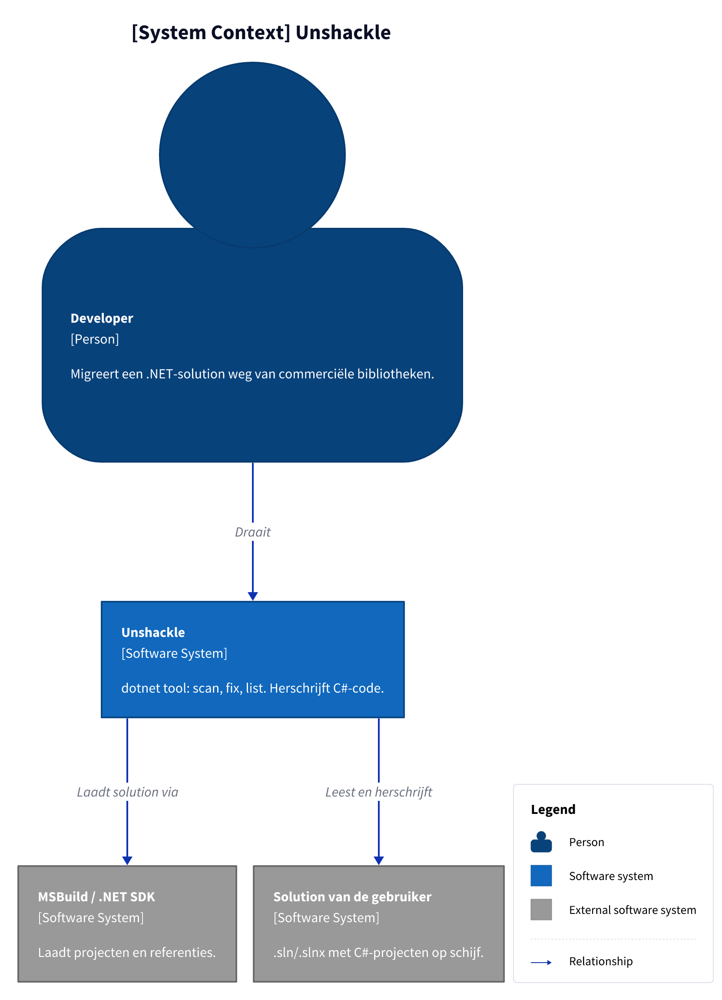
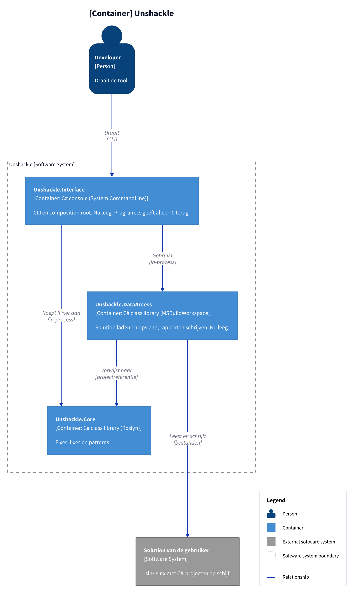
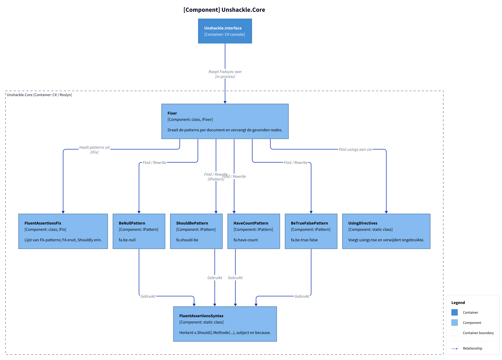

# Unshackle — projectinfo

Hoofddocument van de projectdocumentatie. Het overzicht en de C4-diagrammen staan hier; details staan in losse
documenten, en elk patroon heeft een eigen plan en verificatie (KingmaDoc) in `patterns/`.

## Documenten

| Document                                                 | Inhoud                                                               |
| -------------------------------------------------------- | -------------------------------------------------------------------- |
| [project.md](project.md)                                 | Idee, probleem, bestaande tools, CLI, voorbeelden, roadmap, risico's |
| [architectuur/projecten.md](architectuur/projecten.md)   | Projecten, afhankelijkheden, build-instellingen                      |
| [architectuur/core.md](architectuur/core.md)             | Fixer → Fix → Pattern, zoals ontworpen en zoals gebouwd, SOLID       |
| [architectuur/testen.md](architectuur/testen.md)         | Proofs, types zonder te builden, mocking, samples                    |
| [architectuur/rapportage.md](architectuur/rapportage.md) | Rapportformaten (nog niet gebouwd)                                   |
| [beslissingen.md](beslissingen.md)                       | Codestijl en wat nog beslist moet worden                             |

## C4 Context

**Figure 1.** Wie Unshackle gebruikt en waar het van afhangt.

<!-- kingmadoc:diagram img/README-1.d2 -->

| Element | Type | Rol |
| ------- | ---- | --- |
| Developer | Persoon | Draait de tool op zijn solution |
| Unshackle | Systeem | `src/`: scan, fix, list (alleen Core is gebouwd) |
| Solution van de gebruiker | Extern | `.sln`/`.slnx` die gelezen en herschreven wordt |
| MSBuild / .NET SDK | Extern | Laadt projecten en referenties |

## C4 Container

**Figure 2.** De projecten in `src/` _(Interface en DataAccess zijn nog leeg)_. Het testproject staat er niet in.

<!-- kingmadoc:diagram img/README-2.d2 -->

| Container | Pad | Rol |
| --------- | --- | --- |
| Unshackle.Interface | `src/Unshackle.Interface/Program.cs` | CLI en composition root; verwijst naar Core en DataAccess |
| Unshackle.Core | `src/Unshackle.Core/` | Fixer, fixes, patterns |
| Unshackle.DataAccess | `src/Unshackle.DataAccess/` | Verwijst naar Core; nog geen code |

## C4 Component: Unshackle.Core

**Figure 3.** Onderdelen van Core, met de vier patterns die er nu zijn. Contracten en modellen staan in [modellen/klassen.md](modellen/klassen.md).

<!-- kingmadoc:diagram img/README-3.d2 -->
<!-- kingmadoc:diagram img/README-3.d2 -->
<!-- kingmadoc:diagram img/README-3.d2 -->

| Component | Pad | Rol |
| --------- | --- | --- |
| Fixer | `src/Unshackle.Core/Fixer.cs` | Zie [modellen/fix-flow.md](modellen/fix-flow.md) |
| UsingDirectives | `src/Unshackle.Core/UsingDirectives.cs` | Alleen usings op bovenste niveau |
| FluentAssertionsFix | `src/Unshackle.Core/Fixes/FluentAssertions/FluentAssertionsFix.cs` | Patterns in vaste volgorde |
| FluentAssertionsSyntax | `src/Unshackle.Core/Fixes/FluentAssertions/FluentAssertionsSyntax.cs` | Gedeelde bouwstenen |
| Patterns (4) | `src/Unshackle.Core/Fixes/FluentAssertions/Patterns/` | Zie [modellen/patronen.md](modellen/patronen.md) |

## Modellen

| Model | Document |
| ----- | -------- |
| UML-klassendiagram: contracten en modellen | [modellen/klassen.md](modellen/klassen.md) |
| UML-sequence: `FixAsync` | [modellen/fix-flow.md](modellen/fix-flow.md) |
| UML-activity: Fixed of Manual | [modellen/pattern-beslissing.md](modellen/pattern-beslissing.md) |
| Overzicht van alle patterns | [modellen/patronen.md](modellen/patronen.md) |

## Patronen

Elk patroon heeft een KingmaDoc-plan (vóór de bouw) en -verificatie (na de bouw) in `patterns/`.
Wachtrij en status: `claude/tasks/patroon-queue.md`.

| Patroon-ID      | Plan                                   | Verificatie                                | Taak     |
| --------------- | -------------------------------------- | ------------------------------------------ | -------- |
| `fa.should-be`  | [plan](patterns/fa-should-be-plan.md)  | [verify](patterns/fa-should-be-verify.md)  | TAAK-001 |
| `fa.have-count` | [plan](patterns/fa-have-count-plan.md) | [verify](patterns/fa-have-count-verify.md) | TAAK-002 |
| `fa.be-true-false` | [plan](patterns/fa-be-true-false-plan.md) | [verify](patterns/fa-be-true-false-verify.md) | TAAK-003 |
| `fa.be-null` | [plan](patterns/fa-be-null-plan.md) | [verify](patterns/fa-be-null-verify.md) | TAAK-004 |

## Zie ook

- `claude/docs/INDEX.md` — index voor agents
- `claude/docs/patroon-loop.md` — hoe patronen gemaakt en gedocumenteerd worden
- `claude/docs/code-standaarden.md` — codestijl
