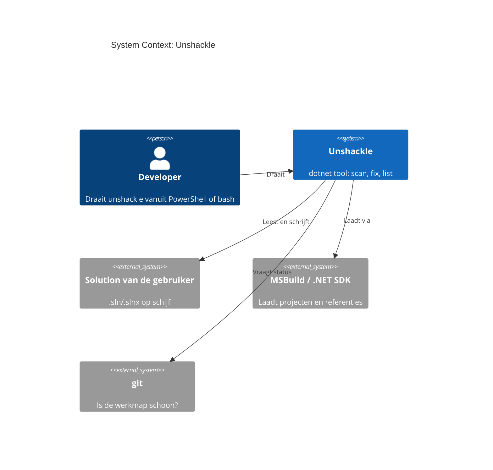
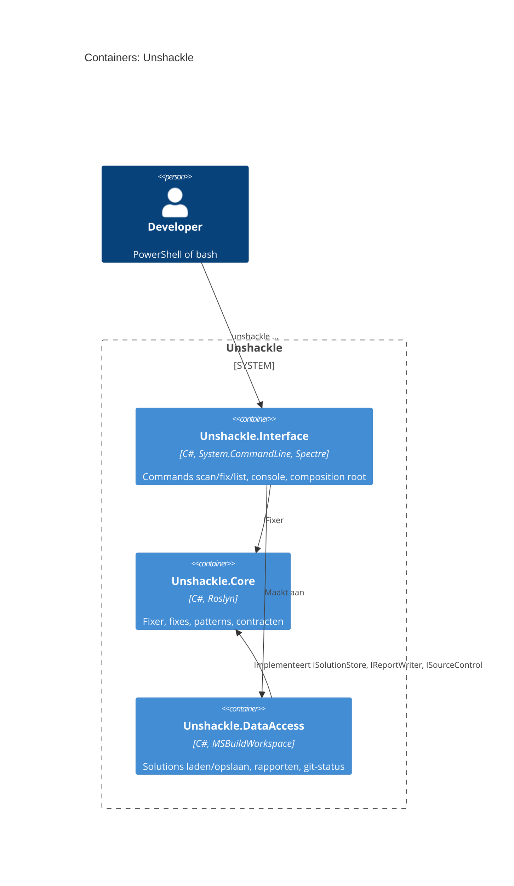

# Feature: End-to-end keten: unshackle scan, fix en list als dotnet tool

|               |                         |
| ------------- | ----------------------- |
| **Project**   | Unshackle               |
| **Status**    | Implemented               |
| **Generated** | 2026-10-11 by KingmaDoc |

> Opgesteld uit TAAK-005. Alles gemarkeerd als _(inferred)_ komt uit de codebase-analyse.

## One-sentence summary

`unshackle scan|fix|list` werkt als `dotnet tool` vanuit elke shell (PowerShell, bash) op een echte `.sln`/`.slnx`,
met rapport (CSV/JSON/Markdown), `--dry-run`-diff en vaste exitcodes.

## Scope (in / out)

**In scope**

- Solution laden en wegschrijven via één `MSBuildWorkspace` (`ISolutionStore` → `MsBuildSolutionStore`).
- Rapport-writers CSV, JSON en Markdown (`IReportWriter`), gekozen op de extensie van `--report`.
- Commands `list`, `scan`, `fix` (`--dry-run`, `--force`), console-uitvoer via Spectre.
- Veiligheidscheck: `fix` weigert op een git-werkmap met niet-gecommitte wijzigingen (`ISourceControl` → git).
- Installeerbaar als `dotnet tool` (`dotnet pack` + `dotnet tool install`), README "Usage" voor PowerShell en bash.
- Integratietest op een kopie van `samples/` in een tempmap (trait `Category=Integration`).

**Out of scope**

- Projectbestanden migreren (FA-pakket eruit, Shouldly erin, `<Using Include>` aanpassen): vervolgtaak.
- De gefixte sample bouwen en testen (kan pas na projectbestand-migratie).
- Een diff-pakket (DiffPlex): eerst eigen regel-diff.

## Requirements

- **REQ-1**: WHEN de gebruiker `unshackle list` draait THE SYSTEM SHALL elke fix tonen met per pattern het `Id` en de `Description`, en exitcode 0 geven.
- **REQ-2**: WHEN de gebruiker `unshackle scan <sln> --fix <id>` draait THE SYSTEM SHALL de solution laden, de fix draaien zonder iets te schrijven en per pattern het aantal Fixed en Manual tonen.
- **REQ-3**: WHEN `--report <pad>` met extensie `.csv`, `.json` of `.md` is meegegeven THE SYSTEM SHALL het rapport met kolommen `File,Line,Fix,Pattern,Status,Reason` naar dat pad schrijven, met paden relatief aan de map van de solution.
- **REQ-4**: WHEN de gebruiker `unshackle fix <sln> --fix <id>` draait op een schone werkmap THE SYSTEM SHALL de gewijzigde documenten wegschrijven.
- **REQ-5**: WHEN `fix` draait zonder `--dry-run` en zonder `--force` en de map van de solution in een git-werkmap met niet-gecommitte wijzigingen ligt THE SYSTEM SHALL weigeren, niets schrijven en exitcode 1 geven.
- **REQ-6**: WHEN `fix --dry-run` draait THE SYSTEM SHALL per gewijzigd document een regel-diff tonen en niets schrijven, ook op een vuile werkmap.
- **REQ-7**: WHEN de solution niet bestaat of MSBuild laadfouten meldt THE SYSTEM SHALL de fouten op stderr tonen en exitcode 1 geven.
- **REQ-8**: WHEN argumenten ongeldig zijn (onbekend command, ontbrekende `--fix`, onbekende fix-id, onbekende rapportextensie) THE SYSTEM SHALL een melding geven en exitcode 2 geven.
- **REQ-9**: WHEN scan of fix Manual-findings oplevert THE SYSTEM SHALL toch exitcode 0 geven (Manual is een uitkomst, geen fout).
- **REQ-10**: WHEN een pad spaties bevat THE SYSTEM SHALL het gewoon laden en schrijven.
- **REQ-11**: WHEN `dotnet pack src/Unshackle.Interface` en `dotnet tool install` zijn gedraaid THE SYSTEM SHALL als commando `unshackle` beschikbaar zijn.
- **REQ-12**: WHEN de integratietest draait THE SYSTEM SHALL op een kopie van `samples/` scan en fix doen en het rapport en een paar herschreven regels controleren, ook in CI (ubuntu).

## Assumptions

- _(inferred)_ Built on the existing stack: C#, .NET 10, Roslyn 5.9 `MSBuildWorkspace` met eigen BuildHost.
- De gebruiker heeft de solution gerestored (`obj/project.assets.json`), anders kent het SemanticModel de bibliotheek niet.
- `git` staat op het PATH; zonder git (of buiten een git-werkmap) geldt de map als schoon.

## Risks

- MSBuildWorkspace laadt niet (SDK, BuildHost) lokaal, in CI of vanuit de tool-installatie → laadfouten worden exitcode 1; integratietest en een echte `dotnet tool install` maken het zichtbaar.
- `fix` overschrijft gebruikerscode → standaard weigeren op een vuile werkmap, `--dry-run` eerst.
- System.CommandLine geeft standaard exitcode 1 bij parsefouten → zelf afvangen en 2 teruggeven.
- Integratietest wijzigt `samples/` → altijd op een kopie (zonder `bin/`/`obj/`) in een tempmap, met restore.

## C4 Context (Mermaid)

Who uses the system and which external systems it depends on.

## C4 Container (Mermaid)

## Open questions

- [x] `fix` op een vuile werkmap? Voorlopige keuze: weigeren tenzij `--force`; `--dry-run` mag altijd.
- [ ] Projectbestanden migreren (pakket en global usings): vervolgtaak.
