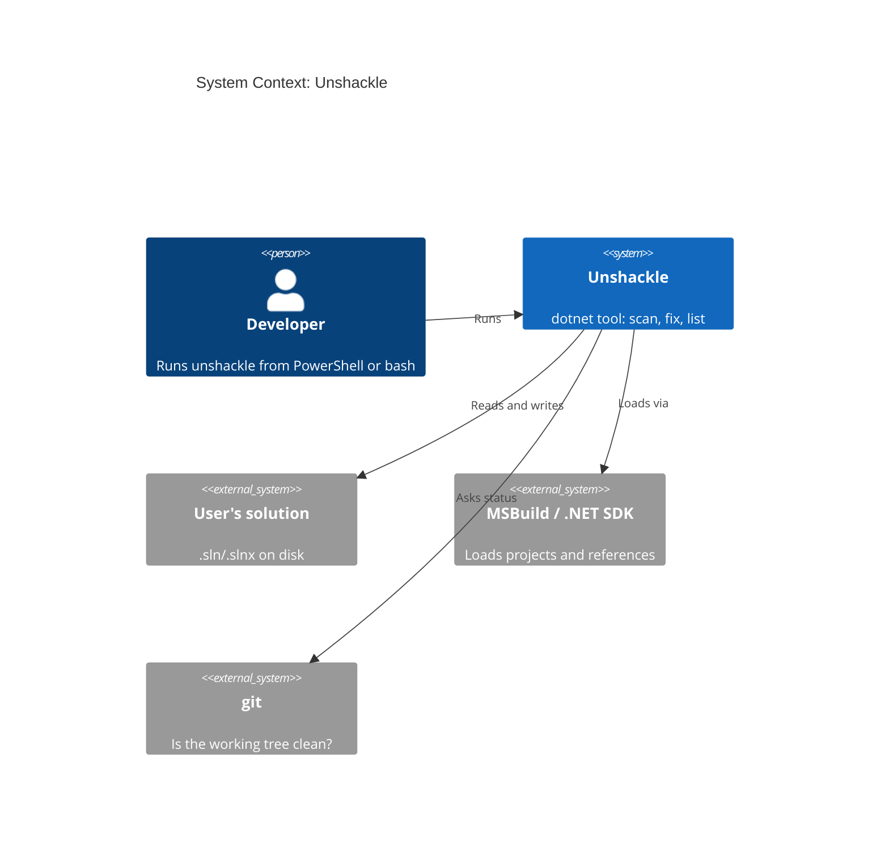
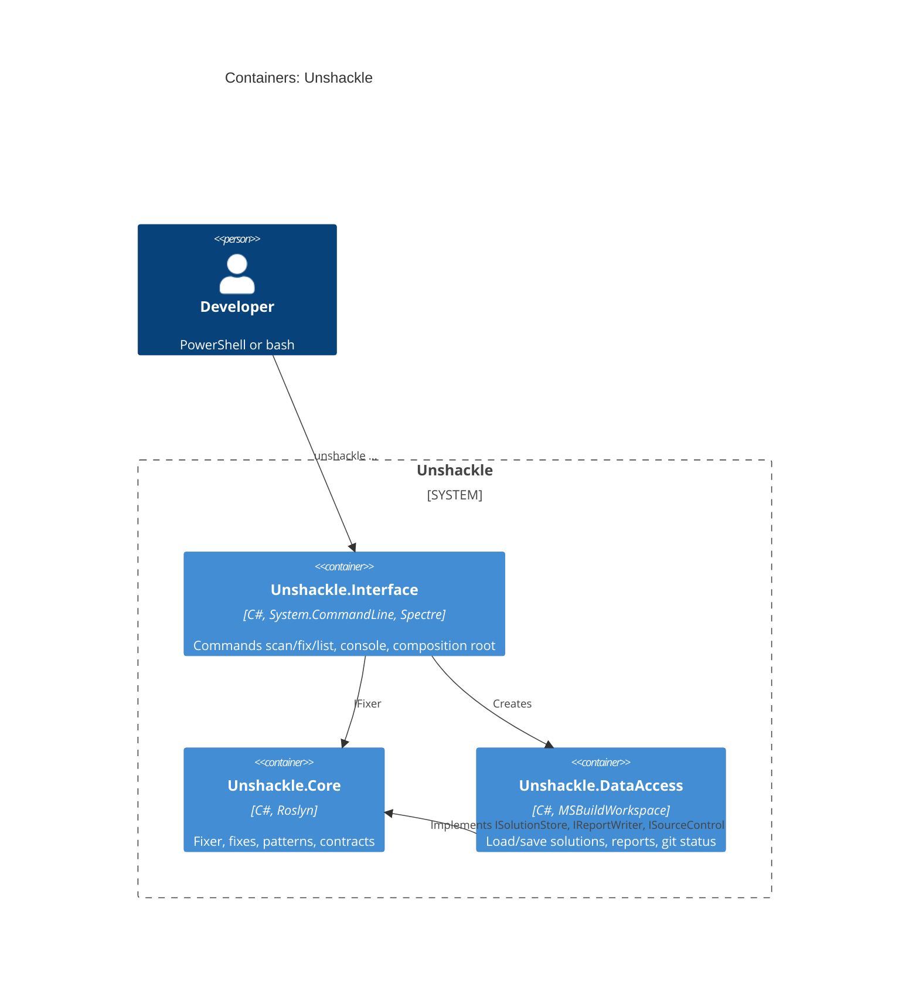

# Feature: End-to-end chain: unshackle scan, fix and list as a dotnet tool

|               |                         |
| ------------- | ----------------------- |
| **Project**   | Unshackle               |
| **Status**    | Implemented               |
| **Generated** | 2026-10-11 by KingmaDoc |

> Drawn up from TAAK-005. Everything marked _(inferred)_ comes from the codebase analysis.

## One-sentence summary

`unshackle scan|fix|list` works as a `dotnet tool` from any shell (PowerShell, bash) on a real `.sln`/`.slnx`,
with a report (CSV/JSON/Markdown), `--dry-run` diff and fixed exit codes.

## Scope (in / out)

**In scope**

- Loading and saving the solution through a single `MSBuildWorkspace` (`ISolutionStore` → `MsBuildSolutionStore`).
- Report writers CSV, JSON and Markdown (`IReportWriter`), chosen by the extension of `--report`.
- Commands `list`, `scan`, `fix` (`--dry-run`, `--force`), console output via Spectre.
- Safety check: `fix` refuses on a git working tree with uncommitted changes (`ISourceControl` → git).
- Installable as a `dotnet tool` (`dotnet pack` + `dotnet tool install`), README "Usage" for PowerShell and bash.
- Integration test on a copy of `samples/` in a temp folder (trait `Category=Integration`).

**Out of scope**

- Migrating project files (FA package out, Shouldly in, adjusting `<Using Include>`): follow-up task.
- Building and testing the fixed sample (only possible after project file migration).
- A diff package (DiffPlex): own line diff first.

## Requirements

- **REQ-1**: WHEN the user runs `unshackle list` THE SYSTEM SHALL show every fix with the `Id` and `Description` per pattern, and return exit code 0.
- **REQ-2**: WHEN the user runs `unshackle scan <sln> --fix <id>` THE SYSTEM SHALL load the solution, run the fix without writing anything and show the number of Fixed and Manual per pattern.
- **REQ-3**: WHEN `--report <path>` with extension `.csv`, `.json` or `.md` is given THE SYSTEM SHALL write the report with columns `File,Line,Fix,Pattern,Status,Reason` to that path, with paths relative to the solution folder.
- **REQ-4**: WHEN the user runs `unshackle fix <sln> --fix <id>` on a clean working tree THE SYSTEM SHALL save the changed documents.
- **REQ-5**: WHEN `fix` runs without `--dry-run` and without `--force` and the solution folder is in a git working tree with uncommitted changes THE SYSTEM SHALL refuse, write nothing and return exit code 1.
- **REQ-6**: WHEN `fix --dry-run` runs THE SYSTEM SHALL show a line diff per changed document and write nothing, also on a dirty working tree.
- **REQ-7**: WHEN the solution does not exist or MSBuild reports load errors THE SYSTEM SHALL show the errors on stderr and return exit code 1.
- **REQ-8**: WHEN arguments are invalid (unknown command, missing `--fix`, unknown fix id, unknown report extension) THE SYSTEM SHALL show a message and return exit code 2.
- **REQ-9**: WHEN scan or fix produces Manual findings THE SYSTEM SHALL still return exit code 0 (Manual is an outcome, not an error).
- **REQ-10**: WHEN a path contains spaces THE SYSTEM SHALL load and write it normally.
- **REQ-11**: WHEN `dotnet pack src/Unshackle.Interface` and `dotnet tool install` have been run THE SYSTEM SHALL be available as the command `unshackle`.
- **REQ-12**: WHEN the integration test runs THE SYSTEM SHALL scan and fix a copy of `samples/` and check the report and a few rewritten lines, also in CI (ubuntu).

## Assumptions

- _(inferred)_ Built on the existing stack: C#, .NET 10, Roslyn 5.9 `MSBuildWorkspace` with its own BuildHost.
- The user has restored the solution (`obj/project.assets.json`), otherwise the SemanticModel does not know the library.
- `git` is on the PATH; without git (or outside a git working tree) the folder counts as clean.

## Risks

- MSBuildWorkspace does not load (SDK, BuildHost) locally, in CI or from the tool installation → load errors become exit code 1; the integration test and a real `dotnet tool install` make it visible.
- `fix` overwrites user code → refuse by default on a dirty working tree, `--dry-run` first.
- System.CommandLine returns exit code 1 on parse errors by default → catch it ourselves and return 2.
- Integration test changes `samples/` → always on a copy (without `bin/`/`obj/`) in a temp folder, with restore.

## C4 Context (Mermaid)

Who uses the system and which external systems it depends on.

## C4 Container (Mermaid)

## Open questions

- [x] `fix` on a dirty working tree? Provisional choice: refuse unless `--force`; `--dry-run` is always allowed.
- [ ] Migrating project files (package and global usings): follow-up task.
