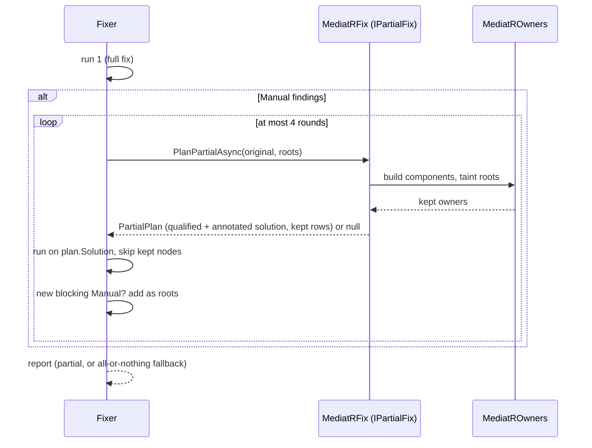

# Feature: MediatR partial migration

|               |                         |
| ------------- | ----------------------- |
| **Project**   | Unshackle               |
| **Status**    | Approved                |
| **Generated** | 2026-10-17 by KingmaDoc |

> Drawn up from TAAK-274, the probe in that task and the analysis in TAAK-271. _(inferred)_ marks codebase analysis.

## One-sentence summary

When Manual findings block a MediatR solution, the code tied to them stays on MediatR (fully qualified) and the rest moves to
Mediator, with both registered side by side, instead of changing nothing.

## Scope (in / out)

**In scope**

- Generic retry in the `Fixer`: run 1 is today's full fix. If an all-or-nothing fix that also implements `IPartialFix` has
  Manual findings, it plans a partial run from those roots, the Fixer runs again on the planned solution with the kept code
  skipped, and repeats with any new Manual finding as an extra root (at most 4 rounds). Anything that does not settle falls
  back to today's all-or-nothing result.
- `MediatROwners` (union-find): owners are type declarations (base list, constraints), members (signature), top-level
  statements in a body, and stand-alone `typeof(Open<>)`. Links: closed MediatR generics to their source type arguments;
  open ones, type parameters, `Send(object)`/`Publish(object)` and kind interfaces outside a base list to the whole kind
  (requests, notifications, streams); references to a source symbol whose type involves MediatR (fields, properties,
  parameters, locals, methods, user base types) to that symbol's owner.
- The components that contain a root stay. Their MediatR type references get `global::MediatR.X`, so the normal using swap
  (also of a global using) leaves them alone; the Fixer skips annotated kept nodes.
- Registration: when MediatR's own `Mediator` is registered directly (`AddScoped<IMediator, Mediator>()`, fullcart) and
  stays, an `AddMediatR(cfg => ...)` with the same lifetime is inserted next to it, which `mediatr.add-mediatr` turns into
  `AddMediator` in the same run (so hosts, lifetime and the generator package follow the existing rules).
- Package rules: a qualified `MediatR.X` keeps the MediatR package even for a swapped type; a qualified name no longer counts
  as a reason to keep `using MediatR`.
- Report: the roots keep their reason; every other kept owner gets a Manual row "stays on MediatR" that names the root.

**Out of scope**

- Splitting an `AddMediatR(cfg => ...)` that must stay into two registrations (behaviors and publisher per world). When
  a kept component contains `AddMediatR`, or the moving side needs a registration that cannot be inserted, the plan gives
  up (all-or-nothing as today). Covers starter and miru (roots are the `AddMediatR` calls themselves) and SampleShop.
- Duplicating an open behavior for both worlds; it joins every request to one component instead.
- Files with `#if` directives in kept code (later target-framework passes reparse and lose the annotation): plan gives up.
- Vendored packages (Ardalis.SharedKernel) next to a partial plan: plan gives up.

## Requirements

- **REQ-1**: WHEN an all-or-nothing fix has Manual findings and implements `IPartialFix` THE SYSTEM SHALL ask it for a plan
  and run the fix again on the planned solution, skipping kept nodes.
- **REQ-2**: WHEN the partial run has a Manual finding other than the planned rows and the package/usings rows that kept
  code causes THE SYSTEM SHALL add it as a root and plan again (at most 4 rounds), then fall back to all-or-nothing.
- **REQ-3**: WHEN a handler, behavior, call site, holder or registration is linked to a root THE SYSTEM SHALL keep its whole
  component on MediatR.
- **REQ-4**: WHEN a link cannot be followed statically (`Send(object)`, open generics, type parameters) THE SYSTEM SHALL
  link to every message of that kind.
- **REQ-5**: WHEN code stays on MediatR in a file or project that also moves THE SYSTEM SHALL write its MediatR type names
  as `global::MediatR.X` and keep the MediatR package in that project next to Mediator's.
- **REQ-6**: WHEN the MediatR runtime registration stays and some messages move THE SYSTEM SHALL register Mediator next
  to it with the same lifetime and add the source generator to that project.
- **REQ-7**: WHEN a kept component contains `AddMediatR`, a root lies outside every owner, or a kept file has `#if` code
  THE SYSTEM SHALL fall back to all-or-nothing.
- **REQ-8**: WHEN a fix has no Manual finding or is not `IPartialFix` THE SYSTEM SHALL behave exactly as before.

## Assumptions

- Probe (TAAK-274 step 2): both registrations live side by side without conflict; MediatR behaviors never run for Mediator
  requests and vice versa; a typed send to the wrong library does not compile, only `object` overloads fail at run time.
- MediatR resolves handlers through DI per message type: a kept message whose handlers stay works independent of what moved.
- Over-linking is safe (fewer moves); under-linking is the risk, so every unknown link goes to the whole kind.

## Risks

- A link the planner misses lets a send reach the wrong library. Limited by: typed sends would not compile; `object` sends
  link the whole kind; corpus `after` (build + own tests) on fullcart and the earlier MediatR repos.
- Retry loop changes run time: at most 4 extra runs, only when run 1 has Manual findings.
- Shared files (`Fixer.cs`, `UsingDirectives.cs`) are also touched by TAAK-272/275: the change is a wrapper around the
  existing run plus a node filter.

## Models

## Open questions

- [x] Unit of ownership: owner nodes per declaration/statement, joined per message kind where links are open (fullcart:
      requests move, notifications stay).
- [x] starter: its handlers and events derive from `Starter.Common`'s MediatR interfaces, and the root is that project's
      `AddMediatR`: every message is in the root's component, so partial migration gains nothing there (stays Manual).

## See also

- `claude/tasks/archief/TAAK-274-mediatr-partial-migration.md`, `claude/tasks/archief/TAAK-271-analyse-manual-blockers.md`
- [mediatr-partial-migration-verify.md](mediatr-partial-migration-verify.md), [mediatr-fix-plan.md](mediatr-fix-plan.md)
