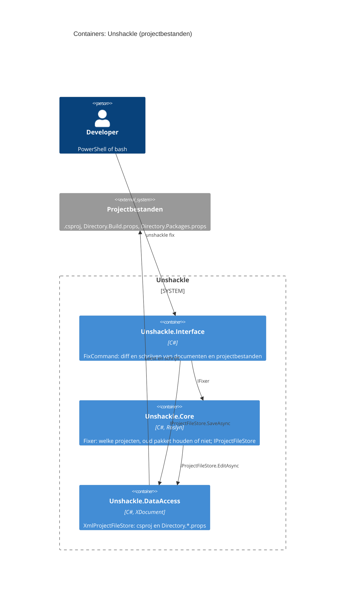

# Feature: Projectbestanden migreren

|               |                         |
| ------------- | ----------------------- |
| **Project**   | Unshackle               |
| **Status**    | Approved                   |
| **Generated** | 2026-10-11 by KingmaDoc |

> Opgesteld uit TAAK-017. Alles gemarkeerd als _(inferred)_ komt uit de codebase-analyse.

## One-sentence summary

`unshackle fix` past naast de code ook `.csproj`, `Directory.Build.props` en `Directory.Packages.props` aan (FluentAssertions eruit,
Shouldly 4.3.0 erin, `<Using>` omgezet), zodat de gefixte solution zonder handwerk bouwt.

## Scope (in / out)

**In scope**

- Core: wat er moet wijzigen per fix (`IFix.Package`: pakket weg, pakket erbij met versie; `<Using>` volgt `RemovedNamespaces` → `AddedNamespaces`).
- Core: per project beslissen of het oude pakket weg mag (geen `.cs` gebruikt het nog) of blijft (Manual op projectniveau).
- DataAccess: `<PackageReference>` met en zonder `Version` (CPM), `<PackageVersion>` in `Directory.Packages.props`, `<Using Include>` en
  `Directory.Build.props`; opmaak en commentaar zoveel mogelijk behouden.
- `scan`/`fix`: rapportrijen voor projectbestanden (Line 0); `--dry-run` toont ook hun diff.
- Integratietest: gefixte kopie van SampleShop bouwt en de tests slagen.

**Out of scope**

- Geïmporteerde props/targets buiten de dichtstbijzijnde `Directory.Build.props` en `Directory.Packages.props`.
- `<PackageReference Update=...>`, `<Using>` met `Alias`/`Static`, `packages.config`.
- Projecten buiten de solution die dezelfde props delen.

## Requirements

- **REQ-1**: WHEN `fix` draait met een fix die een pakketmigratie beschrijft THE SYSTEM SHALL in elk project dat de oude assembly refereert het nieuwe pakket toevoegen als het er nog niet is.
- **REQ-2**: WHEN geen `.cs`-bestand van zo'n project het oude pakket nog gebruikt THE SYSTEM SHALL de `<PackageReference>` van het oude pakket verwijderen of in place vervangen door het nieuwe, en `<Using Include>` van een verwijderde namespace omzetten naar de toegevoegde.
- **REQ-3**: WHEN een `.cs`-bestand van het project het oude pakket nog gebruikt THE SYSTEM SHALL het oude pakket en zijn `<Using>` laten staan en een Manual-rij op projectniveau (Line 0) rapporteren.
- **REQ-4**: WHEN de oude `<PackageReference>` een `Version` heeft THE SYSTEM SHALL de nieuwe met `Version` 4.3.0 (Shouldly) schrijven; WHEN hij geen versie heeft en er een `Directory.Packages.props` is THE SYSTEM SHALL daar een `<PackageVersion>` toevoegen of de oude vervangen.
- **REQ-5**: WHEN de oude `<PackageReference>`, `<Using>` of `<PackageVersion>` in een gedeeld bestand (`Directory.Build.props`, `Directory.Packages.props`) staat THE SYSTEM SHALL hem alleen weghalen als geen project in de solution dat dat bestand deelt het oude pakket houdt.
- **REQ-6**: WHEN een projectbestand wordt aangepast THE SYSTEM SHALL witruimte, commentaar, regeleinden (CRLF/LF), BOM en tekst buiten `<Project>` behouden.
- **REQ-7**: WHEN `fix --dry-run` draait THE SYSTEM SHALL ook de diff van elk projectbestand tonen en niets schrijven.
- **REQ-8**: WHEN `scan` of `fix` draait THE SYSTEM SHALL per gewijzigd projectbestand een Fixed-rij en per project dat het oude pakket houdt een Manual-rij in het rapport zetten, met Line 0.
- **REQ-9**: WHEN een projectbestand niet te lezen of geen geldige XML is THE SYSTEM SHALL dat als Manual-rij rapporteren in plaats van te crashen.
- **REQ-10**: WHEN de integratietest `fix` draait op een kopie van SampleShop (en de ene Manual met de hand oplost) THE SYSTEM SHALL een solution opleveren waarop `dotnet build` en `dotnet test` slagen en waar geen FluentAssertions meer in csproj/props staat, ook in CI (ubuntu).

## Assumptions

- _(inferred)_ Built on the existing stack: C#, .NET 10, Roslyn 5.9 `MSBuildWorkspace`, `System.IO.Abstractions`.
- Pakket-id = assembly-naam (FluentAssertions, Shouldly); zo herkent Core welke projecten het oude pakket gebruiken.
- CPM ⇔ de oude referentie heeft geen versie en er is een `Directory.Packages.props` boven het project.

## Risks

- FA weghalen terwijl code het nog gebruikt → alleen weg als het SemanticModel geen FA-symbool meer vindt; anders Manual.
- Opmaak gaat verloren → `XDocument` met `PreserveWhitespace`, tekst buiten de root letterlijk; tests vergelijken exacte tekst.
- Bestand wijzigt tussen scan en schrijven → `SaveAsync` weigert als de tekst op schijf niet meer `OldText` is.
- `dotnet build`/`test` in de integratietest is traag of SDK-afhankelijk → `global.json` mee kopiëren, trait `Category=Integration`.

## C4 Context (Mermaid)

Ongewijzigd ten opzichte van [end-to-end-keten](end-to-end-keten-plan.md): Unshackle leest en schrijft nu ook de projectbestanden van de solution.

## C4 Container (Mermaid)

## Open questions

- [x] Opmaak behouden: `XDocument` met `PreserveWhitespace` of tekstueel? → `XDocument`; zie Keuzes in TAAK-017.
- [x] Manual in de sample: FA blijft na de eerste `fix`; de integratietest lost hem met de hand op en draait `fix` opnieuw.
