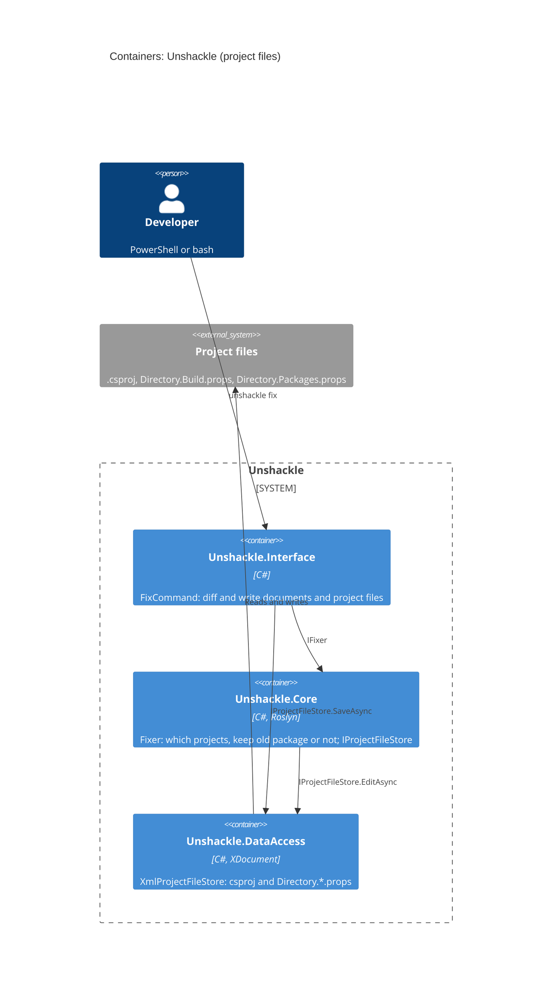

# Feature: Migrating project files

|               |                         |
| ------------- | ----------------------- |
| **Project**   | Unshackle               |
| **Status**    | Approved                   |
| **Generated** | 2026-10-11 by KingmaDoc |

> Drawn up from TAAK-017. Everything marked _(inferred)_ comes from the codebase analysis.

## One-sentence summary

Besides the code, `unshackle fix` also updates `.csproj`, `Directory.Build.props` and `Directory.Packages.props` (FluentAssertions out,
Shouldly 4.3.0 in, `<Using>` converted), so the fixed solution builds without manual work.

## Scope (in / out)

**In scope**

- Core: what has to change per fix (`IFix.Package`: package out, package in with version; `<Using>` follows `RemovedNamespaces` → `AddedNamespaces`).
- Core: decide per project whether the old package may go (no `.cs` uses it anymore) or stays (Manual at project level).
- DataAccess: `<PackageReference>` with and without `Version` (CPM), `<PackageVersion>` in `Directory.Packages.props`, `<Using Include>` and
  `Directory.Build.props`; preserve formatting and comments as much as possible.
- `scan`/`fix`: report rows for project files (Line 0); `--dry-run` also shows their diff.
- Integration test: a fixed copy of SampleShop builds and the tests pass.

**Out of scope**

- Imported props/targets beyond the nearest `Directory.Build.props` and `Directory.Packages.props`.
- `<PackageReference Update=...>`, `<Using>` with `Alias`/`Static`, `packages.config`.
- Projects outside the solution that share the same props.

## Requirements

- **REQ-1**: WHEN `fix` runs with a fix that describes a package migration THE SYSTEM SHALL add the new package to every project that references the old assembly, if it is not there yet.
- **REQ-2**: WHEN no `.cs` file of such a project still uses the old package THE SYSTEM SHALL remove the `<PackageReference>` of the old package or replace it in place with the new one, and convert `<Using Include>` of a removed namespace to the added one.
- **REQ-3**: WHEN a `.cs` file of the project still uses the old package THE SYSTEM SHALL leave the old package and its `<Using>` in place and report a Manual row at project level (Line 0).
- **REQ-4**: WHEN the old `<PackageReference>` has a `Version` THE SYSTEM SHALL write the new one with `Version` 4.3.0 (Shouldly); WHEN it has no version and there is a `Directory.Packages.props` THE SYSTEM SHALL add a `<PackageVersion>` there or replace the old one.
- **REQ-5**: WHEN the old `<PackageReference>`, `<Using>` or `<PackageVersion>` is in a shared file (`Directory.Build.props`, `Directory.Packages.props`) THE SYSTEM SHALL only remove it if no project in the solution that shares that file keeps the old package.
- **REQ-6**: WHEN a project file is edited THE SYSTEM SHALL preserve whitespace, comments, line endings (CRLF/LF), BOM and text outside `<Project>`.
- **REQ-7**: WHEN `fix --dry-run` runs THE SYSTEM SHALL also show the diff of every project file and write nothing.
- **REQ-8**: WHEN `scan` or `fix` runs THE SYSTEM SHALL put a Fixed row in the report per changed project file and a Manual row per project that keeps the old package, with Line 0.
- **REQ-9**: WHEN a project file cannot be read or is not valid XML THE SYSTEM SHALL report it as a Manual row instead of crashing.
- **REQ-10**: WHEN the integration test runs `fix` on a copy of SampleShop (and resolves the one Manual by hand) THE SYSTEM SHALL produce a solution on which `dotnet build` and `dotnet test` succeed and in which there is no FluentAssertions left in csproj/props, also in CI (ubuntu).

## Assumptions

- _(inferred)_ Built on the existing stack: C#, .NET 10, Roslyn 5.9 `MSBuildWorkspace`, `System.IO.Abstractions`.
- Package id = assembly name (FluentAssertions, Shouldly); this is how Core recognizes which projects use the old package.
- CPM ⇔ the old reference has no version and there is a `Directory.Packages.props` above the project.

## Risks

- Removing FA while code still uses it → only remove if the SemanticModel finds no FA symbol anymore; otherwise Manual.
- Formatting gets lost → `XDocument` with `PreserveWhitespace`, text outside the root verbatim; tests compare exact text.
- File changes between scan and write → `SaveAsync` refuses if the text on disk is no longer `OldText`.
- `dotnet build`/`test` in the integration test is slow or SDK-dependent → copy `global.json` along, trait `Category=Integration`.

## C4 Context (Mermaid)

Unchanged compared to [end-to-end-keten](end-to-end-keten-plan.md): Unshackle now also reads and writes the project files of the solution.

## C4 Container (Mermaid)

## Open questions

- [x] Preserve formatting: `XDocument` with `PreserveWhitespace` or textual? → `XDocument`; see Choices in TAAK-017.
- [x] Manual in the sample: FA stays after the first `fix`; the integration test resolves it by hand and runs `fix` again.
