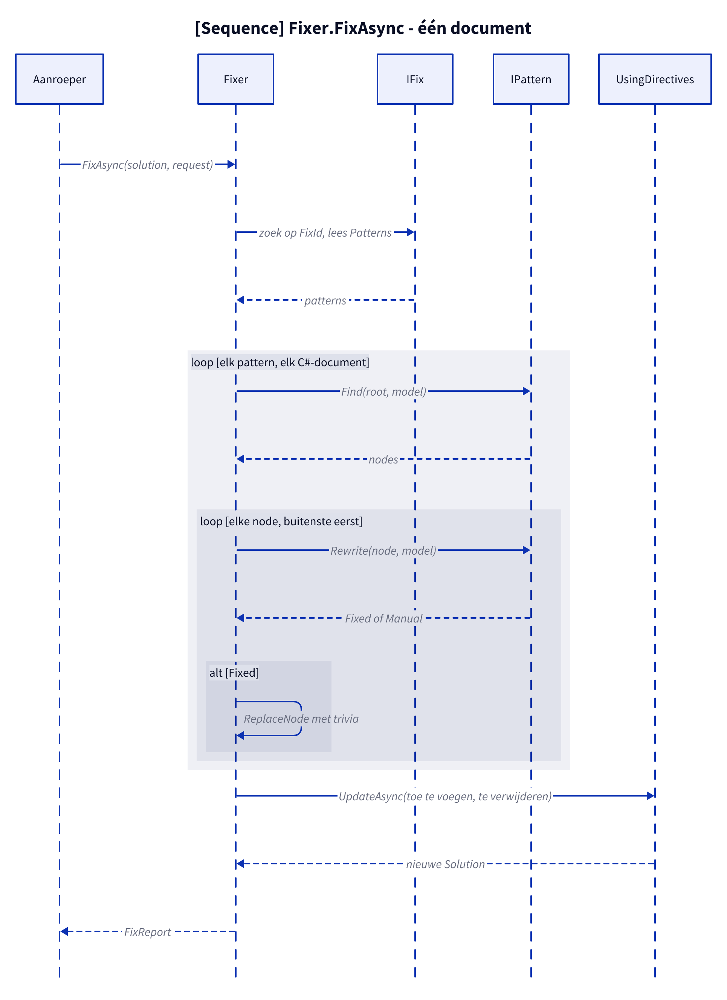

# Flow: Fixer.FixAsync

**Figure 1.** One document in `FixAsync`: each pattern runs on the outcome of the previous one, then the usings follow. The order of the patterns matters: `AllSatisfyPattern` comes first in `FluentAssertionsFix` (see [patronen.md](patronen.md#order)). Omitted: cancellation, unknown fix (`ArgumentException`) and documents of non-C# projects (they are skipped).

<!-- kingmadoc:diagram img/fix-flow-1.d2 -->

| Step | Location in `src/Unshackle.Core/` | What happens |
| ---- | --------------------------------- | ------------ |
| Pick fix | `Fixer.FixAsync` | Looks up `IFix` by `FixId` (case-insensitive) |
| Find | `FileFixer.ApplyPatternAsync` | An exception becomes one `Manual` finding with line 0 |
| Rewrite | `FileFixer.RewriteAsync` | An exception becomes `Manual("Internal error in …")` |
| Replace | `FileFixer.Replace`, `FileFixer.ReplaceWithTrivia` | Overlap with an earlier replacement becomes `Manual`; trivia comes from the old node |
| Usings | `FileFixer.FixFileAsync` → `UsingDirectives.UpdateAsync` | Only if the document changed; namespaces of the results plus `AddedNamespaces` |

## See also

- [klassen.md](klassen.md) — the contracts involved
- [pattern-beslissing.md](pattern-beslissing.md) — what a pattern decides in `Rewrite`
- [../README.md](../README.md)
