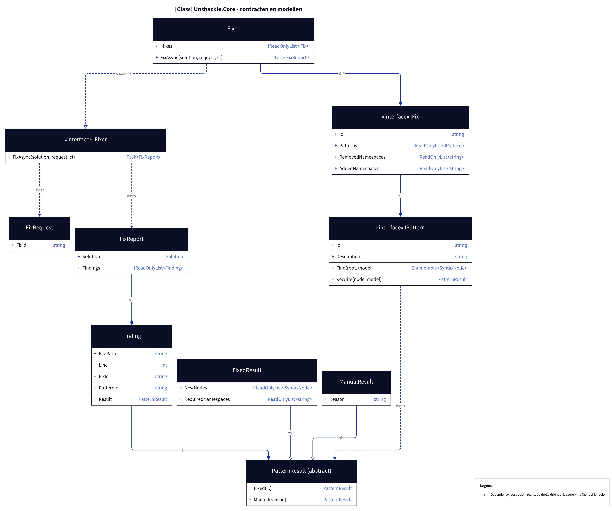
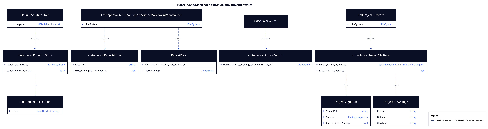

# Klassen: contracten en modellen van Unshackle.Core

**Figure 1.** Contracten (`Abstractions/`) en modellen (`Models/`) rond `Fixer`. Weggelaten: `FluentAssertionsFix` en de patterns (zie [patronen.md](patronen.md)) en `UsingDirectives`.

<!-- kingmadoc:diagram img/klassen-1.d2 -->

| Element | Pad | Rol |
| ------- | --- | --- |
| `IFixer` / `Fixer` | `Abstractions/IFixer.cs`, `Fixer.cs` | Enige ingang (Facade): draait één fix op een `Solution` |
| `IFix` | `Abstractions/IFix.cs` | Eén migratie (Strategy): patterns plus toe te voegen en te verwijderen usings |
| `IPattern` | `Abstractions/IPattern.cs` | Eén soort code vinden (`Find`) en herschrijven (`Rewrite`); gooit nooit |
| `FixRequest` | `Models/FixRequest.cs` | Welke fix (`FixId`) |
| `FixReport` | `Models/FixReport.cs` | Nieuwe `Solution` en alle bevindingen |
| `Finding` | `Models/Finding.cs` | Eén gevonden node: bestand, regel (0 = heel bestand), fix, pattern, resultaat |
| `PatternResult` | `Models/PatternResult.cs` | Fabrieksmethoden `Fixed` (één of meer nodes) en `Manual` |
| `FixedResult` | `Models/FixedResult.cs` | Vervangende nodes en benodigde namespaces |
| `ManualResult` | `Models/ManualResult.cs` | Reden waarom handwerk nodig is |

**Figure 2.** Contracten die Core vastlegt voor I/O (`Abstractions/`) en hun implementaties in `Unshackle.DataAccess`.

<!-- kingmadoc:diagram img/klassen-2.d2 -->

| Element | Pad | Rol |
| ------- | --- | --- |
| `ISolutionStore` / `MsBuildSolutionStore` | `Abstractions/ISolutionStore.cs`, `DataAccess/Solutions/` | Solution laden en wijzigingen wegschrijven via één `MSBuildWorkspace` |
| `SolutionLoadException` | `Abstractions/SolutionLoadException.cs` | MSBuild meldde laadfouten (`Errors`); de CLI maakt er exitcode 1 van |
| `IReportWriter` / `Csv`-, `Json`-, `MarkdownReportWriter` | `Abstractions/IReportWriter.cs`, `DataAccess/Reports/` | Eén rapportformaat per extensie (Strategy) |
| `ReportRow` | `DataAccess/Reports/ReportRow.cs` | `Finding` → kolommen `File,Line,Fix,Pattern,Status,Reason` |
| `IProjectFileStore` / `XmlProjectFileStore` | `Abstractions/IProjectFileStore.cs`, `DataAccess/Projects/` | Projectbestanden aanpassen (`EditAsync` → `ProjectFileChange`, zonder schrijven) en wegschrijven (`SaveAsync`) |
| `ProjectMigration` / `PackageMigration` / `ProjectFileChange` | `Models/` | Per project: welk pakket weg/erbij, houdt het project het oude pakket; resultaat: oude en nieuwe tekst per bestand |
| `ISourceControl` / `GitSourceControl` | `Abstractions/ISourceControl.cs`, `DataAccess/SourceControl/` | Heeft de werkmap niet-gecommitte wijzigingen? (`fix` weigert dan zonder `--force`) |

## Zie ook

- [fix-flow.md](fix-flow.md) — hoe `FixAsync` deze klassen gebruikt
- [../architectuur/core.md](../architectuur/core.md) — ontwerp en keuzes
- [../README.md](../README.md) — C4-overzicht
