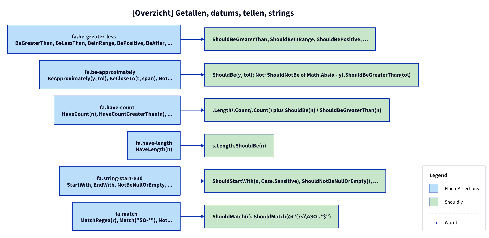
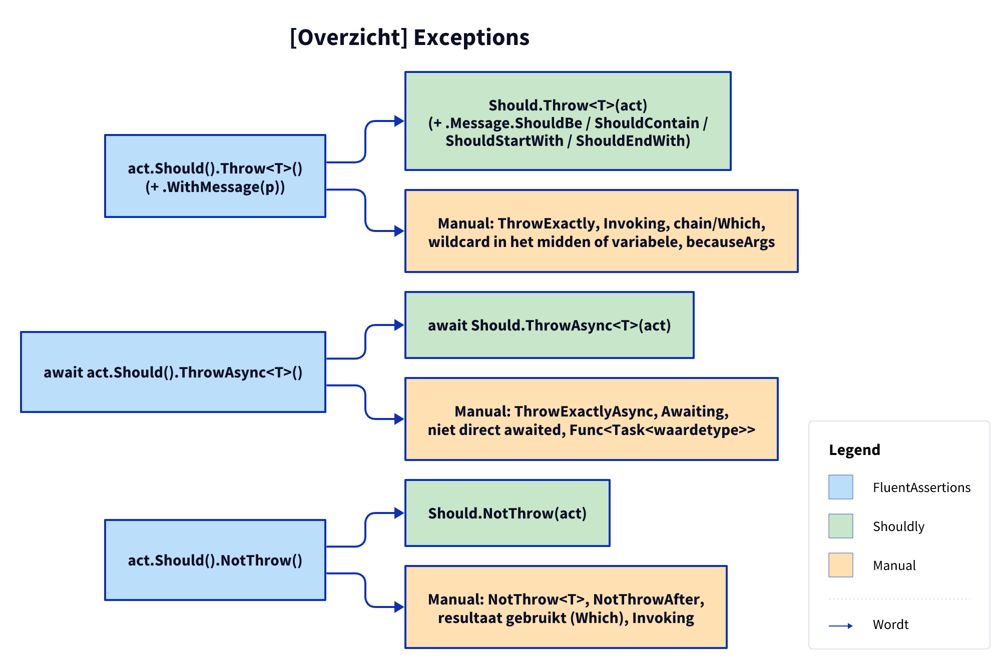
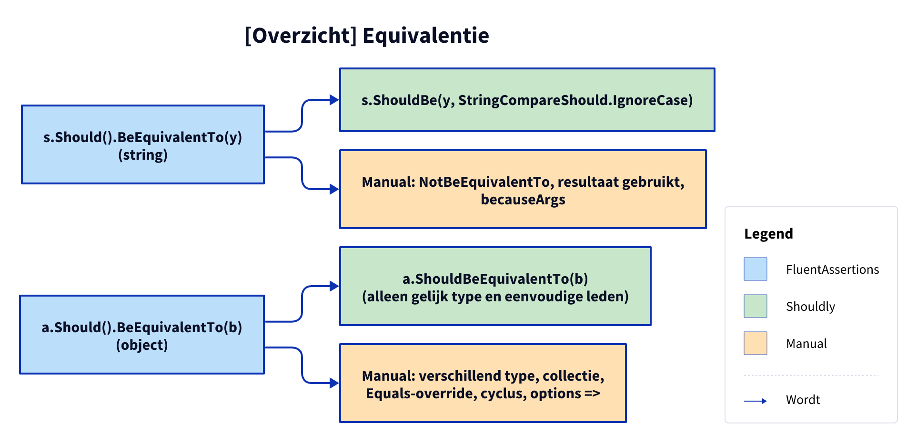
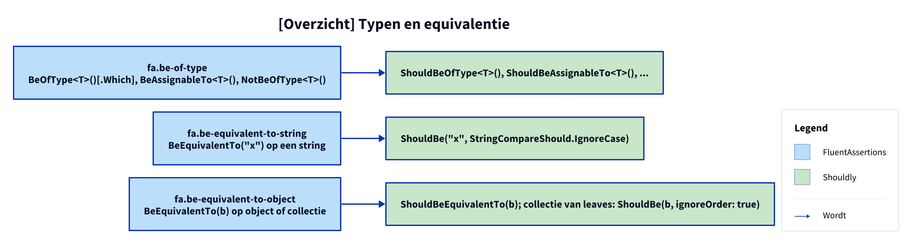
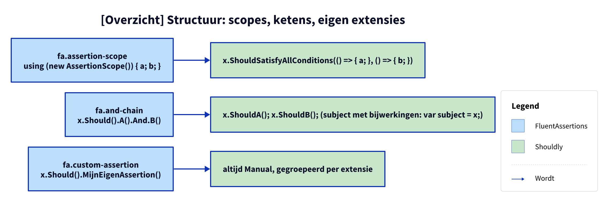

# Patterns: FluentAssertions to Shouldly

Overview of the first 31 FluentAssertions patterns (the current full list is generated in [../../patterns.md](../../patterns.md)), in 6 groups (one figure per group). Each pattern has a plan, models and verify in [../patterns/](../patterns/); the details and all Manual cases are there. All assertion patterns first go through the shared checks of [pattern-beslissing.md](pattern-beslissing.md). Execution order: see [Order](#order).

## Values, booleans, null, empty, identity

**Figure 1.** 6 patterns; Manual cases in the table.

<!-- kingmadoc:diagram img/patronen-1.d2 -->

| Pattern ID | Class | FA form | Shouldly form | Extra Manual | Docs |
| --- | --- | --- | --- | --- | --- |
| `fa.should-be` | `ShouldBePattern` | `Be(y)` | `ShouldBe(y)` | Xml/Types overloads, comparer, type that cannot be cast | [plan](../patterns/fa-should-be-plan.md), [models](../patterns/fa-should-be-modellen.md) |
| `fa.not-be` | `NotBePattern` | `NotBe(y)` | `ShouldNotBe(y)` | as `fa.should-be` | [plan](../patterns/fa-not-be-plan.md), [models](../patterns/fa-not-be-modellen.md) |
| `fa.be-true-false` | `BeTrueFalsePattern` | `BeTrue(), BeFalse()` | `ShouldBeTrue(), ShouldBeFalse(); bool?: ShouldBe(true)` | type other than bool/bool? | [plan](../patterns/fa-be-true-false-plan.md), [models](../patterns/fa-be-true-false-modellen.md) |
| `fa.be-null` | `BeNullPattern` | `BeNull(), NotBeNull()` | `ShouldBeNull(), ShouldNotBeNull()` | only the shared cases | [plan](../patterns/fa-be-null-plan.md), [models](../patterns/fa-be-null-modellen.md) |
| `fa.be-empty` | `BeEmptyPattern` | `BeEmpty(), NotBeEmpty()` | `ShouldBeEmpty(), ShouldNotBeEmpty()` | only the shared cases | [plan](../patterns/fa-be-empty-plan.md), [models](../patterns/fa-be-empty-modellen.md) |
| `fa.be-same-as` | `BeSameAsPattern` | `BeSameAs(y), NotBeSameAs(y)` | `ShouldBeSameAs(y), ShouldNotBeSameAs(y)` | only the shared cases | [plan](../patterns/fa-be-same-as-plan.md), [models](../patterns/fa-be-same-as-modellen.md) |

## Numbers, dates, counting, strings

**Figure 2.** 6 patterns; Manual cases in the table.

<!-- kingmadoc:diagram img/patronen-2.d2 -->

| Pattern ID | Class | FA form | Shouldly form | Extra Manual | Docs |
| --- | --- | --- | --- | --- | --- |
| `fa.be-greater-less` | `BeGreaterLessPattern` | `BeGreaterThan, BeLessThan, BeInRange, BePositive, BeAfter, ...` | `ShouldBeGreaterThan, ShouldBeInRange, ShouldBePositive, ...` | nullable subject, non-comparable type | [plan](../patterns/fa-be-greater-less-plan.md), [models](../patterns/fa-be-greater-less-modellen.md) |
| `fa.be-approximately` | `BeApproximatelyPattern` | `BeApproximately(y, tol), BeCloseTo(t, span), Not...` | `ShouldBe(y, tol); Not: ShouldNotBe of Math.Abs(x - y).ShouldBeGreaterThan(tol)` | see plan | [plan](../patterns/fa-be-approximately-plan.md), [models](../patterns/fa-be-approximately-modellen.md) |
| `fa.have-count` | `HaveCountPattern` | `HaveCount(n), HaveCountGreaterThan(n), ...` | `.Length/.Count/.Count() plus ShouldBe(n) / ShouldBeGreaterThan(n)` | predicate, dictionary, ?., non-generic IEnumerable | [plan](../patterns/fa-have-count-plan.md), [models](../patterns/fa-have-count-modellen.md) |
| `fa.have-length` | `HaveLengthPattern` | `HaveLength(n)` | `s.Length.ShouldBe(n)` | see plan | [plan](../patterns/fa-have-length-plan.md), [models](../patterns/fa-have-length-modellen.md) |
| `fa.string-start-end` | `StringStartEndPattern` | `StartWith, EndWith, NotBeNullOrEmpty, ...` | `ShouldStartWith(x, Case.Sensitive), ShouldNotBeNullOrEmpty(), ...` | see plan | [plan](../patterns/fa-string-start-end-plan.md), [models](../patterns/fa-string-start-end-modellen.md) |
| `fa.match` | `MatchPattern` | `MatchRegex(r), Match("SO-*"), Not...` | `ShouldMatch(r), ShouldMatch(@"(?s)\ASO-.*$")` | no non-empty string constant, subject not a string | [plan](../patterns/fa-match-plan.md), [models](../patterns/fa-match-modellen.md) |

## Collections and dictionaries

**Figure 3.** 7 patterns; Manual cases in the table.

<!-- kingmadoc:diagram img/patronen-3.d2 -->

| Pattern ID | Class | FA form | Shouldly form | Extra Manual | Docs |
| --- | --- | --- | --- | --- | --- |
| `fa.contain` | `ContainPattern` | `Contain(item of predicate), NotContain` | `ShouldContain, ShouldNotContain (string: Case.Sensitive)` | dictionary, multiple items, occurrence constraint | [plan](../patterns/fa-contain-plan.md), [models](../patterns/fa-contain-modellen.md) |
| `fa.contain-key` | `ContainKeyPattern` | `ContainKey(k), NotContainKey(k)` | `ShouldContainKey(k), ShouldNotContainKey(k)` | ContainKeys, ContainValue(s), .WhoseValue | [plan](../patterns/fa-contain-key-plan.md), [models](../patterns/fa-contain-key-modellen.md) |
| `fa.contain-single-which` | `ContainSinglePattern` | `ContainSingle(), ContainSingle(p)[.Which]` | `ShouldHaveSingleItem(), ShouldContain(p, 1), x.Where(p).ShouldHaveSingleItem()` | see plan | [plan](../patterns/fa-contain-single-which-plan.md), [models](../patterns/fa-contain-single-which-modellen.md) |
| `fa.only-contain` | `OnlyContainPattern` | `OnlyContain(pred)` | `ShouldNotBeEmpty(); ShouldAllBe(pred)` | not directly in a block (subject with side effects is hoisted) | [plan](../patterns/fa-only-contain-plan.md), [models](../patterns/fa-only-contain-modellen.md) |
| `fa.all-satisfy` | `AllSatisfyPattern` | `AllSatisfy(a => { ... })` | `ShouldNotBeEmpty(); foreach (var a in x) { ... }` | because, method group, async, return, not in a block | [plan](../patterns/fa-all-satisfy-plan.md), [models](../patterns/fa-all-satisfy-modellen.md) |
| `fa.equal-sequence` | `EqualSequencePattern` | `Equal(seq), Equal(1, 2), NotEqual` | `ShouldBe(seq), ShouldBe(new[] { 1, 2 }) (volgorde telt)` | see plan | [plan](../patterns/fa-equal-sequence-plan.md), [models](../patterns/fa-equal-sequence-modellen.md) |
| `fa.direct-mapping` | `DirectMappingPattern` | `BeOneOf, BeSubsetOf, OnlyHaveUniqueItems, HaveValue` | `ShouldBeOneOf, ShouldBeSubsetOf, ShouldBeUnique, ShouldNotBeNull` | ContainInOrder: Manual with example code | [plan](../patterns/fa-direct-mapping-plan.md), [models](../patterns/fa-direct-mapping-modellen.md) |

## Exceptions

**Figure 4.** 6 patterns; Manual cases in the table.

<!-- kingmadoc:diagram img/patronen-4.d2 -->

| Pattern ID | Class | FA form | Shouldly form | Extra Manual | Docs |
| --- | --- | --- | --- | --- | --- |
| `fa.throw` | `ThrowPattern` | `act.Should().Throw<T>()[.WithMessage(p)][.Which]` | `Should.Throw<T>(act)[.Message.ShouldBe/ShouldContain/...]` | wildcard in the middle or non-constant, AggregateException risk, .Where/.And | [plan](../patterns/fa-throw-plan.md), [models](../patterns/fa-throw-modellen.md) |
| `fa.throw-async` | `ThrowAsyncPattern` | `await act.Should().ThrowAsync<T>()[.WithMessage(p)]` | `await Should.ThrowAsync<T>(act)` | not directly awaited, .Which, Func<Task<value type>> | [plan](../patterns/fa-throw-async-plan.md), [models](../patterns/fa-throw-async-modellen.md) |
| `fa.throw-exactly` | `ThrowExactlyPattern` | `ThrowExactly<T>(), ThrowExactlyAsync<T>()` | `Should.Throw<T>(act).ShouldBeOfType<T>()` | as `fa.throw` | [plan](../patterns/fa-throw-exactly-plan.md), [models](../patterns/fa-throw-exactly-modellen.md) |
| `fa.invoking` | `InvokingPattern` | `x.Invoking(s => s.M()).Should().Throw<T>() / Awaiting / NotThrow` | `Should.Throw<T>(() => x.M()) e.d.` | receiver that is not stable | [plan](../patterns/fa-invoking-plan.md), [models](../patterns/fa-invoking-modellen.md) |
| `fa.not-throw` | `NotThrowPattern` | `act.Should().NotThrow()` | `Should.NotThrow(act)` | NotThrow<T>(), NotThrowAfter, result used | [plan](../patterns/fa-not-throw-plan.md), [models](../patterns/fa-not-throw-modellen.md) |
| `fa.not-throw-async` | `NotThrowAsyncPattern` | `await act.Should().NotThrowAsync()` | `await Should.NotThrowAsync(act)` | not directly awaited, result used | [plan](../patterns/fa-not-throw-async-plan.md), [models](../patterns/fa-not-throw-async-modellen.md) |

## Types and equivalence

**Figure 5.** 3 patterns; Manual cases in the table.

<!-- kingmadoc:diagram img/patronen-5.d2 -->

| Pattern ID | Class | FA form | Shouldly form | Extra Manual | Docs |
| --- | --- | --- | --- | --- | --- |
| `fa.be-of-type` | `BeOfTypePattern` | `BeOfType<T>()[.Which], BeAssignableTo<T>(), NotBeOfType<T>()` | `ShouldBeOfType<T>(), ShouldBeAssignableTo<T>(), ...` | see plan | [plan](../patterns/fa-be-of-type-plan.md), [models](../patterns/fa-be-of-type-modellen.md) |
| `fa.be-equivalent-to-string` | `BeEquivalentToStringPattern` | `BeEquivalentTo("x") op een string` | `ShouldBe("x", StringCompareShould.IgnoreCase)` | NotBeEquivalentTo | [plan](../patterns/fa-be-equivalent-to-string-plan.md), [models](../patterns/fa-be-equivalent-to-string-modellen.md) |
| `fa.be-equivalent-to-object` | `BeEquivalentToObjectPattern` | `BeEquivalentTo(b) op object of collectie` | `ShouldBeEquivalentTo(b); collectie van leaves: ShouldBe(b, ignoreOrder: true)` | different types, Equals override, cycle, options =>, NotBeEquivalentTo | [plan](../patterns/fa-be-equivalent-to-object-plan.md), [models](../patterns/fa-be-equivalent-to-object-modellen.md) |

## Structure: scopes, chains, own extensions

**Figure 6.** 3 patterns; Manual cases in the table.

<!-- kingmadoc:diagram img/patronen-6.d2 -->

| Pattern ID | Class | FA form | Shouldly form | Extra Manual | Docs |
| --- | --- | --- | --- | --- | --- |
| `fa.assertion-scope` | `AssertionScopePattern` | `using (new AssertionScope()) { a; b; }` | `x.ShouldSatisfyAllConditions(() => { a; }, () => { b; })` | context string, other statements, await | [plan](../patterns/fa-assertion-scope-plan.md), [models](../patterns/fa-assertion-scope-modellen.md) |
| `fa.and-chain` | `AndChainPattern` | `x.Should().A().And.B()` | `x.ShouldA(); x.ShouldB(); (subject met bijwerkingen: var subject = x;)` | link Manual or unknown, not in a block | [plan](../patterns/fa-and-chain-plan.md), [models](../patterns/fa-and-chain-modellen.md) |
| `fa.custom-assertion` | `CustomAssertionPattern` | `x.Should().BeCancelled()` on an own `ReferenceTypeAssertions` class | `x.ShouldBeCancelled()` + the class as Shouldly extensions; else Manual, grouped per extension | when class, `Should()` and every call convert | [plan](../patterns/fa-custom-assertion-plan.md), [models](../patterns/fa-custom-assertion-modellen.md) |

## Order

`FluentAssertionsFix.Patterns` runs in this order: `AssertionScope`, `AllSatisfy`, `AndChain`, then the assertion patterns (`ShouldBe`, `NotBe`, `HaveCount`, `BeTrueFalse`, `BeNull`, `BeEmpty`, `Contain`, `BeEquivalentToString`, `Throw`, `ThrowAsync`, `ThrowExactly`, `Invoking`, `BeGreaterLess`, `NotThrow`, `ContainKey`, `BeEquivalentToObject`, `OnlyContain`, `BeOfType`, `StringStartEnd`, `ContainSingle`, `EqualSequence`, `HaveLength`, `BeApproximately`, `BeSameAs`, `NotThrowAsync`, `Match`, `DirectMapping`), and finally `CustomAssertion`. `AssertionScope` must go first: the lambdas of `ShouldSatisfyAllConditions` still contain FA statements that the other patterns rewrite afterwards. `AllSatisfy` next: the `using Shouldly` only comes after all patterns, so the loop body must stay FA until the assertion patterns rewrite it as separate statements (TAAK-014, choice 4; see [fix-flow.md](fix-flow.md)). `AndChain` comes before the assertion patterns, which would report a link after `.And` as Manual; it splits the chain and calls the same patterns per link. `CustomAssertion` comes last and catches any remaining `x.Should().Iets()` of an own extension.

The shared cases (see [pattern-beslissing.md](pattern-beslissing.md)): inside a non-converted `AssertionScope`, a form other than `x.Should().Methode()` (e.g. after `.And`), result used, named arguments or `becauseArgs` with a non-constant `because`. `becauseArgs` with a constant format string become `string.Format(CultureInfo.InvariantCulture, because, args)` (TAAK-097). Proofs per pattern: `src/Unshackle.Tests/Proofs/FluentAssertions/<Naam>/`.

MediatR patterns: see [../README.md](../README.md#patronen).

## See also

- [pattern-beslissing.md](pattern-beslissing.md) — shared steps
- [fix-flow.md](fix-flow.md) — how patterns run one after another
- [klassen.md](klassen.md) — `IPattern` and `PatternResult`
- [../README.md](../README.md)
