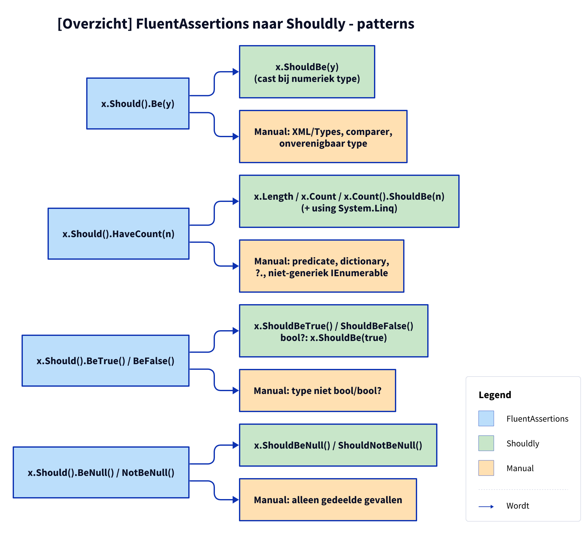

# Patronen: FluentAssertions naar Shouldly

**Figure 1.** Welke FluentAssertions-vorm elk van de vier patterns omzet, en welke gevallen Manual blijven. Volgorde is die van `FluentAssertionsFix.Patterns`. Alle patterns vragen ook de gedeelde controles van [pattern-beslissing.md](pattern-beslissing.md).

<!-- kingmadoc:diagram img/patronen-1.d2 -->

| Pattern-ID | Klasse | FA-vorm | Shouldly-vorm | Type-afhankelijk | Extra Manual | Taak |
| ---------- | ------ | ------- | ------------- | ---------------- | ------------ | ---- |
| `fa.should-be` | `ShouldBePattern` | `Be(y)` | `ShouldBe(y)` | Verwachte waarde krijgt een cast als FA hem naar het type van het subject zou omzetten | `FluentAssertions.Xml`/`Types`-overloads, comparer, niet te casten type | TAAK-001 |
| `fa.have-count` | `HaveCountPattern` | `HaveCount(n)` | `.Length`, `.Count` of `.Count()` plus `ShouldBe(n)` | Array, type met `Count`, `IEnumerable<T>` (dan `System.Linq`) | Predicate, dictionary, `?.`, niet-generiek `IEnumerable`, onbekend type | TAAK-002 |
| `fa.be-true-false` | `BeTrueFalsePattern` | `BeTrue()`, `BeFalse()` | `ShouldBeTrue()`, `ShouldBeFalse()`; `bool?`: `ShouldBe(true)` | `bool` of `bool?` | Elk ander type | TAAK-003 |
| `fa.be-null` | `BeNullPattern` | `BeNull()`, `NotBeNull()` | `ShouldBeNull()`, `ShouldNotBeNull()` | Geen: dezelfde extension voor referentietypes en `Nullable<T>` | Alleen de gedeelde gevallen | TAAK-004 |

De gedeelde Manual-gevallen: andere vorm dan `x.Should().Methode()` (bijv. na `.And`), resultaat gebruikt, `becauseArgs` of benoemde argumenten. Proofs per pattern: `src/Unshackle.Tests/Proofs/FluentAssertions/<Naam>/`. Plan en verificatie: [../README.md](../README.md#patronen).

## Zie ook

- [pattern-beslissing.md](pattern-beslissing.md) — gedeelde stappen
- [klassen.md](klassen.md) — `IPattern` en `PatternResult`
- [../README.md](../README.md)
