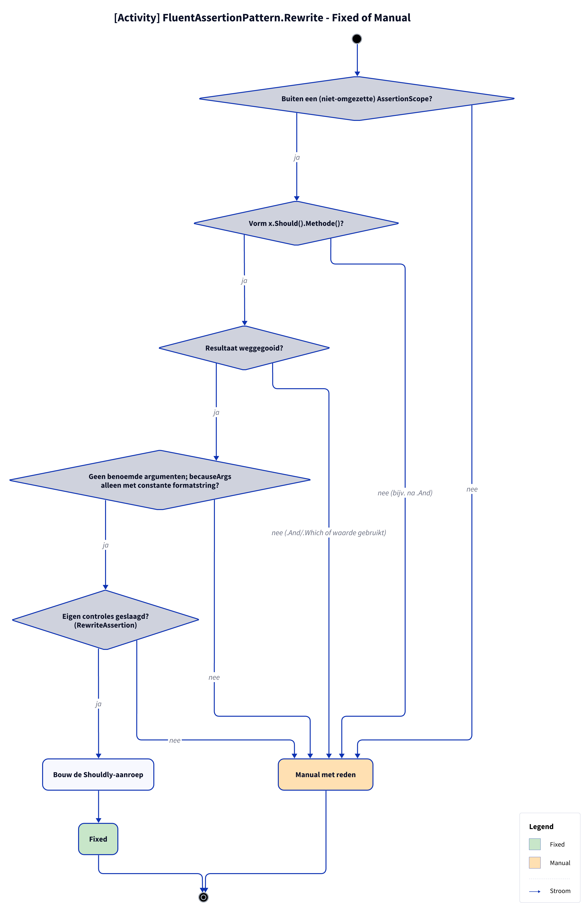

# Beslissing: Fixed of Manual

**Figure 1.** De gedeelde stappen die elk FluentAssertions-assertion-pattern doorloopt: `FluentAssertionPattern.Rewrite` (Template Method) doet ze met hulp van `FluentAssertionsSyntax` en roept daarna `RewriteAssertion` van het pattern aan. De exception-patterns (`Throw`, `ThrowAsync`, `NotThrow`, ...) implementeren `IPattern` zelf maar doen dezelfde stappen. De eigen controles per pattern; die staan in [patronen.md](patronen.md).

<!-- kingmadoc:diagram img/pattern-beslissing-1.d2 -->

| Stap | Hulp in `FluentAssertionsSyntax` | Uitkomst bij falen |
| ---- | -------------------------------- | ------------------ |
| Scope | `IsInsideAssertionScope` | Manual: binnen een `AssertionScope` die `fa.assertion-scope` niet omzette |
| Vorm | `GetSubject` | Manual: niet `x.Should().Methode(...)` |
| Resultaat | `IsResultDiscarded` | Manual: Shouldly geeft niets terug (of het subject) |
| Argumenten | `TryGetArguments` | Manual bij benoemde argumenten of `becauseArgs` met een niet-constante/onjuiste formatstring; anders wordt het `string.Format(CultureInfo.InvariantCulture, because, args)` (TAAK-097) |
| Eigen controles | `RewriteAssertion` per pattern | Manual met patroon-eigen reden |

## Zie ook

- [patronen.md](patronen.md) — de eigen controles per pattern
- [fix-flow.md](fix-flow.md) — wat de Fixer met het resultaat doet
- [../README.md](../README.md)
