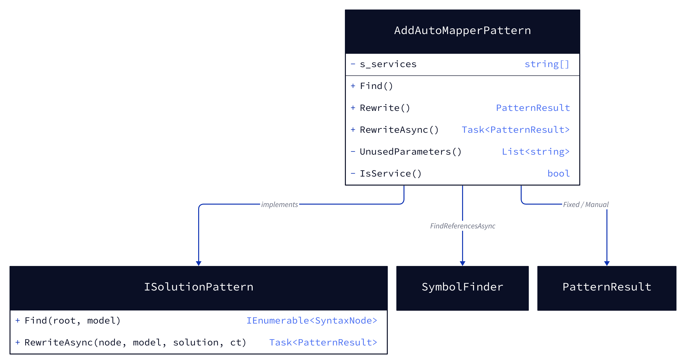
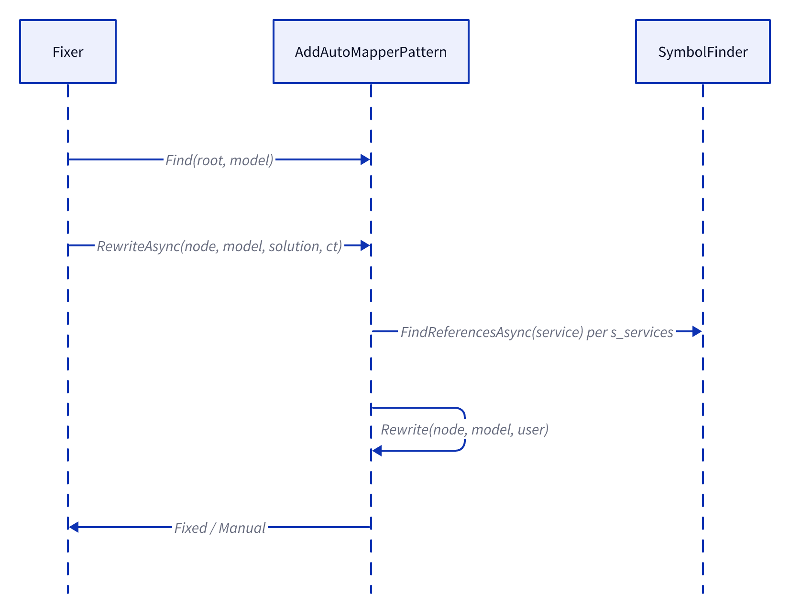
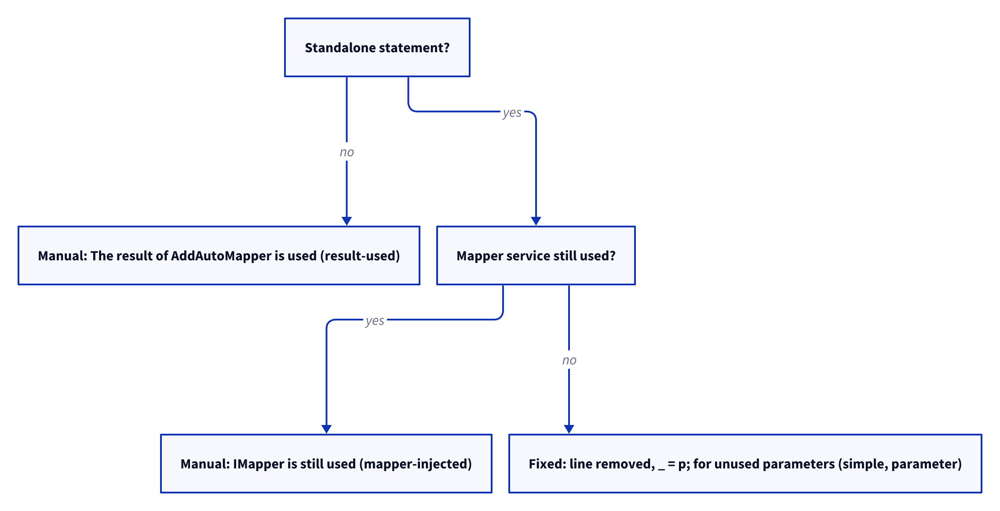

# Models: automapper.add-automapper

Facts from `src/Unshackle.Core/Fixes/AutoMapper/Patterns/AddAutoMapperPattern.cs`.

## Figure 1: class diagram

<!-- kingmadoc:diagram img/automapper-add-automapper-modellen-1.d2 -->

| Element                | Role                                                                 |
| ---------------------- | -------------------------------------------------------------------- |
| `AddAutoMapperPattern` | finds `AddAutoMapper`, decides removed or Manual                     |
| `s_services`           | `IMapper`, `IMapperBase`, `IRuntimeMapper`, `IConfigurationProvider` |
| `SymbolFinder`         | looks for service usage in the whole solution                        |
| `PatternResult`        | `Fixed([_ = p;])` or `Manual(reason)`                                |

## Figure 2: sequence

<!-- kingmadoc:diagram img/automapper-add-automapper-modellen-2.d2 -->

| Step                | Explanation                                                         |
| ------------------- | ------------------------------------------------------------------- |
| Find                | `AddAutoMapper` from assembly `AutoMapper`; the statement if there is one |
| FindReferencesAsync | the first reference becomes `file:line`                             |
| Rewrite             | decision tree below                                                 |

## Figure 3: decision tree

<!-- kingmadoc:diagram img/automapper-add-automapper-modellen-3.d2 -->

| Question           | Leaf         | Proof                 |
| ------------------ | ------------ | --------------------- |
| result used        | Manual       | `result-used`         |
| service used       | Manual       | `mapper-injected`     |
| otherwise          | line removed | `simple`, `parameter` |

## See also

- [plan](automapper-add-automapper-plan.md), [verify](automapper-add-automapper-verify.md)
- `src/Unshackle.Core/Fixes/AutoMapper/Patterns/AddAutoMapperPattern.cs`, `src/Unshackle.Tests/Proofs/AutoMapper/AddAutoMapper/`
