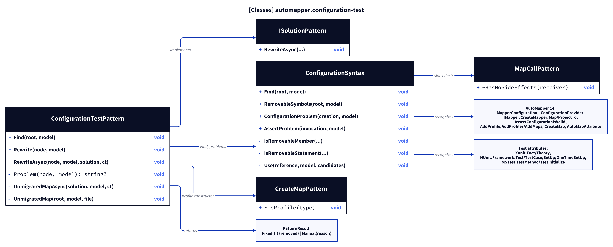
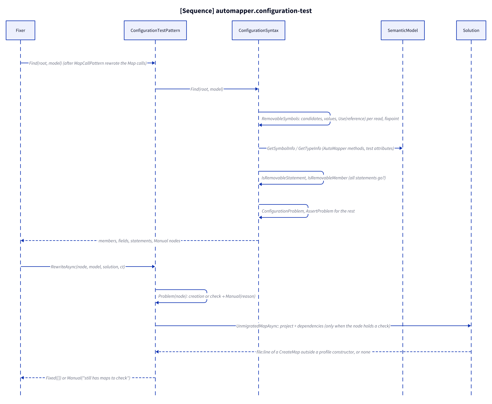
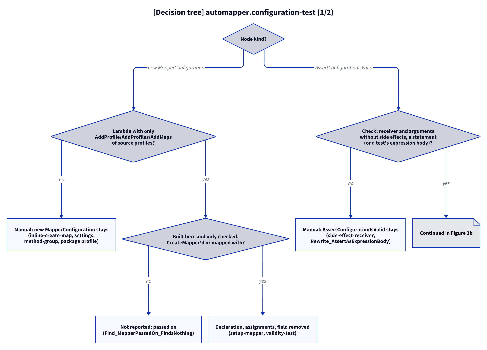
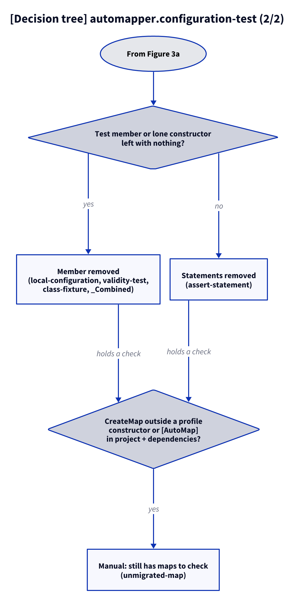

# Models: automapper.configuration-test

Facts from `src/Unshackle.Core/Fixes/AutoMapper/Patterns/ConfigurationTestPattern.cs` and `ConfigurationSyntax.cs`.

## Figure 1: classes

**Figure 1.** The pattern asks `ConfigurationSyntax` what can go; both reuse helpers of the Map and profile patterns.

<!-- kingmadoc:diagram img/automapper-configuration-test-modellen-1.d2 -->

| Element                     | Role                                                                                                                  |
| --------------------------- | --------------------------------------------------------------------------------------------------------------------- |
| `ConfigurationTestPattern`  | `ISolutionPattern`, last in `AutoMapperFix.Patterns`; `Rewrite`/`RewriteAsync` give `Fixed([])` (removal) or `Manual`  |
| `ConfigurationSyntax`       | `Find`; `RemovableSymbols` (which variables are dead), `ConfigurationProblem` (not profile-only), `AssertProblem`       |
| `MapCallPattern`            | `HasNoSideEffects`: a receiver that is only names (shared rule for dropping an expression)                            |
| `CreateMapPattern`          | `IsProfile`: a CreateMap in a constructor of a `Profile` subclass is claimed by the profile patterns                    |
| AutoMapper types            | `MapperConfiguration`, `IConfigurationProvider`, `IMapper` (`CreateMapper`, `Map`, `ProjectTo`), `AssertConfigurationIsValid`, `AddProfile`/`AddProfiles`/`AddMaps`, `CreateMap`/`CreateProjection`, `AutoMapAttribute` |
| Test attributes             | xUnit `Fact`/`Theory`, NUnit `Test`/`TestCase`/`TestCaseSource`/`SetUp`/`OneTimeSetUp`, MSTest `TestMethod`/`DataTestMethod`/`TestInitialize` (and derived) |

## Figure 2: sequence

**Figure 2.** From `Fixer` via `Find` to a removal or `Manual`.

<!-- kingmadoc:diagram img/automapper-configuration-test-modellen-2.d2 -->

| Step       | Method in the code                                    | What happens                                                                                   |
| ---------- | ----------------------------------------------------- | ---------------------------------------------------------------------------------------------- |
| Variables  | `ConfigurationSyntax.RemovableSymbols`, `Use`         | Locals/private fields of an AutoMapper type: values built here, reads only check/CreateMapper/Map; fixpoint over linked variables |
| Statements | `IsRemovableStatement`                                | Check statements, declarations and assignments of removable variables                         |
| Members    | `IsRemovableMember`                                   | A test method, setup or lone default constructor whose statements all go is reported instead   |
| Manual     | `ConfigurationProblem`, `AssertProblem`               | A configuration that is not profile-only; a check that cannot simply be left out               |
| Rewrite    | `ConfigurationTestPattern.Problem`, `UnmigratedMapAsync` | Manual for those nodes; otherwise removal unless a map outside a profile constructor remains |

## Figure 3: decision tree

**Figure 3a.** The questions per node, with the proof or unit test of each leaf. Split into Figures 3a–3b (at most 12 arrows each).

<!-- kingmadoc:diagram img/automapper-configuration-test-modellen-3.d2 -->

**Figure 3b.** Continuation of Figure 3a from its "Continued in Figure 3b" node.

<!-- kingmadoc:diagram img/automapper-configuration-test-modellen-4.d2 -->

| Leaf                                     | Condition                                                                 | Evidence                                                                                   |
| ---------------------------------------- | ------------------------------------------------------------------------- | ------------------------------------------------------------------------------------------ |
| Member removed                           | test method, setup or lone default constructor, every statement goes       | `ConfigurationTest/validity-test`, `local-configuration`, `setup-mapper`, `class-fixture`, `_Combined/configuration-test-fixture` |
| Statements removed                       | check or variable statements in another member                            | `ConfigurationTest/assert-statement`, unit test `FixAsync_MapInReferencedProject_ChecksBeforeRemoving` |
| Declaration, assignments, field removed  | variable built here from profiles, only checked or mapped with            | `ConfigurationTest/setup-mapper`, `validity-test`, `_Combined/configuration-test-fixture`   |
| Not reported                             | profile-only configuration or mapper passed on; injected `IMapper`        | unit test `Find_MapperPassedOn_FindsNothing`                                               |
| Manual: new MapperConfiguration stays    | settings, inline maps, method group, profile from a referenced assembly   | `ConfigurationTest/inline-create-map`, `settings`, `method-group`, unit test `Rewrite_ProfileFromReferencedAssembly_ReportsManual` |
| Manual: AssertConfigurationIsValid stays | side effects, or not a statement of its own (while maps stay: the kept reason first, TAAK-273) | `ConfigurationTest/side-effect-receiver`, unit test `Rewrite_AssertAsExpressionBody_ReportsManual` |
| Manual: still has maps to check          | a CreateMap outside a profile constructor or `[AutoMap]` remains           | `ConfigurationTest/unmigrated-map`, unit test `FixAsync_MapInReferencedProject_ChecksBeforeRemoving` |

## See also

- [automapper-configuration-test-plan.md](automapper-configuration-test-plan.md)
- [automapper-configuration-test-verify.md](automapper-configuration-test-verify.md)
- `src/Unshackle.Core/Fixes/AutoMapper/Patterns/ConfigurationTestPattern.cs`
- `src/Unshackle.Tests/Proofs/AutoMapper/ConfigurationTest/`
