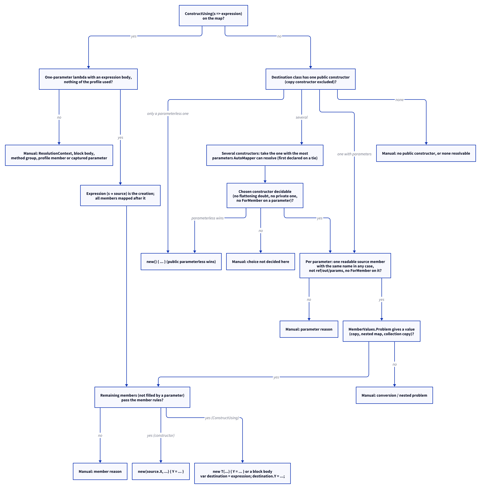

# Models: automapper.constructor

Facts from `src/Unshackle.Core/Fixes/AutoMapper/Patterns/CreateMapPattern.cs` (`Rewrite`, `Problem`, `ConstructorChoice`, `ConstructorProblem`, `ConstructUsingProblem`, `Extensions`) and `MemberValues.cs`.

> The figure was created as a D2 source in `img/`; `kingmadoc`/`d2` were not available in this environment, so the PNG/SVG follow with the next `kingmadoc render`.

## Figure 1: decision tree

**Figure 1.** The questions for one `CreateMap<A, B>` whose destination may need a constructor.

<!-- kingmadoc:diagram img/automapper-constructor-modellen-1.d2 -->

| Step         | Method in the code                       | What happens |
| ------------ | ---------------------------------------- | ------------ |
| ConstructUsing | `CreateMapPattern.ConstructUsingProblem` | A one-parameter expression lambda over the source and static members becomes the creation (TAAK-266); the constructors of the type are not consulted |
| Constructor  | `CreateMapPattern.ConstructorChoice`     | One public constructor: as before. Several: the most parameters AutoMapper can resolve (first declared on a tie, over a parameterless one); undecidable or private: Manual (TAAK-266) |
| Arguments    | `CreateMapPattern.ConstructorProblem`    | Per parameter the single source member matching in any case, through `MemberValues.Problem`; `creation` = `new(...)` |
| Members      | `CreateMapPattern.Problem`               | Members named like a parameter (any case) are skipped; the rest as before |
| MapInto      | `CreateMapPattern.Rewrite`               | A constructor map that needs `MapInto` is Manual |
| MaxDepth     | `CreateMapPattern.Rewrite`, `UnsupportedOptions.MaxDepthLimit` | `MaxDepth(n >= 2)` on an acyclic nested copy is dropped (TAAK-266) |
| Write        | `CreateMapPattern.Extensions`            | `=> new(...)` with the object initializer when members remain; a block body after a `ConstructUsing` that is no plain `new` |

## See also

- [automapper-constructor-plan.md](automapper-constructor-plan.md)
- [automapper-constructor-verify.md](automapper-constructor-verify.md)
