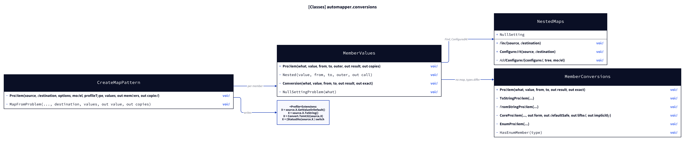
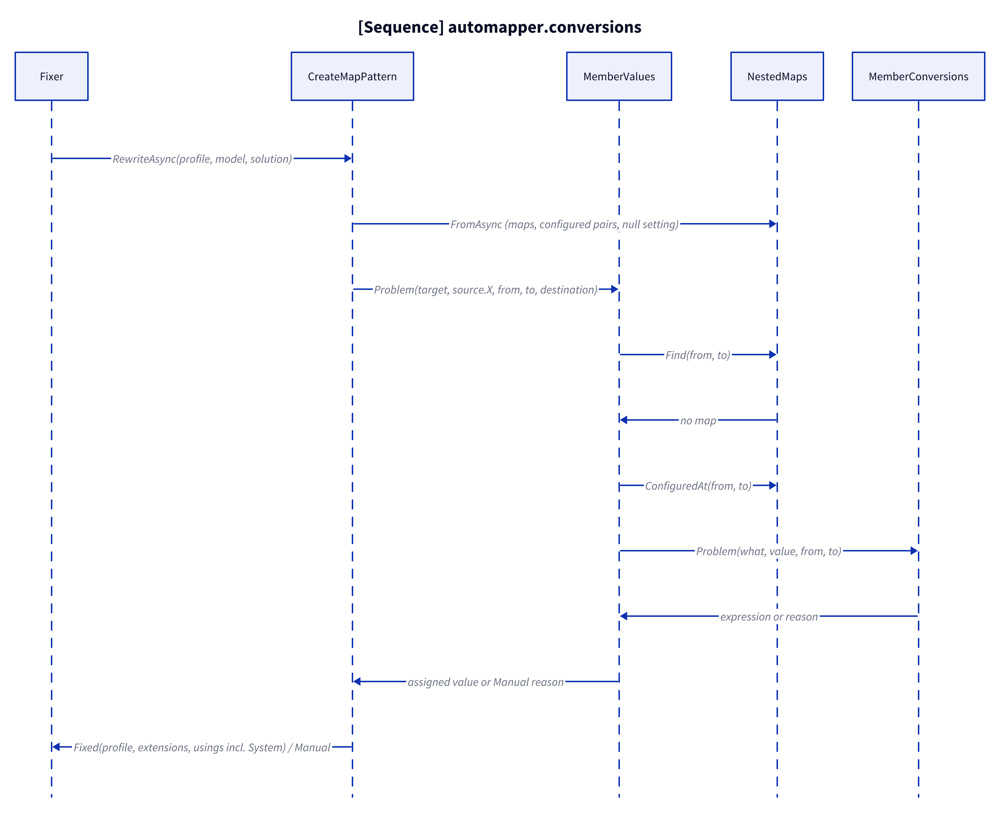
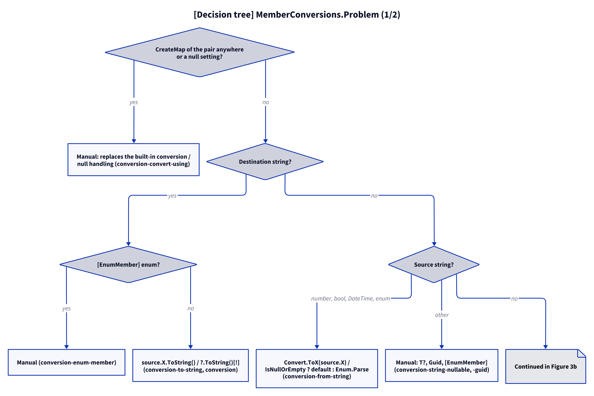
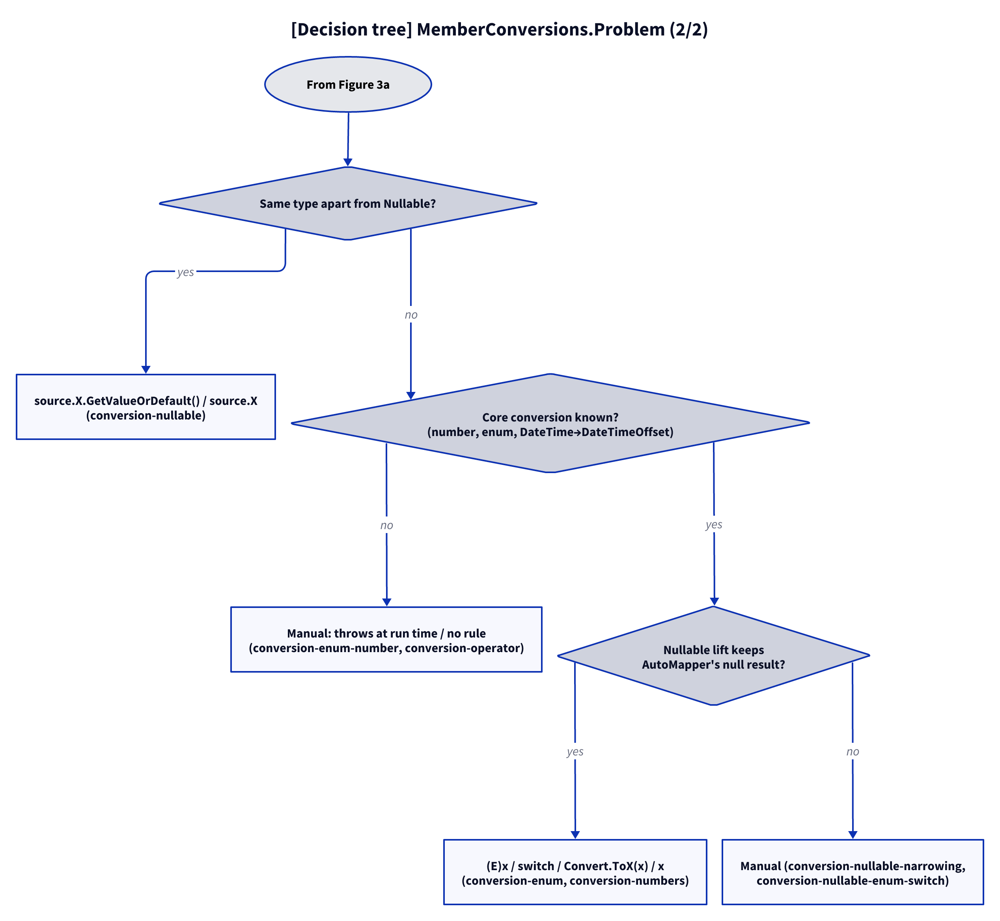

# Models: automapper.conversions

Facts from `src/Unshackle.Core/Fixes/AutoMapper/Patterns/MemberConversions.cs`, `MemberValues.cs`, `NestedMaps.cs` and `CreateMapPattern.cs`.

## Figure 1: classes

**Figure 1.** The profile rewrite asks `MemberValues` per member; without a nested map `MemberValues` asks `MemberConversions`.

<!-- kingmadoc:diagram img/automapper-conversions-modellen-1.d2 -->

| Element             | Role                                                                                                                          |
| ------------------- | ----------------------------------------------------------------------------------------------------------------------------- |
| `CreateMapPattern`  | Shared rewrite of the three profile patterns; `Problem` (same-named members) and `MapFromProblem` (expressions) ask `MemberValues` |
| `MemberValues`      | Nested map first, same type as is, otherwise `Conversion`: configured pair and null setting checks, then `MemberConversions`; element conversions inside `Select` |
| `MemberConversions` | `Problem`: AutoMapper 14's built-in conversion as an expression, or a Manual reason, or no rule; `exact` tells whether the expression has the destination type itself |
| `NestedMaps`        | `ConfiguredAt`: every `CreateMap<A, B>` pair of the solution (also outside profiles) with its location; `NullSetting`          |

## Figure 2: sequence

**Figure 2.** From `Fixer` via the member value to the conversion and back to `Fixed` or `Manual`.

<!-- kingmadoc:diagram img/automapper-conversions-modellen-2.d2 -->

| Step        | Method in the code                                          | What happens                                                                 |
| ----------- | ----------------------------------------------------------- | ---------------------------------------------------------------------------- |
| Index       | `NestedMaps.FromAsync`, `AddConfigured`                     | Profile maps, every `CreateMap` pair of the solution, null settings          |
| Member      | `CreateMapPattern.Problem` / `MapFromProblem` → `MemberValues.Problem` | The value per destination member (or expression)                 |
| Nested      | `MemberValues.Nested`                                       | A map of the pair is called as `ToY()` (TAAK-245); no map → conversion       |
| Guard       | `MemberValues.Conversion`, `NestedMaps.ConfiguredAt`, `NullSettingProblem` | A `CreateMap` of the pair or a null setting → Manual              |
| Convert     | `MemberConversions.Problem` → `ToStringProblem` / `FromStringProblem` / `CoreProblem` / `EnumProblem` | The form per conversion, lifted over `Nullable<T>` |
| Write       | `CreateMapPattern.Extensions`, `PatternResult.Fixed(nodes, namespaces)` | `System` (for `Convert`/`Enum`) and `System.Linq` as required usings |

## Figure 3: decision tree

**Figure 3a.** The questions of `MemberValues.Conversion` and `MemberConversions.Problem` for one member or element. Split into Figures 3a–3b (at most 12 arrows each).

<!-- kingmadoc:diagram img/automapper-conversions-modellen-3.d2 -->

**Figure 3b.** Continuation of Figure 3a from its "Continued in Figure 3b" node.

<!-- kingmadoc:diagram img/automapper-conversions-modellen-4.d2 -->

| Leaf                                           | Condition                                                            | Evidence                                    |
| ---------------------------------------------- | -------------------------------------------------------------------- | ------------------------------------------- |
| Manual "replaces AutoMapper's built-in conversion" / "null handling" | a `CreateMap` of the pair anywhere; `AllowNull*` assigned | `CreateMap/conversion-convert-using`, unit test `Rewrite_ConversionWithNullSetting_ReportsManual` |
| Manual "[EnumMember]"                          | enum with `[EnumMember]` to or from `string`, or enum ↔ enum          | `CreateMap/conversion-enum-member`, unit tests `Rewrite_BuiltInConversionNotWritable_ReportsManual` |
| Fixed `ToString()` / `?.ToString()[!]`         | destination `string`                                                 | `CreateMap/conversion`, `conversion-to-string`, `ForMemberMapFrom/conversion`, `ForMemberMapFrom/conversion-expression` |
| Fixed `Convert.ToX(source.X)` / `Enum.Parse`   | source `string`, destination number, `bool`, `DateTime` or enum       | `CreateMap/conversion-from-string`           |
| Manual "keeps null as null" / "a Parse call throws on null" | source `string`, destination `T?`, `Guid`, `TimeSpan`, `char` | `CreateMap/conversion-string-nullable`, `conversion-string-guid` |
| Fixed `GetValueOrDefault()` / `source.X`       | same type apart from `Nullable<T>`                                    | `CreateMap/conversion-nullable`              |
| Manual "throws at run time" / "(AutoMapper converts)" | enum ↔ other number, `char` ↔ `double`, `DateTimeOffset` → `DateTime`; own types | `CreateMap/conversion-enum-number`, `conversion-operator` |
| Manual "default ... does not" / "overflow check" | lift would change AutoMapper's null result or overflow             | `CreateMap/conversion-nullable-enum-switch`, `conversion-nullable-narrowing` |
| Fixed cast / switch / `Convert.ToX` / implicit | numbers, enums, `DateTime` → `DateTimeOffset`, lifted where exact    | `CreateMap/conversion-enum`, `conversion-numbers`, `conversion-collection`, `_Combined/conversion-map-into` |

## See also

- [automapper-conversions-plan.md](automapper-conversions-plan.md)
- [automapper-conversions-verify.md](automapper-conversions-verify.md)
- [automapper-nested-maps-modellen.md](automapper-nested-maps-modellen.md)
- `src/Unshackle.Core/Fixes/AutoMapper/Patterns/MemberConversions.cs`
- `src/Unshackle.Tests/Proofs/AutoMapper/CreateMap/`
