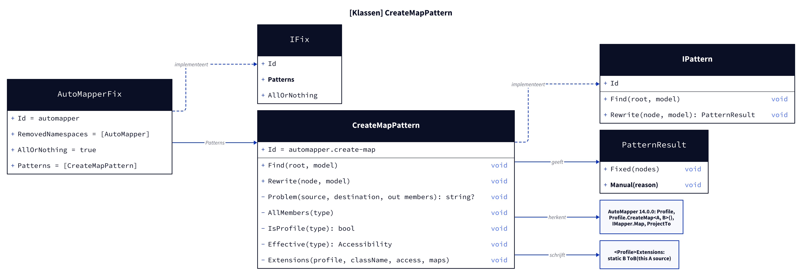
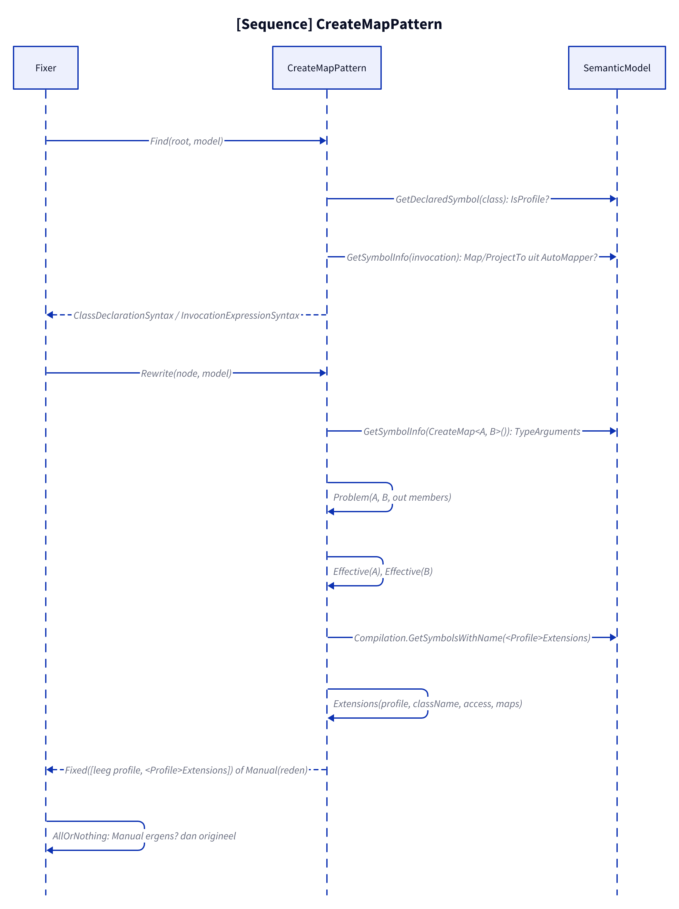
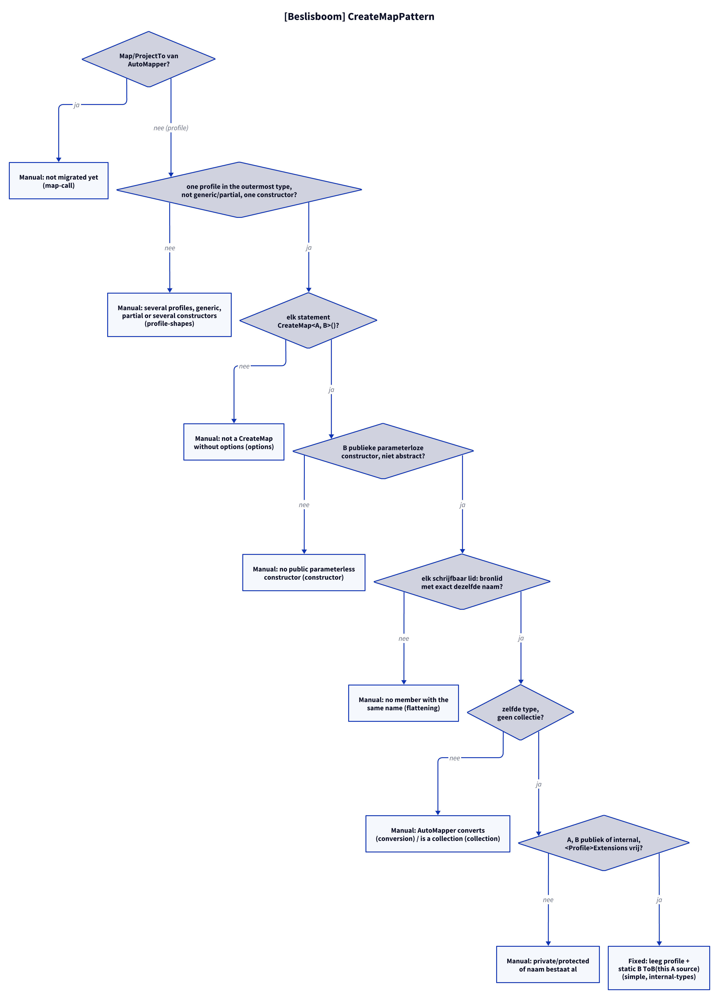

# Models: automapper.create-map

Facts from `src/Unshackle.Core/Fixes/AutoMapper/Patterns/CreateMapPattern.cs` and `AutoMapperFix.cs`.

## Figure 1: classes

**Figure 1.** `AutoMapperFix`, `CreateMapPattern` and what it recognises and writes.

<!-- kingmadoc:diagram img/automapper-create-map-modellen-1.d2 -->

| Element            | Role                                                                                    |
| ------------------ | --------------------------------------------------------------------------------------- |
| `AutoMapperFix`    | Fix `automapper`, `AllOrNothing`: one Manual and the solution stays as it was           |
| `CreateMapPattern` | Finds profiles and `Map`/`ProjectTo` calls, writes `<Profile>Extensions`                |
| `Problem`          | Reason why a map is not plain assignments, otherwise the list of same-named members     |
| `Effective`        | Real accessibility of A and B (nested and generic types) → `public` or `internal`       |
| `Extensions`       | Builds the static class as text with the file's indentation and line endings            |

## Figure 2: sequence

**Figure 2.** From `Fixer` via `Find` and `Rewrite` to `Fixed` or `Manual`.

<!-- kingmadoc:diagram img/automapper-create-map-modellen-2.d2 -->

| Step      | Method in the code                           | What happens                                              |
| --------- | -------------------------------------------- | --------------------------------------------------------- |
| Find      | `Find`, `IsProfile`, `GetSymbolInfo`         | Profiles with a non-empty constructor; `Map`/`ProjectTo`  |
| Check     | `Problem`, `Effective`, `GetSymbolsWithName` | Members, types, constructor, accessibility, name conflict |
| Write     | `Extensions`, `ReplaceNode`                  | Constructor empty, static class directly after the profile |
| Fixer     | `AllOrNothing`                               | One Manual in the solution → nothing applied              |

## Figure 3: decision tree

**Figure 3.** Questions of `Rewrite`.

<!-- kingmadoc:diagram img/automapper-create-map-modellen-3.d2 -->

| Leaf                                             | Condition                                  | Evidence                   |
| ------------------------------------------------ | ------------------------------------------ | -------------------------- |
| Manual "not migrated yet"                        | AutoMapper's `ProjectTo`, `Map(src, dest)` | `map-into`                 |
| Manual "several profiles" / "generic" / "partial" / "several constructors" | see [automapper-profile-shapes-modellen.md](automapper-profile-shapes-modellen.md) (nested and `=>` profiles are rewritten since TAAK-248) | `generic`, `partial`, `several-constructors`, `nested-several-profiles` |
| Manual "not a CreateMap without options"         | another option (`MaxDepth`, ...; `ReverseMap` since TAAK-249 and `ForMember` are rewritten), another statement | `options` |
| Manual "no public parameterless constructor"     | positional record, abstract                | `constructor`, unit test   |
| Member left out (TAAK-261)                       | no source member AutoMapper reads, or get-only (no setter) and not a collection, and no `AssertConfigurationIsValid` in the solution | `unmatched-member`, `ForMemberIgnore/unmatched` |
| Manual "no member with the same name ... AssertConfigurationIsValid" | an unmatched member while the solution calls `AssertConfigurationIsValid` (since TAAK-256 flattening, `GetX()` and case are rewritten) | `unmatched-asserted` |
| Manual "AutoMapper converts" | another type without a CreateMap of its own (since TAAK-245 nested maps and lists/arrays are rewritten, see [automapper-nested-maps-modellen.md](automapper-nested-maps-modellen.md)) | `conversion-operator`, `nested-no-map` (`conversion` is rewritten since TAAK-247, see [automapper-conversions-modellen.md](automapper-conversions-modellen.md)) |
| Manual "non-public setter" / "get-only collection" | the source has the member and AutoMapper writes the private setter or fills the collection (TAAK-261) | `private-setter`, `get-only-collection` |
| Required member named `= default` (TAAK-282)    | a `required` destination member nothing maps, no initializer, no constructor declared on the type | `_Combined/required-members`, `_Combined/project-to-required` |
| Manual "is required and nothing maps it"         | that member has an initializer or the type has a constructor (AutoMapper keeps the value) | unit tests `Rewrite_RequiredMemberAutoMapperKeepsAValueOf_ReportsManual` |
| Stray `#region`/`#endregion` dropped (TAAK-280)  | removed maps carried one half of a pair (`ProfileDirectives.Repair`) | `_Combined/region-directives` |
| Manual "conditional compilation"                 | a removed map sat inside `#if`                | unit test `Rewrite_DirectivesAroundCreateMap_StayBalancedOrManual` |
| Fixed                                            | all of the above no                        | `simple`, `internal-types` |

## See also

- [automapper-create-map-plan.md](automapper-create-map-plan.md)
- [automapper-create-map-verify.md](automapper-create-map-verify.md)
- `src/Unshackle.Core/Fixes/AutoMapper/Patterns/CreateMapPattern.cs`
- `src/Unshackle.Tests/Proofs/AutoMapper/CreateMap/`
