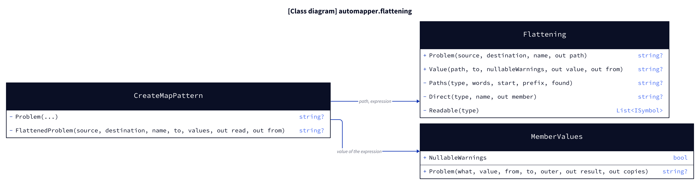
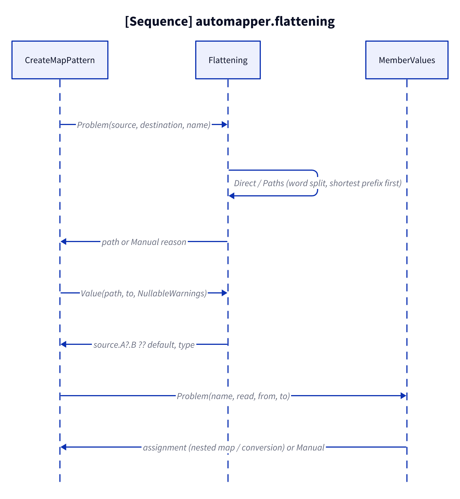
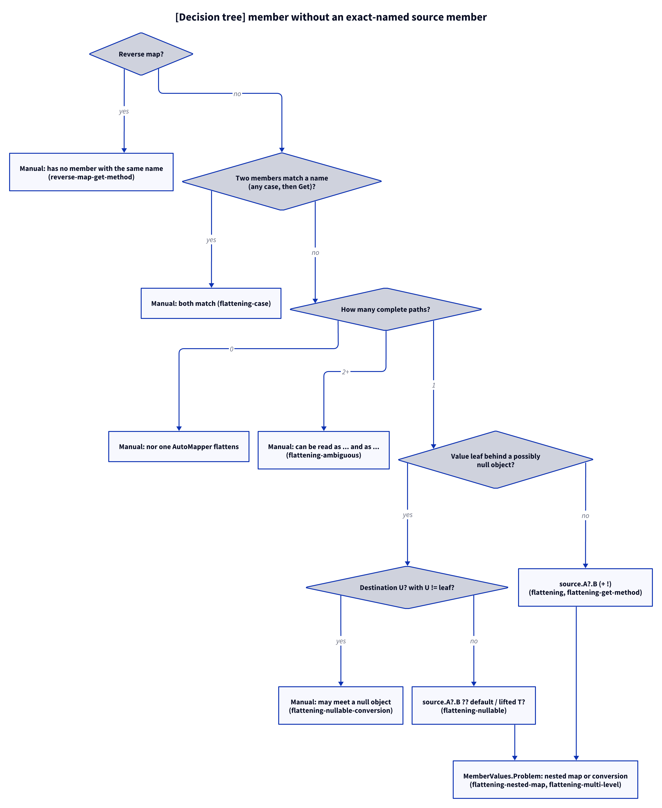

# Models: automapper.flattening

Facts from `src/Unshackle.Core/Fixes/AutoMapper/Patterns/Flattening.cs`, `CreateMapPattern.cs` and `MemberValues.cs`.

> The figures are D2 sources in `img/`; `kingmadoc`/`d2` were not available in this environment, so the PNG/SVG follow with the next `kingmadoc render`.

## Figure 1: classes

**Figure 1.** The profile rewrite asks `Flattening` for the path and hands its expression to `MemberValues`.

<!-- kingmadoc:diagram img/automapper-flattening-modellen-1.d2 -->

| Element            | Role |
| ------------------ | ---- |
| `CreateMapPattern` | `Problem` per destination member; `FlattenedProblem` when there is no source member of the exact name |
| `Flattening`       | `Problem`: AutoMapper's path (`Direct`, `Paths`, `Readable`); `Value`: the null-safe C# expression and its type |
| `MemberValues`     | `Problem`: nested map or conversion on that expression; `NullableWarnings` for the `!` |

## Figure 2: sequence

**Figure 2.** From `CreateMapPattern.Problem` to the assignment or a Manual reason.

<!-- kingmadoc:diagram img/automapper-flattening-modellen-2.d2 -->

| Step   | Method in the code | What happens |
| ------ | ------------------ | ------------ |
| Exact  | `CreateMapPattern.Problem` | One source member with the exact name → `source.X` as before |
| Path   | `Flattening.Problem` → `Direct`, `Paths` | Direct match (any case, then `Get`), else word split, all complete paths |
| Value  | `Flattening.Value` | `?.` after reference types; `?? default` or lifted `T?` for a value leaf; `!` |
| Member | `MemberValues.Problem` | Nested map, collection copy or conversion on the expression |

## Figure 3: decision tree

**Figure 3.** The questions for one destination member without an exact-named source member.

<!-- kingmadoc:diagram img/automapper-flattening-modellen-3.d2 -->

| Question | Leaf | Proof |
| -------- | ---- | ----- |
| Reverse map? | Manual "has no member with the same name" | `CreateMap/reverse-map-get-method` |
| Two members match a name? | Manual "both match" | `CreateMap/flattening-case` |
| No path? | Manual "nor one AutoMapper flattens" | unit test `Rewrite_OtherNameRuleUnsure_ReportsManual` |
| Two paths? | Manual "can be read ... as ... and as ..." | `CreateMap/flattening-ambiguous` |
| Value leaf behind null into other `U?`? | Manual "may meet a null object" | `CreateMap/flattening-nullable-conversion` |
| Value leaf behind null | `?? default` / lifted `T?` | `CreateMap/flattening-nullable` |
| Reference leaf | `source.A?.B` (+ `!`) | `CreateMap/flattening`, `CreateMap/flattening-nullable` |
| Other type | nested map / conversion | `CreateMap/flattening-nested-map`, `CreateMap/flattening-multi-level` |

## See also

- [automapper-flattening-plan.md](automapper-flattening-plan.md)
- [automapper-flattening-verify.md](automapper-flattening-verify.md)
- `src/Unshackle.Core/Fixes/AutoMapper/Patterns/Flattening.cs`
- `src/Unshackle.Tests/Proofs/AutoMapper/CreateMap/` (`flattening*`)
