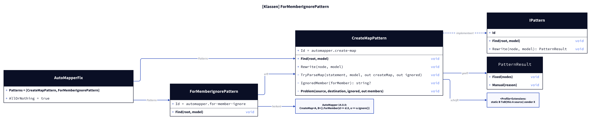
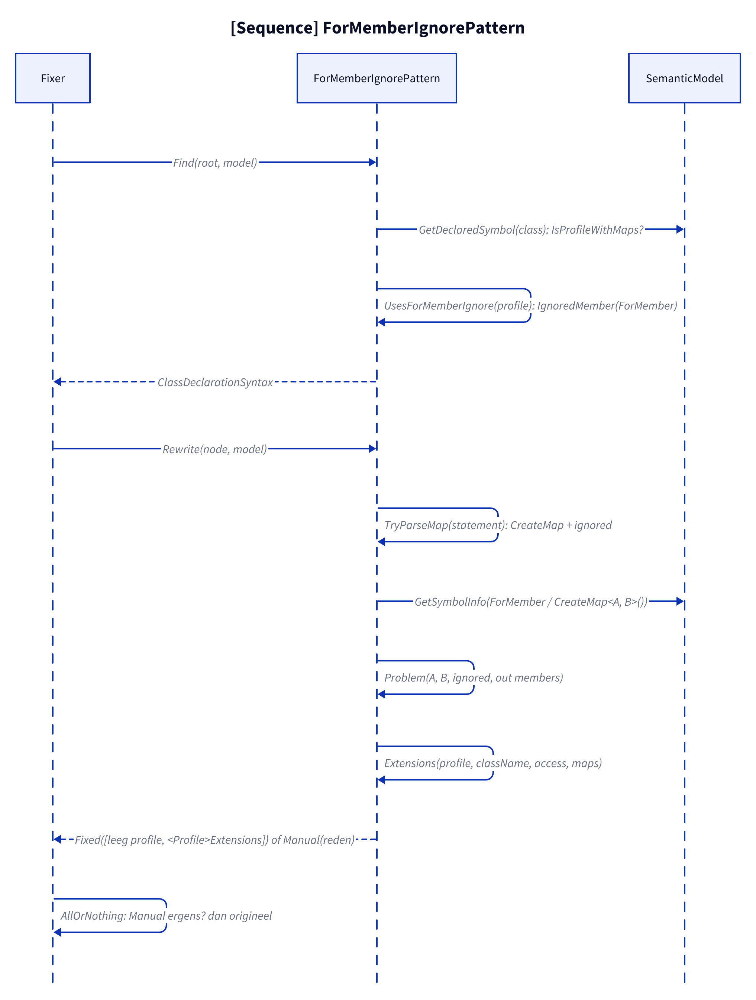
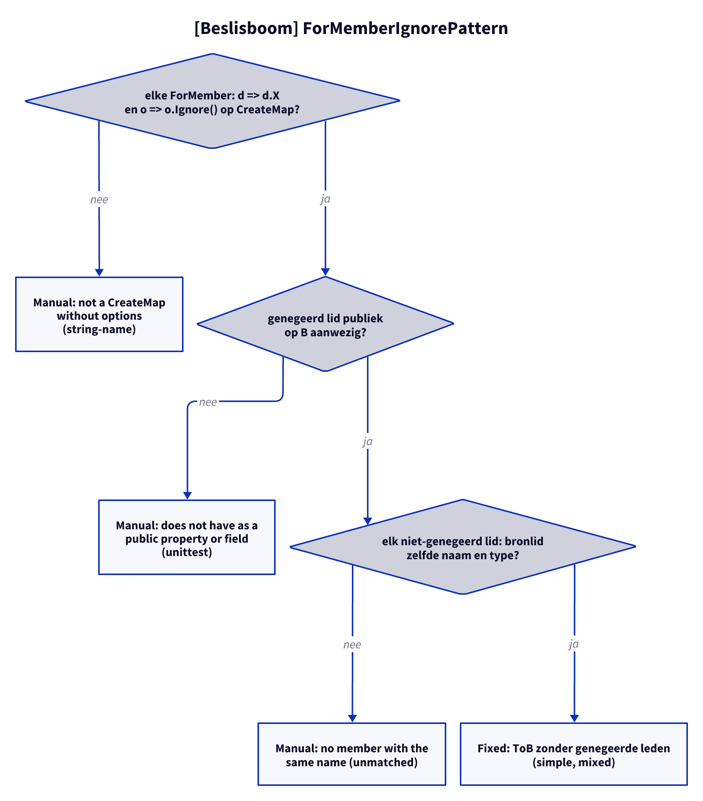

# Models: automapper.for-member-ignore

Facts from `src/Unshackle.Core/Fixes/AutoMapper/Patterns/ForMemberIgnorePattern.cs` and `CreateMapPattern.cs`.

> The figures were created as D2 sources in `img/`; `kingmadoc`/`d2` were not available in this environment, so the PNG/SVG follow with the next `kingmadoc render`.

## Figure 1: classes

**Figure 1.** `ForMemberIgnorePattern` as a subclass of `CreateMapPattern`.

<!-- kingmadoc:diagram img/automapper-for-member-ignore-modellen-1.d2 -->

| Element                  | Role                                                                                          |
| ------------------------ | --------------------------------------------------------------------------------------------- |
| `ForMemberIgnorePattern` | Id `automapper.for-member-ignore`; `Find` claims profiles with `ForMember(.., o => o.Ignore())` |
| `CreateMapPattern`       | Base: `Rewrite` (shared), `Find` for profiles without Ignore and for `Map`/`ProjectTo`        |
| `TryParseMap`            | Peels `.ForMember(...)` links off `CreateMap<A, B>()`; collects the ignored member names      |
| `IgnoredMember`          | Recognises `d => d.X` + `o => o.Ignore()`, returns `X`, otherwise null                        |
| `Problem`                | Skips ignored members, checks the rest                                                        |

## Figure 2: sequence

**Figure 2.** From `Fixer` via `Find` and `Rewrite` to `Fixed` or `Manual`.

<!-- kingmadoc:diagram img/automapper-for-member-ignore-modellen-2.d2 -->

| Step      | Method in the code                                 | What happens                                                    |
| --------- | -------------------------------------------------- | --------------------------------------------------------------- |
| Find      | `Find`, `IsProfileWithMaps`, `UsesForMemberIgnore` | Profiles with at least one `ForMember(.., o => o.Ignore())`     |
| Parse     | `TryParseMap`, `IgnoredMember`, `GetSymbolInfo`    | `CreateMap<A, B>()` plus the ignored member names               |
| Check     | `Problem`, `Effective`, `GetSymbolsWithName`       | The ignored member exists; other members, types, accessibility  |
| Write     | `Extensions`, `ReplaceNode`                        | Constructor empty, `<Profile>Extensions` without ignored members |

## Figure 3: decision tree

**Figure 3.** Questions of `Rewrite` that belong to Ignore (the others are in the create-map model).

<!-- kingmadoc:diagram img/automapper-for-member-ignore-modellen-3.d2 -->

| Leaf                                        | Condition                                                   | Evidence                                 |
| ------------------------------------------- | ----------------------------------------------------------- | ---------------------------------------- |
| Manual "not a CreateMap without options"    | `MapFrom`, string name, nested member or `ReverseMap` in the chain | `string-name`, `reverse-map`      |
| Manual "does not have as a public property" | the ignored member does not exist publicly on B             | unit test                                |
| Manual "no member with the same name"       | a non-ignored member without a source member                | `unmatched`                              |
| Fixed (member left out)                     | an ignored member, with or without a source member          | `simple`, `mixed`, unit test             |

## See also

- [automapper-for-member-ignore-plan.md](automapper-for-member-ignore-plan.md)
- [automapper-for-member-ignore-verify.md](automapper-for-member-ignore-verify.md)
- [automapper-create-map-modellen.md](automapper-create-map-modellen.md)
- `src/Unshackle.Core/Fixes/AutoMapper/Patterns/ForMemberIgnorePattern.cs`
- `src/Unshackle.Tests/Proofs/AutoMapper/ForMemberIgnore/`
