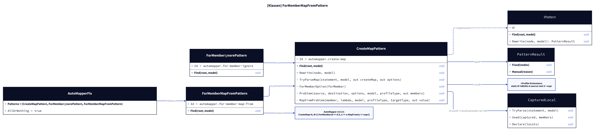
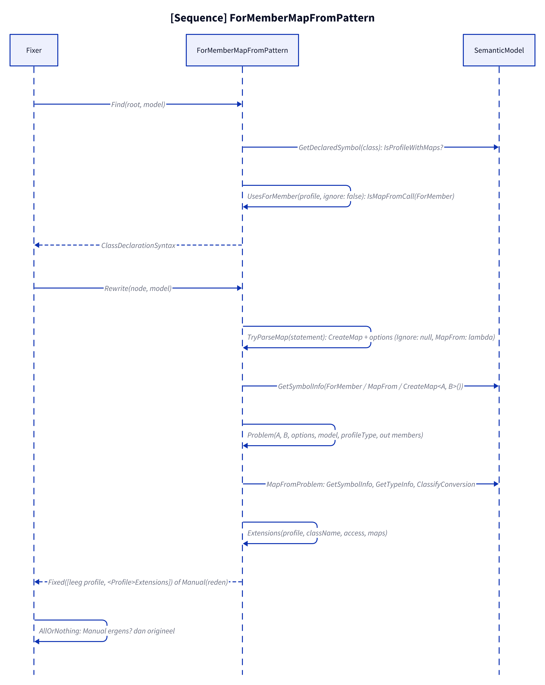
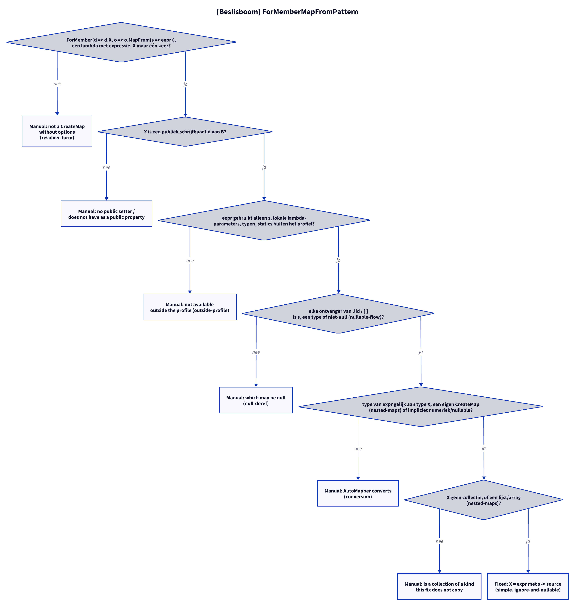

# Models: automapper.for-member-map-from

Facts from `src/Unshackle.Core/Fixes/AutoMapper/Patterns/ForMemberMapFromPattern.cs` and `CreateMapPattern.cs`.

> The figures were created as D2 sources in `img/`; `kingmadoc`/`d2` were not available in this environment, so the PNG/SVG follow with the next `kingmadoc render`.

## Figure 1: classes

**Figure 1.** `ForMemberMapFromPattern` next to `ForMemberIgnorePattern`, both subclasses of `CreateMapPattern`.

<!-- kingmadoc:diagram img/automapper-for-member-map-from-modellen-1.d2 -->

| Element                   | Role                                                                                                       |
| ------------------------- | ---------------------------------------------------------------------------------------------------------- |
| `ForMemberMapFromPattern` | Id `automapper.for-member-map-from`; `Find` claims every profile with a `ForMember(.., o => o.MapFrom(..))` |
| `CreateMapPattern`        | Shared `Rewrite`; `Find` for profiles without Ignore/MapFrom and for `Map`/`ProjectTo`                     |
| `ForMemberOption`         | Recognises `d => d.X` with `o.Ignore()` (MapFrom null) or `o.MapFrom(s => expr)` (the lambda)              |
| `TryParseMap`             | Peels off the `.ForMember` links; collects `options` (name to lambda or null); a duplicate name is no match |
| `Problem`                 | Per member of B: ignored, MapFrom, or a source member with the same name and type; returns `(name, value)` |
| `MapFromProblem`          | Checks the expression and replaces `s` with `source`                                                       |

## Figure 2: sequence

**Figure 2.** From `Fixer` via `Find` and `Rewrite` to `Fixed` or `Manual`.

<!-- kingmadoc:diagram img/automapper-for-member-map-from-modellen-2.d2 -->

| Step      | Method in the code                                               | What happens                                             |
| --------- | ---------------------------------------------------------------- | -------------------------------------------------------- |
| Find      | `Find`, `IsProfileWithMaps`, `UsesForMember`, `IsMapFromCall`    | Profiles with at least one `MapFrom` call                |
| Parse     | `TryParseMap`, `ForMemberOption`, `GetSymbolInfo`                | `CreateMap<A, B>()` plus the options per member          |
| Check     | `Problem`, `MapFromProblem`, `GetTypeInfo`, `ClassifyConversion` | Members, expression (names, null safety, type, collection) |
| Write     | `Extensions`, `ReplaceNode`                                      | Constructor empty, `<Profile>Extensions` with `X = expr` |

## Figure 3: decision tree

**Figure 3.** The questions of `Rewrite` that belong to MapFrom (the others are in the create-map and ignore models).

<!-- kingmadoc:diagram img/automapper-for-member-map-from-modellen-3.d2 -->

| Leaf                           | Condition                                                    | Evidence                                   |
| ------------------------------ | ------------------------------------------------------------ | ------------------------------------------ |
| Manual "without options"       | resolver lambda, string name, generic, X twice               | `resolver-form`, unit test                 |
| Manual "no public setter"      | X has no public setter                                       | unit test                                  |
| Manual "not available outside" | the expression uses an instance member of the profile        | `outside-profile`                          |
| Manual "which may be null"     | the receiver is not `s`/a type and not NotNull               | `null-deref`, unit test                    |
| Manual "AutoMapper converts"   | type of the expression unequal to the type of X (apart from numeric/nullable) | `conversion`              |
| Manual "is a collection"       | X is a collection                                            | `collection`                               |
| Fixed (`X = expr`)             | everything above passed                                      | `simple`, `ignore-and-nullable`, unit tests |

## See also

- [automapper-for-member-map-from-plan.md](automapper-for-member-map-from-plan.md)
- [automapper-for-member-map-from-verify.md](automapper-for-member-map-from-verify.md)
- [automapper-for-member-ignore-modellen.md](automapper-for-member-ignore-modellen.md)
- `src/Unshackle.Core/Fixes/AutoMapper/Patterns/ForMemberMapFromPattern.cs`
- `src/Unshackle.Tests/Proofs/AutoMapper/ForMemberMapFrom/`
