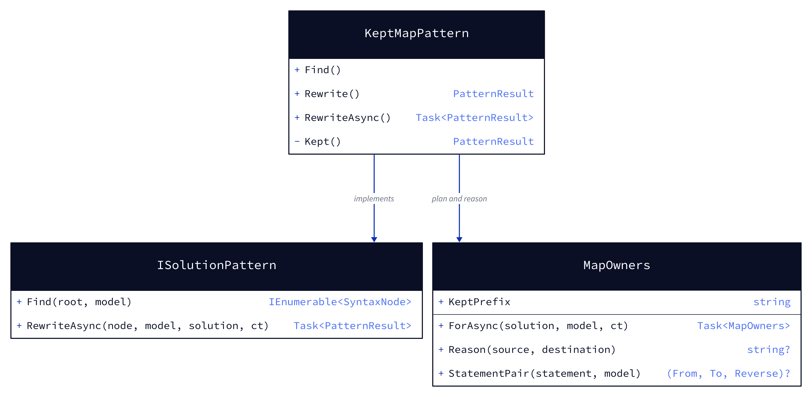
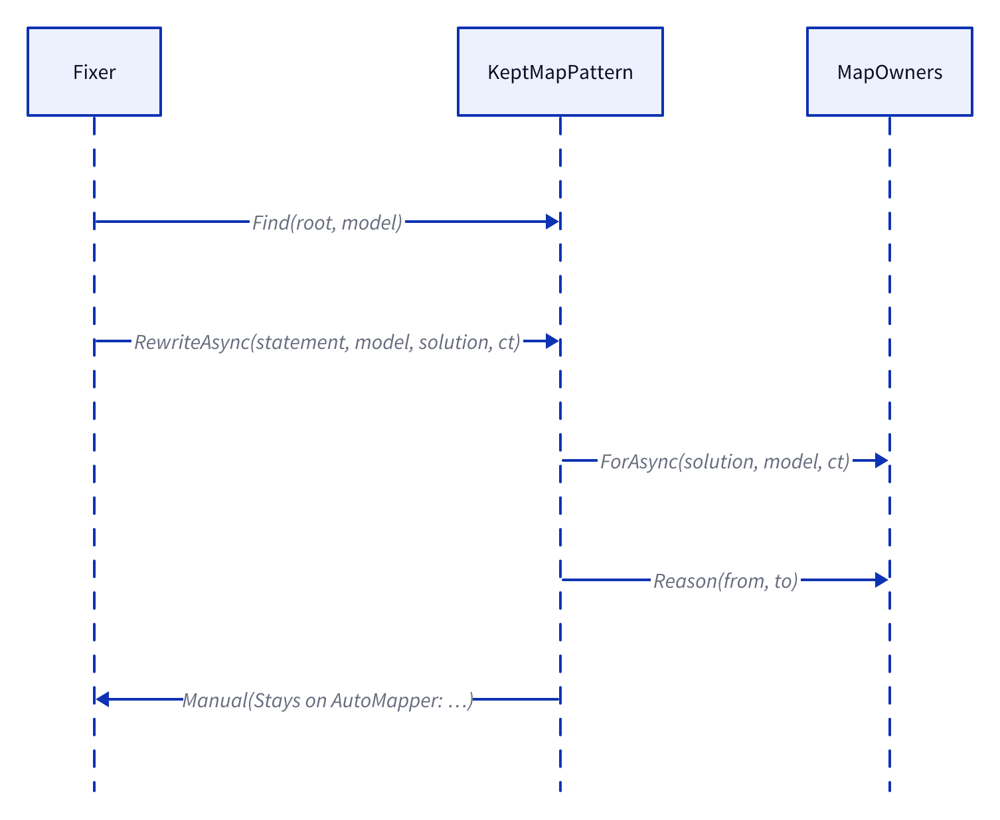
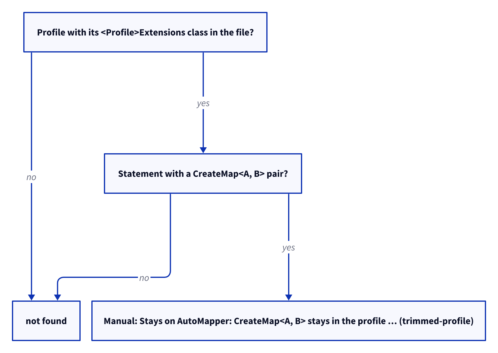

# Models: automapper.kept-map

Facts from `src/Unshackle.Core/Fixes/AutoMapper/Patterns/KeptMapPattern.cs` and `MapOwners.cs`.

## Figure 1: class diagram

<!-- kingmadoc:diagram img/automapper-kept-map-modellen-1.d2 -->

| Element          | Role                                                             |
| ---------------- | ---------------------------------------------------------------- |
| `KeptMapPattern` | finds the statements left in a trimmed profile, reports them     |
| `MapOwners`      | the solution-wide plan: which pairs stay on AutoMapper, and why  |

## Figure 2: sequence

<!-- kingmadoc:diagram img/automapper-kept-map-modellen-2.d2 -->

## Figure 3: decision tree

<!-- kingmadoc:diagram img/automapper-kept-map-modellen-3.d2 -->

| Question                 | Leaf      | Proof             |
| ------------------------ | --------- | ----------------- |
| profile partly rewritten | Manual    | `trimmed-profile` |
| otherwise                | not found | —                 |

## See also

- [plan](automapper-kept-map-plan.md), [verify](automapper-kept-map-verify.md)
