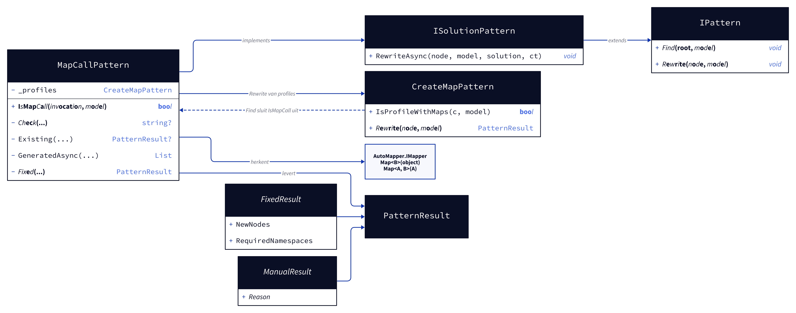
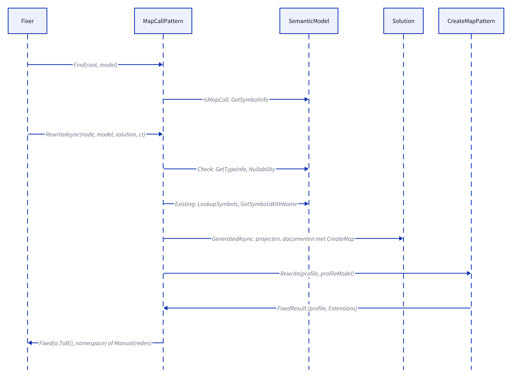
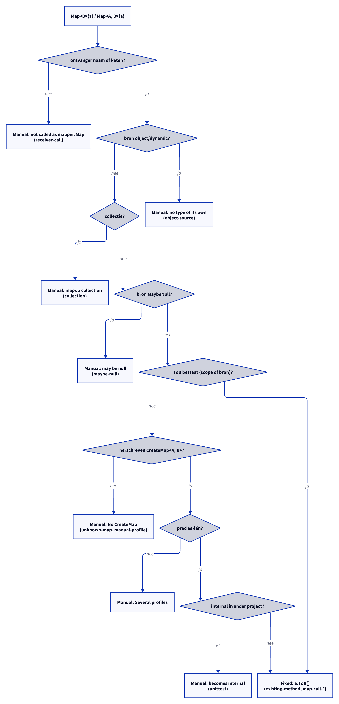

# Models: automapper.map-call

Facts from `src/Unshackle.Core/Fixes/AutoMapper/Patterns/MapCallPattern.cs` and `CreateMapPattern.cs`.

> The figures were created as D2 sources in `img/`; `kingmadoc`/`d2` were not available in this environment, so the PNG/SVG follow with the next `kingmadoc render`.

## Figure 1: classes

**Figure 1.** `MapCallPattern` as an `ISolutionPattern`, with `CreateMapPattern` for the profiles.

<!-- kingmadoc:diagram img/automapper-map-call-modellen-1.d2 -->

| Element            | Role                                                                                                                      |
| ------------------ | ------------------------------------------------------------------------------------------------------------------------- |
| `MapCallPattern`   | Id `automapper.map-call`; `Find` via `IsMapCall`; `Rewrite` only with an existing `ToB`, `RewriteAsync` also with profiles |
| `IsMapCall`        | AutoMapper's `Map` with one argument and one or two type arguments                                                        |
| `CreateMapPattern` | `Rewrite` returns the generated extension class; `Find` skips `IsMapCall` calls                                           |
| `Check`            | Receiver, source type, collection, nullable flow                                                                          |
| `Existing`         | `ToB` in scope, or in the compilation's source code (with a `using`)                                                      |
| `GeneratedAsync`   | Profiles in the project and its dependencies: method name, namespace, internal                                            |

## Figure 2: sequence

**Figure 2.** From `Fixer` via `Find` and `RewriteAsync` to `Fixed` or `Manual`.

<!-- kingmadoc:diagram img/automapper-map-call-modellen-2.d2 -->

| Step      | Method in the code                                | What happens                                               |
| --------- | ------------------------------------------------- | ---------------------------------------------------------- |
| Find      | `Find`, `IsMapCall`                               | AutoMapper's `Map<B>(a)` / `Map<A, B>(a)`                  |
| Check     | `Check`                                           | Receiver without side effects, source type, collection, null |
| Existing  | `Existing`, `LookupSymbols`, `GetSymbolsWithName` | A `ToB` that already exists (also just generated in this file) |
| Profiles  | `GeneratedAsync`, `CreateMapPattern.Rewrite`      | Which `ToB` the fix writes and in which namespace          |
| Write     | `Fixed`                                           | `a.ToB()`, parentheses where needed, `using` if needed     |

## Figure 3: decision tree

**Figure 3.** The questions of `RewriteAsync`.

<!-- kingmadoc:diagram img/automapper-map-call-modellen-3.d2 -->

| Leaf                              | Condition                                    | Evidence                                                             |
| --------------------------------- | -------------------------------------------- | -------------------------------------------------------------------- |
| Manual "not called as mapper.Map" | the receiver is a call or another expression | `receiver-call`                                                      |
| Manual "no type of its own"       | the source is `object` or `dynamic`         | `object-source`                                                      |
| Fixed `Select(x => x.ToB())`      | collection whose element map is rewritten (TAAK-259) | `_Combined/collection-map-call`                              |
| Fixed `a?.ToB()` / `a?.ToB()!` / Manual "may be null" | source MaybeNull; target allows null (`?.`) or not (`?.…!`, TAAK-273); struct destination Manual | `maybe-null-target`, `maybe-null`, `maybe-null-struct` |
| Manual "No CreateMap"             | no `ToB`, no rewritten profile               | `unknown-map`, `manual-profile`                                      |
| Manual "Several profiles"         | more than one profile maps A to B            | —                                                                    |
| Manual "becomes internal"         | an internal `ToB` in another project         | unit test                                                            |
| Fixed (`a.ToB()`)                 | everything above passed                      | `existing-method`, `map-call-profile`, `map-call-global`, unit tests |

## See also

- [automapper-map-call-plan.md](automapper-map-call-plan.md)
- [automapper-map-call-verify.md](automapper-map-call-verify.md)
- [automapper-create-map-modellen.md](automapper-create-map-modellen.md)
- `src/Unshackle.Core/Fixes/AutoMapper/Patterns/MapCallPattern.cs`
- `src/Unshackle.Tests/Proofs/AutoMapper/MapCall/`
