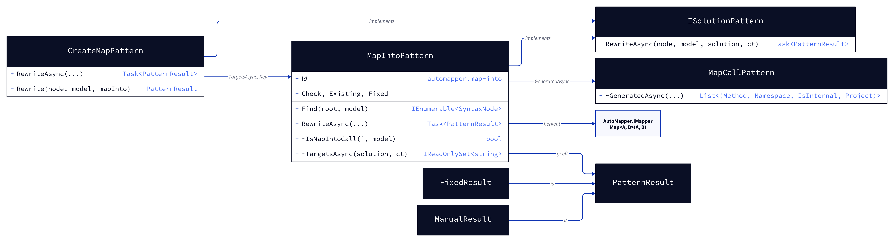
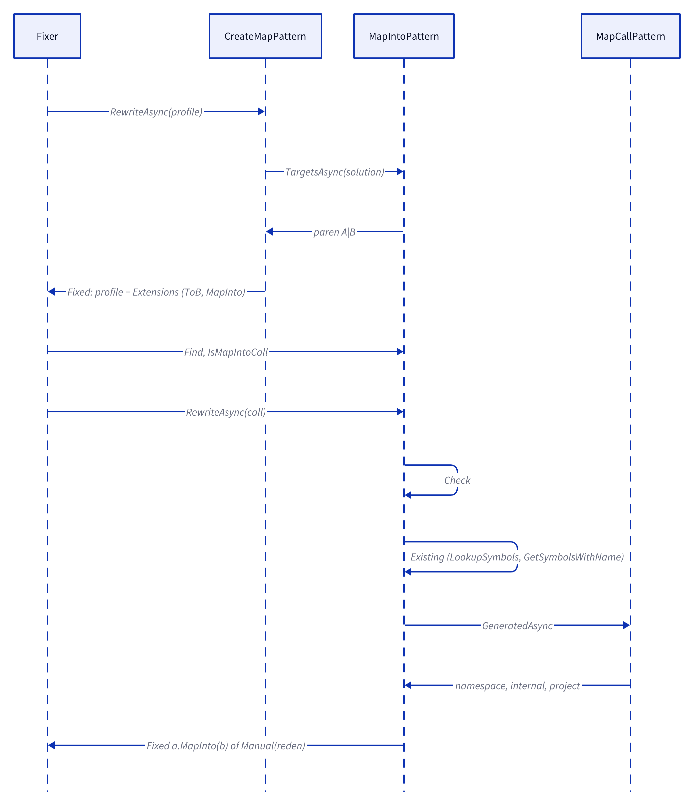
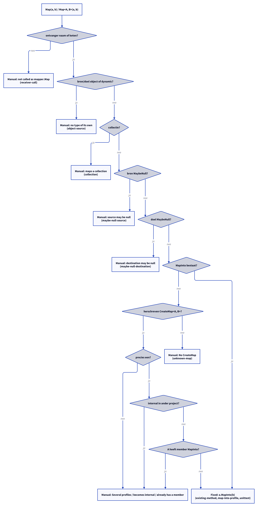

# Modellen: automapper.map-into

Feiten uit `src/Unshackle.Core/Fixes/AutoMapper/Patterns/MapIntoPattern.cs`, `CreateMapPattern.cs` en `MapCallPattern.cs`.

> De figuren zijn als D2-bron aangemaakt in `img/`; `kingmadoc`/`d2` waren in deze omgeving niet beschikbaar, dus de PNG/SVG volgen bij de eerstvolgende `kingmadoc render`.

## Figuur 1: klassen

**Figure 1.** `MapIntoPattern` en `CreateMapPattern` als `ISolutionPattern`; `MapCallPattern` levert de profile-zoektocht.

<!-- kingmadoc:diagram img/automapper-map-into-modellen-1.d2 -->

| Element            | Rol                                                                                            |
| ------------------ | ---------------------------------------------------------------------------------------------- |
| `MapIntoPattern`   | Id `automapper.map-into`; `Find` via `IsMapIntoCall`; `Rewrite` alleen met bestaande `MapInto` |
| `IsMapIntoCall`    | `Map<A, B>` van AutoMapper met twee argumenten, tweede parameter van type `B`                  |
| `TargetsAsync`     | Alle paren `A|B` (`Key`) die een `Map(a, b)` in de solution gebruikt                           |
| `CreateMapPattern` | `RewriteAsync` schrijft `MapInto` voor die paren, na de `ToB`-methoden                         |
| `GeneratedAsync`   | Uit `MapCallPattern`: profile met `CreateMap<A, B>`, namespace, internal, project              |

## Figuur 2: sequence

**Figure 2.** Profile-rewrite en aanroep-rewrite in de Fixer.

<!-- kingmadoc:diagram img/automapper-map-into-modellen-2.d2 -->

| Stap      | Methode in de code                              | Wat gebeurt er                                            |
| --------- | ----------------------------------------------- | --------------------------------------------------------- |
| Profile   | `CreateMapPattern.RewriteAsync`, `TargetsAsync` | `MapInto` erbij voor maps die `Map(a, b)` gebruikt        |
| Vinden    | `Find`, `IsMapIntoCall`                         | `Map(a, b)` van AutoMapper                                |
| Toetsen   | `Check`                                         | Ontvanger, typen, collectie, null van bron en doel        |
| Bestaand  | `Existing`                                      | `MapInto` die al bestaat (ook net gegenereerd hier)       |
| Profiles  | `MapCallPattern.GeneratedAsync`                 | Welke profile de map heeft, namespace, toegankelijkheid   |
| Schrijven | `Fixed`                                         | `a.MapInto(b)`, haakjes waar nodig, `using` indien nodig  |

## Figuur 3: beslisboom

**Figure 3.** De vragen van `RewriteAsync`.

<!-- kingmadoc:diagram img/automapper-map-into-modellen-3.d2 -->

| Blad                              | Voorwaarde                                | Bewijs                                          |
| --------------------------------- | ----------------------------------------- | ----------------------------------------------- |
| Manual "not called as mapper.Map" | ontvanger is een aanroep                  | `receiver-call`                                 |
| Manual "no type of its own"       | bron of doel `object`/`dynamic`           | `object-source`                                 |
| Manual "maps a collection"        | bron of doel collectie                    | `collection`                                    |
| Manual "source may be null"       | flow-state bron MaybeNull                 | `maybe-null-source`                             |
| Manual "destination may be null"  | flow-state doel MaybeNull                 | `maybe-null-destination`                        |
| Manual "No CreateMap"             | geen `MapInto`, geen herschreven profile  | `unknown-map`                                   |
| Manual "Several profiles" e.a.    | meerdere profiles, internal, eigen member | —                                               |
| Fixed (`a.MapInto(b)`)            | alles hierboven gehaald                   | `existing-method`, `map-into-profile`, unittest |

## Zie ook

- [automapper-map-into-plan.md](automapper-map-into-plan.md)
- [automapper-map-into-verify.md](automapper-map-into-verify.md)
- `src/Unshackle.Core/Fixes/AutoMapper/Patterns/MapIntoPattern.cs`
- `src/Unshackle.Tests/Proofs/AutoMapper/MapInto/`
