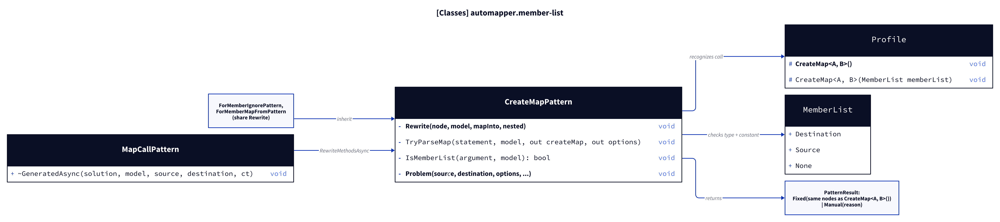
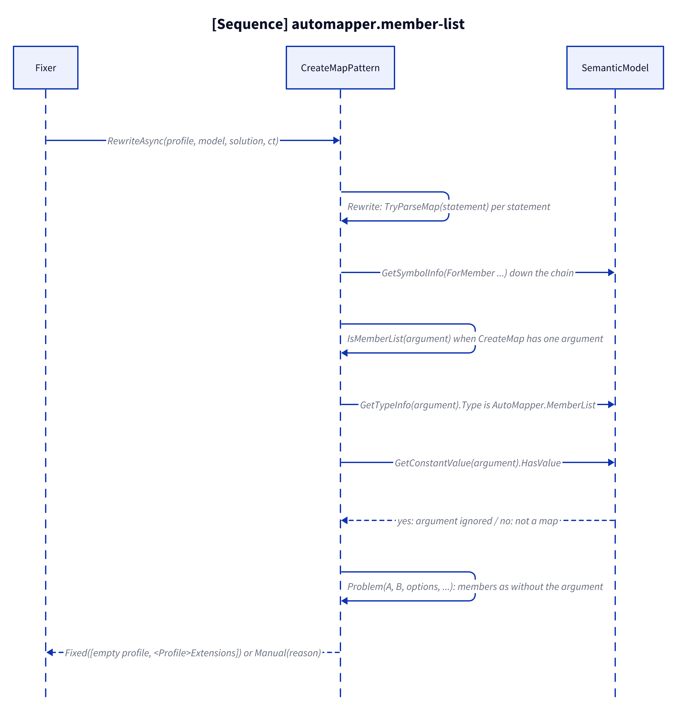
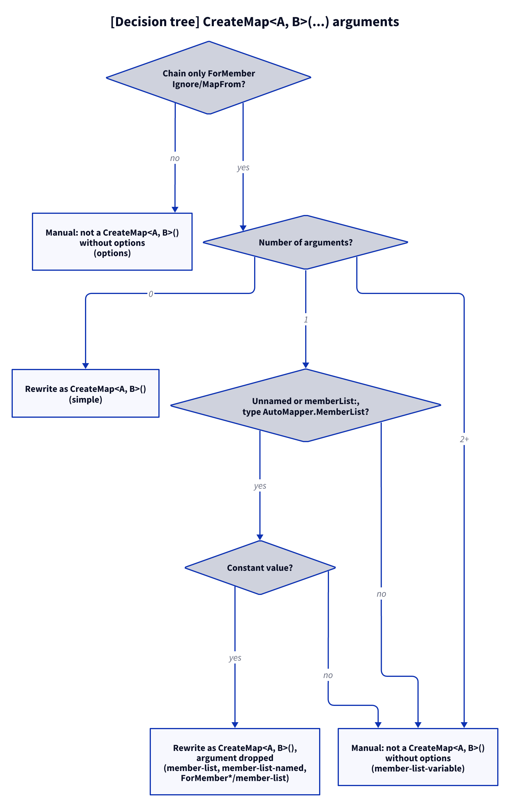

# Models: automapper.member-list

Facts from `src/Unshackle.Core/Fixes/AutoMapper/Patterns/CreateMapPattern.cs` (`TryParseMap`, `IsMemberList`).

> The figures were created as D2 sources in `img/`; `kingmadoc`/`d2` were not available in this environment, so the PNG/SVG follow with the next `kingmadoc render`.

## Figure 1: classes

**Figure 1.** `TryParseMap` asks `IsMemberList` about the only argument of `CreateMap`, and the AutoMapper types it checks.

<!-- kingmadoc:diagram img/automapper-member-list-modellen-1.d2 -->

| Element            | Role                                                                                                          |
| ------------------ | ------------------------------------------------------------------------------------------------------------- |
| `CreateMapPattern` | Shared profile rewrite; `TryParseMap` parses a `CreateMap` statement, `IsMemberList` judges its one argument   |
| `ForMemberIgnorePattern`, `ForMemberMapFromPattern` | Inherit the rewrite, so their profiles accept the member list too                  |
| `MapCallPattern`   | Gets the generated method names through `RewriteMethodsAsync`, so `Map<B>(a)` on such a map works              |
| `MemberList` (AutoMapper) | Enum `Destination`, `Source`, `None`; parameter `memberList` of `Profile.CreateMap<A, B>(MemberList)`   |
| `PatternResult`    | `Fixed` (the same nodes as without the argument) or `Manual` (the existing "not a CreateMap<A, B>() without options") |

## Figure 2: sequence

**Figure 2.** From `Fixer` to the parsed map; the argument stops at `TryParseMap`.

<!-- kingmadoc:diagram img/automapper-member-list-modellen-2.d2 -->

| Step     | Method in the code                                  | What happens                                                                 |
| -------- | --------------------------------------------------- | ---------------------------------------------------------------------------- |
| Rewrite  | `CreateMapPattern.Rewrite`                          | Per constructor statement                                                    |
| Parse    | `TryParseMap`                                       | Walks the `ForMember` chain down to the `CreateMap` invocation               |
| Argument | `IsMemberList` → `GetTypeInfo`, `GetConstantValue`  | Zero arguments, or one constant `MemberList` (positional or `memberList:`)   |
| Members  | `Problem`                                           | The same members as without the argument                                     |
| Write    | `Extensions`, `PatternResult.Fixed`                 | The argument is not written anywhere                                         |

## Figure 3: decision tree

**Figure 3.** The questions about the chain and the arguments of `CreateMap<A, B>(...)`.

<!-- kingmadoc:diagram img/automapper-member-list-modellen-3.d2 -->

| Leaf                                             | Condition                                              | Evidence                                    |
| ------------------------------------------------ | ------------------------------------------------------ | ------------------------------------------- |
| Rewrite as `CreateMap<A, B>()`                   | no argument                                            | `CreateMap/simple`                          |
| Rewrite as `CreateMap<A, B>()`, argument dropped | one constant `MemberList`, positional or `memberList:` | `CreateMap/member-list`, `CreateMap/member-list-named`, `ForMemberIgnore/member-list`, `ForMemberMapFrom/member-list`, `_Combined/member-list-map-call`, unit test `Rewrite_ConstantMemberList_SameAsWithout` |
| Manual "not a CreateMap<A, B>() without options" | a non-constant or other argument                       | `CreateMap/member-list-variable`, unit test `Rewrite_MemberListParameter_ReportsManual` |
| Manual "not a CreateMap<A, B>() without options" | another option in the chain (`MaxDepth`, ...; `ReverseMap` is rewritten since TAAK-249) | `CreateMap/options` |

## See also

- [automapper-member-list-plan.md](automapper-member-list-plan.md)
- [automapper-member-list-verify.md](automapper-member-list-verify.md)
- [automapper-create-map-modellen.md](automapper-create-map-modellen.md)
- `src/Unshackle.Core/Fixes/AutoMapper/Patterns/CreateMapPattern.cs`
- `src/Unshackle.Tests/Proofs/AutoMapper/CreateMap/`
