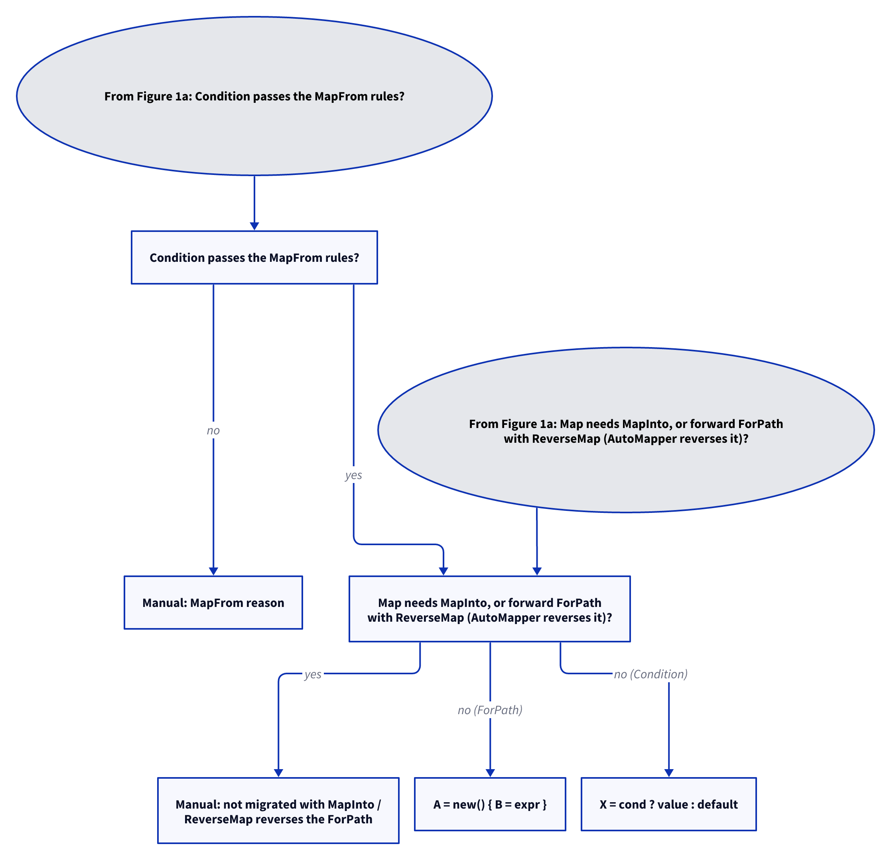

# Models: automapper.member-options

Facts from `src/Unshackle.Core/Fixes/AutoMapper/Patterns/MemberOptions.cs` (`TryParse`) and `CreateMapPattern.cs` (`TryParseOptions`, `Rewrite`, `Problem`, `PathProblem`, `ConditionProblem`, `KeepsDefault`).

## Figure 1: decision tree

**Figure 1a.** The questions for one `Condition`, `PreCondition` or `ForPath` option of a `CreateMap<A, B>`. Split into Figures 1a–1b (at most 12 arrows each).

<!-- kingmadoc:diagram img/automapper-member-options-modellen-1.d2 -->

**Figure 1b.** Continuation of Figure 1a from its "Continued in Figure 1b" node.

<!-- kingmadoc:diagram img/automapper-member-options-modellen-2.d2 -->

| Step       | Method in the code                     | What happens | Proof |
| ---------- | -------------------------------------- | ------------ | ----- |
| Parse      | `MemberOptions.TryParse`               | Condition/PreCondition with a source lambda, MapFrom, ForPath of one or two members; other options set `Unsupported` | `CreateMap/null-substitute`, `CreateMap/condition-destination`, `CreateMap/for-path-deep` |
| ForPath    | `CreateMapProblems.PathProblem`         | `A = new() { B = expr }` when `A` is settable, a class with `new()`, and not mapped itself | `CreateMap/for-path`, `CreateMap/for-path-member` |
| Condition  | `CreateMapProblems.ConditionProblem`, `KeepsDefault` | The member keeps `default` on a new object, the condition passes `MapFromProblem` | `CreateMap/condition`, `CreateMap/condition-map-from`, `CreateMap/pre-condition`, `CreateMap/condition-initializer` |
| Guard      | `CreateMapPattern.Rewrite`, `Reverse` | With MapInto (forward or reverse map), or a forward ForPath with ReverseMap: Manual; a Condition or ForPath on the reverse map goes through the same `Problem` with the reverse destination (TAAK-264) | `CreateMap/forward-for-path-reverse-map`, `CreateMap/reverse-condition`, unit tests |
| Map call   | `MapCallPattern`                       | `Map<B>(a)` → `a.ToB()` | `_Combined/condition-map-call` |

## See also

- [automapper-member-options-plan.md](automapper-member-options-plan.md)
- [automapper-member-options-verify.md](automapper-member-options-verify.md)
- `src/Unshackle.Core/Fixes/AutoMapper/Patterns/MemberOptions.cs`
- `src/Unshackle.Tests/Proofs/AutoMapper/CreateMap/`
