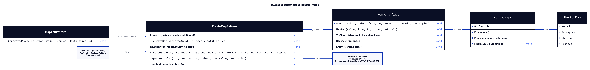
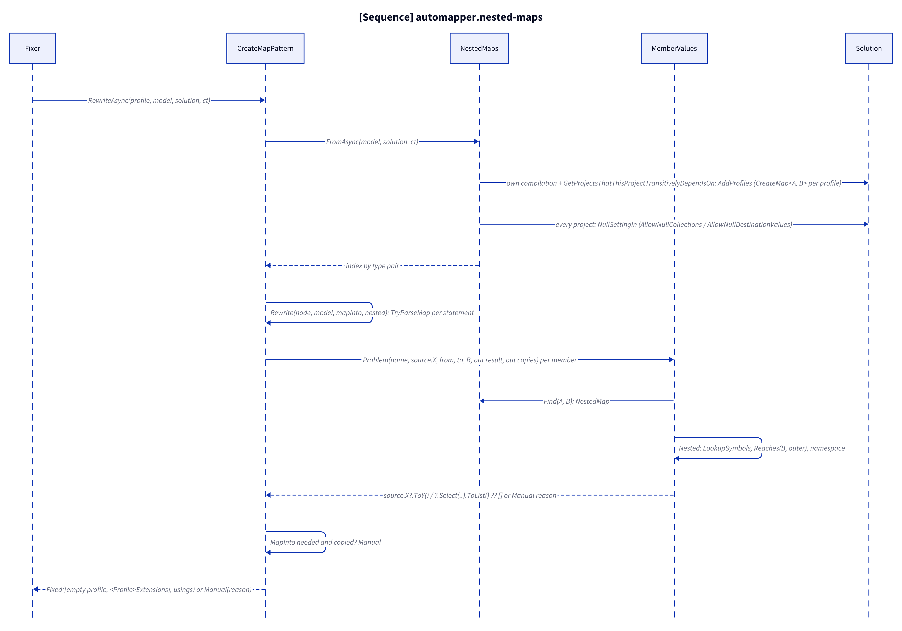
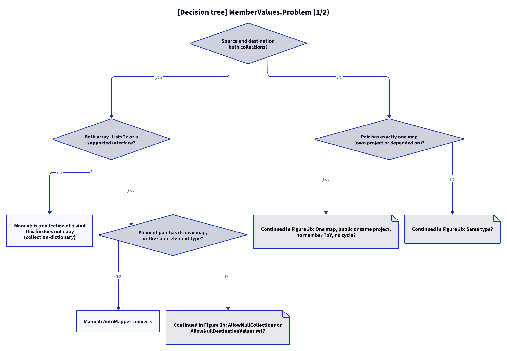

# Models: automapper.nested-maps

Facts from `src/Unshackle.Core/Fixes/AutoMapper/Patterns/CreateMapPattern.cs`, `MemberValues.cs`, `NestedMaps.cs`, `NestedMap.cs` and `MapCallPattern.cs`.

> The figures were created as D2 sources in `img/`; `kingmadoc`/`d2` were not available in this environment, so the PNG/SVG follow with the next `kingmadoc render`.

## Figure 1: classes

**Figure 1.** The profile rewrite asks `MemberValues` per member; `MemberValues` looks the type pair up in `NestedMaps`.

<!-- kingmadoc:diagram img/automapper-nested-maps-modellen-1.d2 -->

| Element            | Role                                                                                                                         |
| ------------------ | ---------------------------------------------------------------------------------------------------------------------------- |
| `CreateMapPattern` | Shared rewrite of the three profile patterns; builds `NestedMaps` (with the solution in `RewriteAsync`) and one `MemberValues` per profile |
| `MemberValues`     | `Problem`: the assigned expression for a member (nested call, collection copy, plain copy) or a Manual reason; collects usings |
| `NestedMaps`       | Index of every `CreateMap<A, B>` of the profiles by fully qualified type pair; `NullSetting` where a null setting is assigned |
| `NestedMap`        | One map: method name (`CreateMapPattern.MethodName`), namespace, internal class, project (null: the profile's own)          |
| `MapCallPattern`   | `GeneratedAsync` rewrites profiles through `RewriteMethodsAsync`, so a map with a nested map in another project is found     |

## Figure 2: sequence

**Figure 2.** From `Fixer` via the index and the member values to `Fixed` or `Manual`.

<!-- kingmadoc:diagram img/automapper-nested-maps-modellen-2.d2 -->

| Step     | Method in the code                                      | What happens                                                                |
| -------- | ------------------------------------------------------- | --------------------------------------------------------------------------- |
| Index    | `NestedMaps.FromAsync`, `AddCompilation`, `AddProfiles` | Maps of the own project, projects depended on, and rewritten `<Profile>Extensions` in the same file |
| Settings | `NestedMaps.NullSettingIn`                              | An assignment to `AllowNullCollections`/`AllowNullDestinationValues` anywhere in the solution |
| Member   | `CreateMapPattern.Problem`/`MapFromProblem` → `MemberValues.Problem` | The value per destination member                               |
| Nested   | `MemberValues.Nested`, `LookupSymbols`, `Reaches`       | One map, callable, no member of that name, no cycle; the using it needs     |
| MapInto  | `CreateMapPattern.Rewrite`                              | A map with a copied member that needs `MapInto` is Manual                    |
| Write    | `Extensions`, `PatternResult.Fixed(nodes, namespaces)`  | `System.Linq` and the other profile's namespace as required usings          |

## Figure 3: decision tree

**Figure 3.** The questions of `MemberValues.Problem` for one member.

<!-- kingmadoc:diagram img/automapper-nested-maps-modellen-3.d2 -->

| Leaf                                         | Condition                                                          | Evidence                                    |
| -------------------------------------------- | ------------------------------------------------------------------ | ------------------------------------------- |
| Manual "is a collection of a kind"           | dictionary, set, own collection type                               | `CreateMap/collection-dictionary`           |
| Manual "AutoMapper converts"                 | element or member pair without a map and not the same type         | `CreateMap/nested-no-map`, `CreateMap/conversion-operator` (built-in conversions: [automapper-conversions-modellen.md](automapper-conversions-modellen.md)) |
| Manual "several profiles" / "internal" / "a cycle" | more than one map, internal class in another project, destination type reaches the outer one | `CreateMap/nested-several`, `CreateMap/nested-cycle`, unit test `FixAsync_NestedMapInternalInOtherProject_ReportsManual` |
| Manual "null handling"                       | `AllowNullCollections`/`AllowNullDestinationValues` assigned        | unit test `Rewrite_AllowNullCollectionsConfigured_ReportsManual` |
| Manual "MapInto would replace it"            | the map also needs `MapInto`                                        | unit test `FixAsync_MapIntoWithNestedMember_ReportsManual` |
| Fixed collection copy                        | supported collection kinds, mapped or same elements                | `CreateMap/nested-collections`, `CreateMap/collection`, `ForMemberMapFrom/collection`, `ForMemberMapFrom/nested` |
| Fixed nested call                            | one usable map                                                     | `CreateMap/nested`, `nested-nullable`, `nested-same-type`, `nested-other-profile`, `_Combined/nested-*` |
| Fixed `X = source.X`                         | same type, no map                                                  | `CreateMap/simple`                          |

## See also

- [automapper-nested-maps-plan.md](automapper-nested-maps-plan.md)
- [automapper-nested-maps-verify.md](automapper-nested-maps-verify.md)
- [automapper-create-map-modellen.md](automapper-create-map-modellen.md)
- `src/Unshackle.Core/Fixes/AutoMapper/Patterns/MemberValues.cs`
- `src/Unshackle.Tests/Proofs/AutoMapper/CreateMap/`
