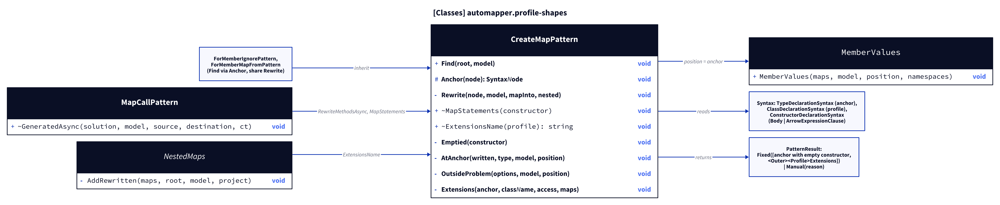
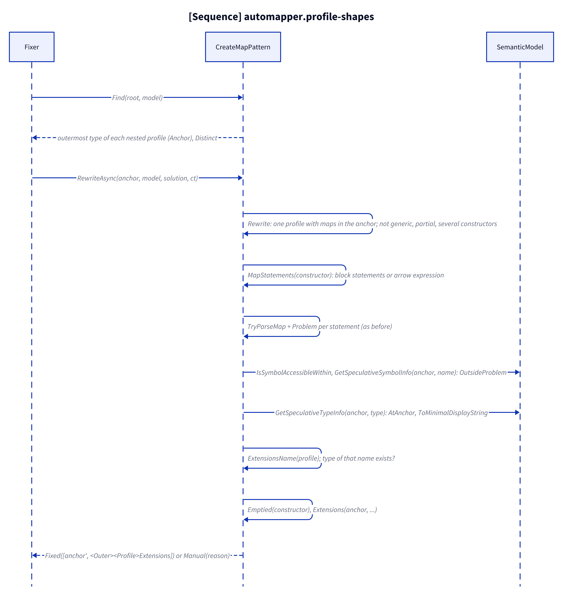
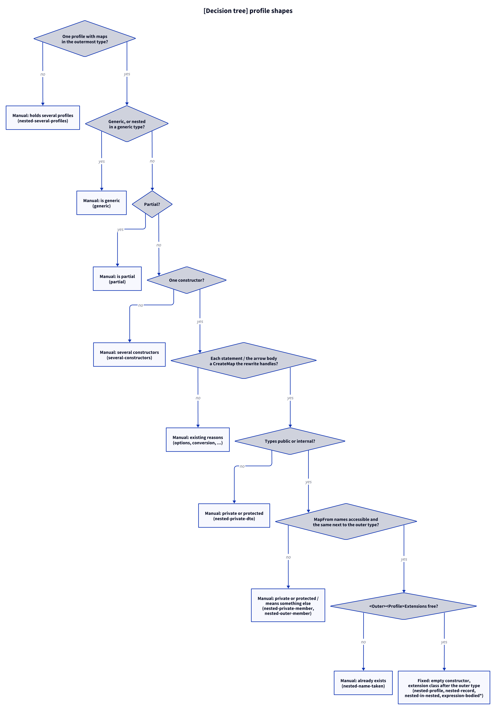

# Models: automapper.profile-shapes

Facts from `src/Unshackle.Core/Fixes/AutoMapper/Patterns/CreateMapPattern.cs` (`Find`, `Anchor`, `Rewrite`, `MapStatements`, `ExtensionsName`, `Emptied`, `AtAnchor`, `OutsideProblem`, `Extensions`), `ForMemberIgnorePattern.cs`, `ForMemberMapFromPattern.cs`, `MapCallPattern.cs` (`GeneratedAsync`) and `NestedMaps.cs` (`AddRewritten`).

## Figure 1: classes

**Figure 1.** The profile rewrite and the helpers that make a nested or expression-bodied profile fit it.

<!-- kingmadoc:diagram img/automapper-profile-shapes-modellen-1.d2 -->

| Element            | Role                                                                                                                       |
| ------------------ | -------------------------------------------------------------------------------------------------------------------------- |
| `CreateMapPattern` | `Find` maps a profile to its outermost type (`Anchor`); `Rewrite` checks the shape, binds names at the anchor and writes the class after it |
| `ForMemberIgnorePattern`, `ForMemberMapFromPattern` | Their `Find` also goes through `Anchor`; they share `Rewrite`                                 |
| `MapCallPattern`   | `GeneratedAsync` accepts any first node and pairs methods with `MapStatements`, so `Map` calls find nested and arrow-bodied profiles |
| `NestedMaps`       | `AddRewritten` recognises an earlier rewrite by `ExtensionsName` (`<Outer><Profile>Extensions`)                              |
| `MemberValues`     | Gets the anchor as position: usings and type names as the extension class needs them                                       |
| `PatternResult`    | `Fixed([outermost type with the emptied constructor, extension class])` or `Manual(reason)`                                |

## Figure 2: sequence

**Figure 2.** From `Find` via the shape checks and the binding at the anchor to `Fixed` or `Manual`.

<!-- kingmadoc:diagram img/automapper-profile-shapes-modellen-2.d2 -->

| Step     | Method in the code                                         | What happens                                                                          |
| -------- | ---------------------------------------------------------- | ------------------------------------------------------------------------------------- |
| Find     | `Find`, `Anchor`                                           | A nested profile is reported as its outermost type, once                              |
| Shape    | `Rewrite`                                                  | One profile with maps in the anchor; not generic, partial or with several constructors |
| Body     | `MapStatements`, `TryParseMap`                             | The block's statements or the arrow's expression                                      |
| Names    | `OutsideProblem` → `IsSymbolAccessibleWithin`, `GetSpeculativeSymbolInfo` | `MapFrom` names reachable from the extension class                       |
| Types    | `AtAnchor` → `GetSpeculativeTypeInfo`, `ToMinimalDisplayString` | `Command` becomes `AddNote.Command` when needed; Manual when the method name would change |
| Write    | `ExtensionsName`, `Emptied`, `Extensions`                  | Name free?; empty block (also for `=>`); class after the anchor with its indentation   |

## Figure 3: decision tree

**Figure 3.** The shape questions of `Rewrite`; the questions per map are those of the other `automapper-*` models.

<!-- kingmadoc:diagram img/automapper-profile-shapes-modellen-3.d2 -->

| Leaf                                    | Condition                                                       | Evidence                                    |
| --------------------------------------- | --------------------------------------------------------------- | ------------------------------------------- |
| Manual "holds several profiles"         | two or more profiles with maps in one outermost type            | `CreateMap/nested-several-profiles`          |
| Manual "is generic or nested in a generic type" | type parameters on the profile or a containing type      | `CreateMap/generic`                          |
| Manual "is partial"                     | `partial` profile                                               | `CreateMap/partial`                          |
| Manual "has several constructors"       | more than one constructor (static included)                     | `CreateMap/several-constructors`             |
| Manual "is private or protected"        | a mapped type is not reachable from a top-level class           | `CreateMap/nested-private-dto`               |
| Manual "MapFrom ... private or protected" / "means something else" | a `MapFrom` name the extension class cannot use | `ForMemberMapFrom/nested-private-member`, `ForMemberMapFrom/nested-outer-member` |
| Manual "already exists"                 | a type `<Outer><Profile>Extensions` exists                       | `CreateMap/nested-name-taken`                |
| Fixed                                   | all of the above pass                                           | `CreateMap/nested-profile`, `nested-record`, `nested-in-nested`, `expression-bodied`, `expression-bodied-base`, `member-list-nested-profile`, `ForMemberIgnore/nested-profile`, `ForMemberMapFrom/nested-profile`, `_Combined/nested-profile-map-call`, `_Combined/nested-profiles-nested-map`, unit tests in `ProfileShapesTests` |

## See also

- [automapper-profile-shapes-plan.md](automapper-profile-shapes-plan.md)
- [automapper-profile-shapes-verify.md](automapper-profile-shapes-verify.md)
- [automapper-create-map-modellen.md](automapper-create-map-modellen.md)
- `src/Unshackle.Core/Fixes/AutoMapper/Patterns/CreateMapPattern.cs`
- `src/Unshackle.Tests/Proofs/AutoMapper/CreateMap/`
