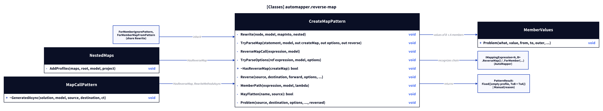
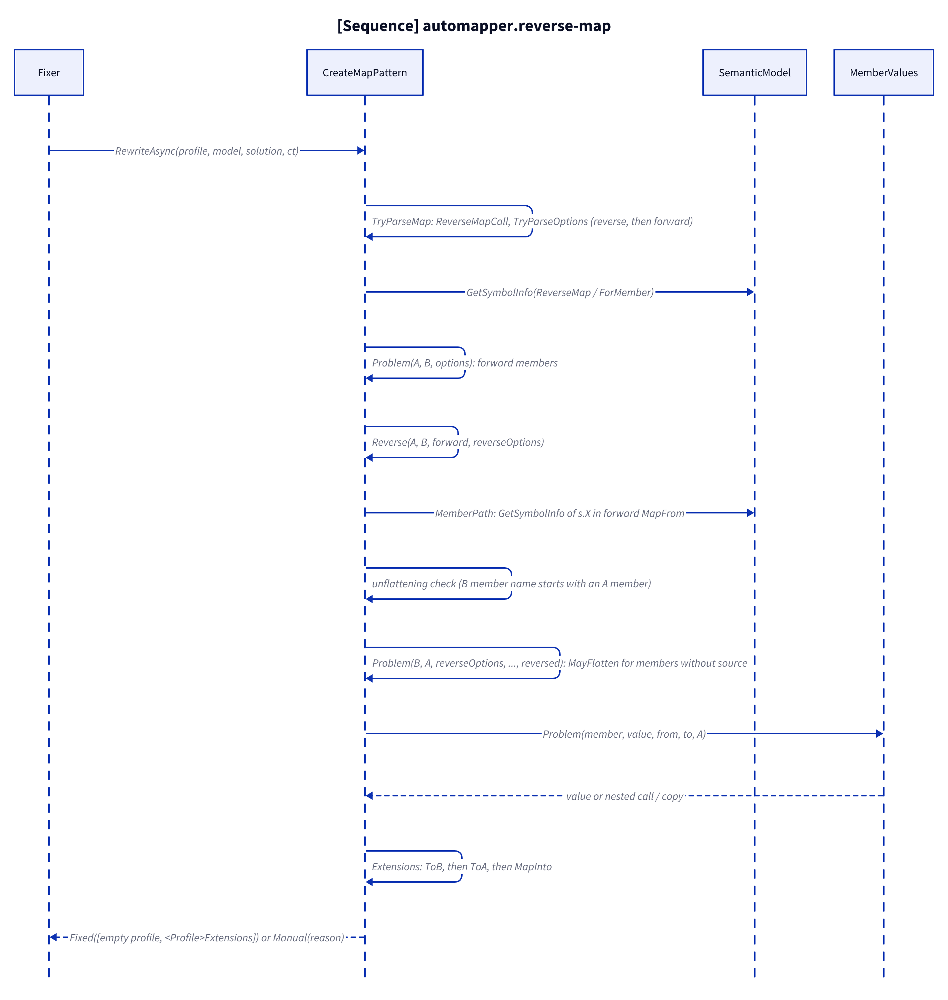
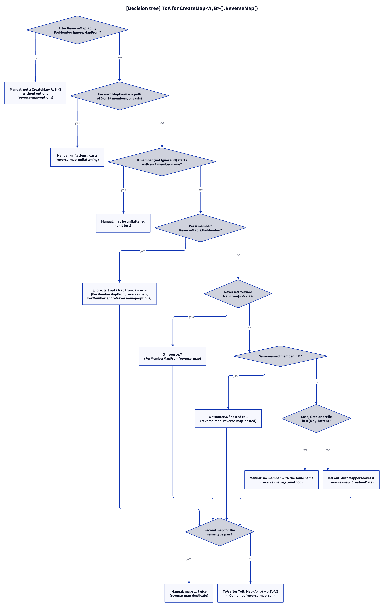

# Models: automapper.reverse-map

Facts from `src/Unshackle.Core/Fixes/AutoMapper/Patterns/CreateMapPattern.cs` (`TryParseMap`, `ReverseMapCall`, `TryParseOptions`, `HasReverseMap`, `Reverse`, `MemberPath`, `Unwrap`, `MayFlatten`, `Problem`), `NestedMaps.cs` (`AddProfiles`) and `MapCallPattern.cs` (`GeneratedAsync`).

> The figures were created as D2 sources in `img/`; `kingmadoc`/`d2` were not available in this environment, so the PNG/SVG follow with the next `kingmadoc render`.

## Figure 1: classes

**Figure 1.** The shared profile rewrite with its reverse-map methods, and the two classes that count the generated methods.

<!-- kingmadoc:diagram img/automapper-reverse-map-modellen-1.d2 -->

| Element            | Role                                                                                                          |
| ------------------ | ------------------------------------------------------------------------------------------------------------- |
| `CreateMapPattern` | `TryParseMap` splits the chain at `ReverseMap()`; `Reverse` builds the `B → A` members; `Problem` writes them  |
| `ForMemberIgnorePattern`, `ForMemberMapFromPattern` | Inherit the rewrite, so their profiles get `ToA` too                              |
| `NestedMaps`       | `AddProfiles` registers `B → A` for a `CreateMap` with `HasReverseMap`, so a member can call `ToA`            |
| `MapCallPattern`   | `GeneratedAsync` counts a reverse method after its forward one, so `Map<A>(b)` finds `ToA`                     |
| `MemberValues`     | Same values as forward: plain copy, nested call, list copy                                                     |
| `PatternResult`    | `Fixed` (emptied profile + extensions class with `ToB` and `ToA`) or `Manual(reason)`                          |

## Figure 2: sequence

**Figure 2.** From `Fixer` to `ToA`.

<!-- kingmadoc:diagram img/automapper-reverse-map-modellen-2.d2 -->

| Step       | Method in the code                     | What happens                                                                         |
| ---------- | -------------------------------------- | ------------------------------------------------------------------------------------ |
| Parse      | `TryParseMap`, `ReverseMapCall`, `TryParseOptions` | Options outside `ReverseMap()` → reverse, inside → forward                   |
| Forward    | `Problem(A, B, options, ...)`          | Unchanged                                                                            |
| Reverse    | `Reverse` → `MemberPath`, `Unwrap`     | Forward `MapFrom(s => s.X)` for `Y` becomes `X ← Y`; other paths Manual              |
| Unflatten  | `Reverse`                              | A `B` member (not `Ignore()`d) starting with an `A` member name → Manual             |
| Members    | `Problem(B, A, reverseOptions, ..., reversed)`, `MayFlatten` | Reverse options, reversed `MapFrom`, same name, else left out or Manual |
| Write      | `Extensions`                           | `ToA` right after `ToB`; `MapInto(this B, A)` when a `Map(b, a)` call uses it        |

## Figure 3: decision tree

**Figure 3.** The questions `Rewrite` asks for a `ReverseMap()`, with the evidence of each leaf.

<!-- kingmadoc:diagram img/automapper-reverse-map-modellen-3.d2 -->

| Leaf                                         | Condition                                                         | Evidence                                    |
| -------------------------------------------- | ----------------------------------------------------------------- | ------------------------------------------- |
| Manual "not a CreateMap<A, B>() without options" | another option after `ReverseMap()` (`ForPath`, ...)          | `CreateMap/reverse-map-options`             |
| Manual "unflattens" / "maps the whole" / "casts" / "both read" | forward `MapFrom` path of 2+ or 0 members, a cast, a member read twice | `ForMemberMapFrom/reverse-map-unflattening`, unit test `Rewrite_ReverseMapAutoMapperDoesMoreFor_ReportsManual` |
| Manual "may be unflattened"                  | a `B` member, not `Ignore()`d, starting with an `A` member name   | unit test `Rewrite_ReverseMapAutoMapperDoesMoreFor_ReportsManual` |
| Reverse option                               | `ReverseMap().ForMember(... Ignore()/MapFrom(...))`               | `ForMemberMapFrom/reverse-map`, `ForMemberIgnore/reverse-map-options`, unit test `Rewrite_ReverseOptionAndReversedMapFrom_OptionWins`; `ForMemberMapFrom/reverse-map-null-deref` (Manual) |
| `X = source.Y`                               | forward `ForMember(d => d.Y, o => o.MapFrom(s => s.X))`           | `ForMemberMapFrom/reverse-map`              |
| Same-named member                            | as a forward map (forward `Ignore()` does not count)              | `CreateMap/reverse-map`, `CreateMap/reverse-map-nested`, `ForMemberIgnore/reverse-map`, `CreateMap/member-list-reverse-map` |
| Manual "no member with the same name"        | other case, `GetX` member/method, flattening prefix in `B`         | `CreateMap/reverse-map-get-method`          |
| Left out                                     | nothing in `B` AutoMapper could map from                          | `CreateMap/reverse-map` (`CreationDate`), `_Combined/reverse-map-call` (`CreatedBy`) |
| Manual "maps ... twice"                      | the profile also has `CreateMap<B, A>`                            | `CreateMap/reverse-map-duplicate`           |
| `b.ToA()`, `b.MapInto(a)`                    | a `Map<A>(b)` / `Map(b, a)` call                                  | `_Combined/reverse-map-call`, unit test `FixAsync_ReverseMapInOtherFile_CallsReverseMethod` |

## See also

- [automapper-reverse-map-plan.md](automapper-reverse-map-plan.md)
- [automapper-reverse-map-verify.md](automapper-reverse-map-verify.md)
- [automapper-nested-maps-modellen.md](automapper-nested-maps-modellen.md)
- `src/Unshackle.Core/Fixes/AutoMapper/Patterns/CreateMapPattern.cs`
- `src/Unshackle.Tests/Proofs/AutoMapper/CreateMap/`
