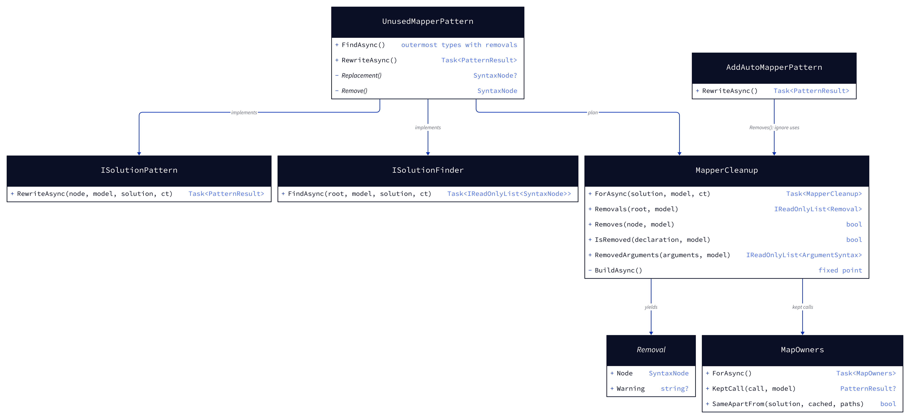
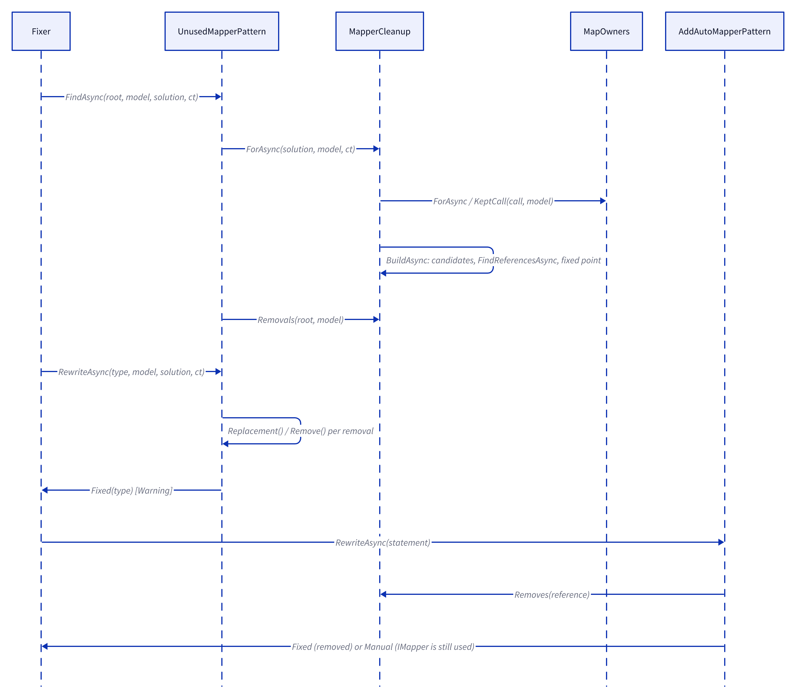
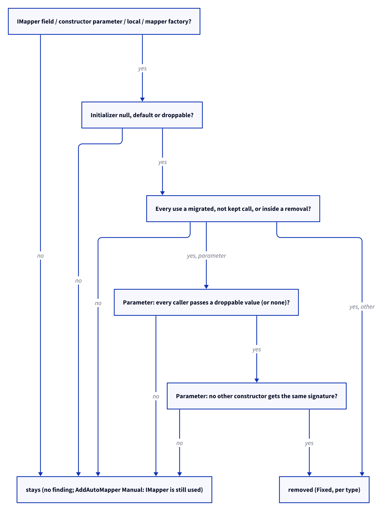

# Models: automapper.unused-imapper

Facts from `src/Unshackle.Core/Fixes/AutoMapper/Patterns/UnusedMapperPattern.cs`, `MapperCleanup.cs` and `AddAutoMapperPattern.cs`.

## Figure 1: class diagram

<!-- kingmadoc:diagram img/automapper-unused-imapper-modellen-1.d2 -->

| Element                | Role                                                                                           |
| ---------------------- | ---------------------------------------------------------------------------------------------- |
| `UnusedMapperPattern`  | finds the types with removals and rewrites each in one go                                      |
| `MapperCleanup`        | the solution-wide plan: which IMapper symbols go, and which nodes that removes                 |
| `Removal`              | one node to remove or trim, with an optional warning (dropped null check on a DI lookup)       |
| `MapOwners`            | tells which Map calls stay on AutoMapper (`KeptCall`); its cache check is shared               |
| `AddAutoMapperPattern` | skips an IMapper reference that lies inside a removal                                          |

## Figure 2: sequence

<!-- kingmadoc:diagram img/automapper-unused-imapper-modellen-2.d2 -->

## Figure 3: decision tree (per candidate, per round of the fixed point)

<!-- kingmadoc:diagram img/automapper-unused-imapper-modellen-3.d2 -->

| Question                         | Leaf                     | Proof / test                                                                 |
| -------------------------------- | ------------------------ | ---------------------------------------------------------------------------- |
| only assigned                    | removed                  | `assigned-only`                                                              |
| uses are migrated calls          | removed, registration too | `_Combined/unused-imapper-registration`                                     |
| caller passes a factory value    | removed with factory     | `test-factory`                                                               |
| null checks on the parameter     | removed                  | `null-checks`                                                                |
| DI lookup with `== null` check   | removed, with a warning  | `service-lookup`                                                             |
| handed out, `null` passed, clash | stays                    | `FixAsync_MapperUsedOtherwise_KeepsItAndTheRegistration`                     |
| lookup without AddAutoMapper     | stays                    | `FixAsync_ServiceLookupNotRegisteredByAddAutoMapperOrNotANullCheck_KeepsTheLookup` |

## See also

- [plan](automapper-unused-imapper-plan.md), [verify](automapper-unused-imapper-verify.md),
  `src/Unshackle.Core/Fixes/AutoMapper/Patterns/UnusedMapperPattern.cs`, `src/Unshackle.Tests/Proofs/AutoMapper/UnusedMapper/`
