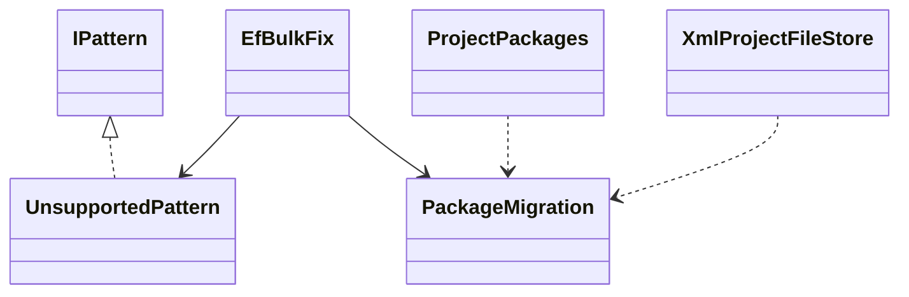
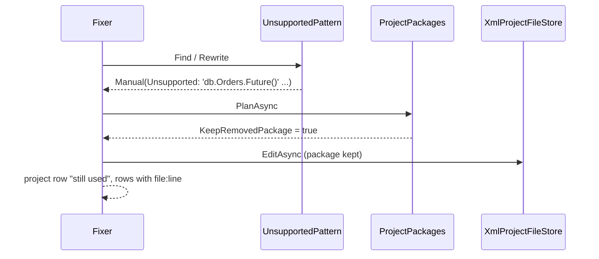
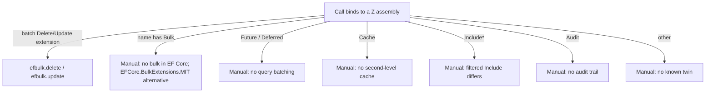

# Models: efbulk.unsupported

Facts from `src/Unshackle.Core/Fixes/EfBulk/Patterns/UnsupportedPattern.cs`, `EfBulkFix.Package` and `XmlProjectFileStore.EditAsync`.

## Figure 1: classes

**Figure 1.** The pattern, the fix's package migration and the engine path that applies it.

| Element | Role |
| --- | --- |
| `UnsupportedPattern` | Finds Z calls/constructors other than the batch extensions; always `Manual(Unsupported, reason)` |
| `EfBulkFix.Package` | Remove Plus, also remove Extensions, add nothing |
| `ProjectPackages` | Keeps the package for any bound Z symbol, also for referenced projects of a keeping project |
| `XmlProjectFileStore` | With no added package, removes `RemovedPackage` like an also-removed one |

## Figure 2: sequence

**Figure 2.** One run on a project with a `Future` call left.

## Figure 3: decision tree

**Figure 3.** Reason per call.

## See also

- [efbulk-unsupported-plan.md](efbulk-unsupported-plan.md)
- [efbulk-unsupported-verify.md](efbulk-unsupported-verify.md)