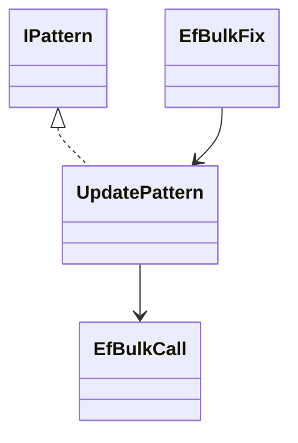
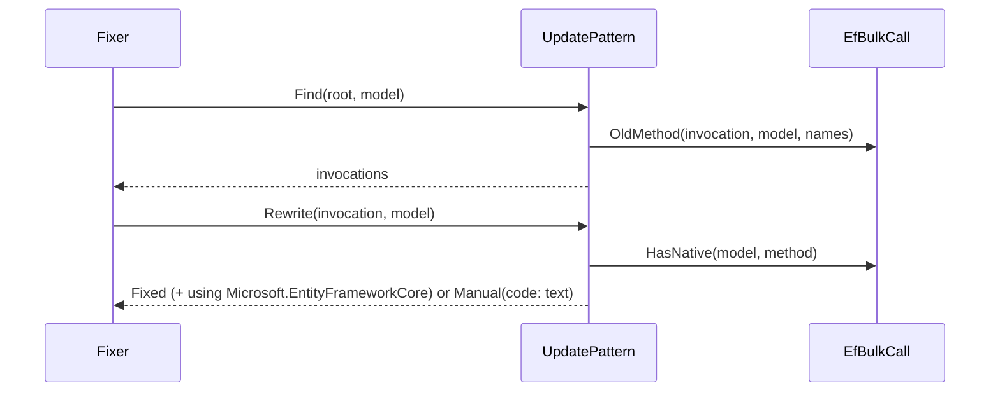
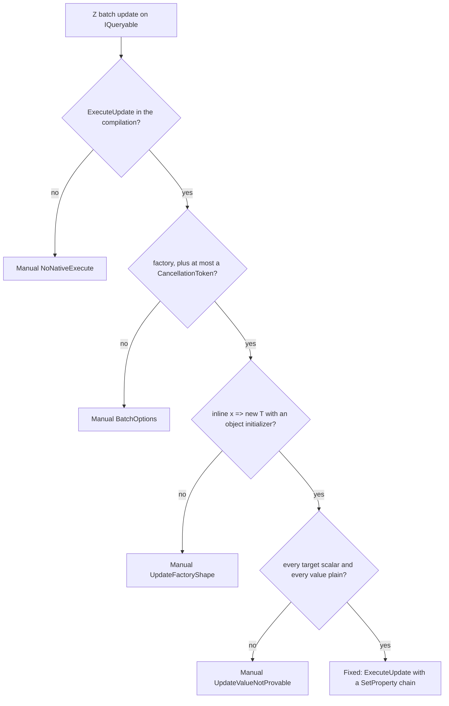

# Models: efbulk.update

Facts from `src/Unshackle.Core/Fixes/EfBulk/Patterns/UpdatePattern.cs` and `src/Unshackle.Core/Fixes/EfBulk/EfBulkCall.cs`.

## Figure 1: classes

**Figure 1.** The pattern and the helper it uses.

| Element | Role |
| --- | --- |
| `UpdatePattern` | `Find` selects the Z calls, `Rewrite` returns `Fixed` or `Manual(code, reason)` |
| `EfBulkCall` | Assembly-based match (`OldMethod`), EF version guard (`HasNative`), token check, rename |

## Figure 2: sequence

**Figure 2.** The flow the Fixer drives.

## Figure 3: decision tree

**Figure 3.** What `Rewrite` asks.

| Leaf | Proof |
| --- | --- |
| Fixed | `plus-initializer`, `extensions-async` |
| Manual `UpdateFactoryShape` | `factory-variable` |
| Manual `UpdateValueNotProvable` | `method-call`, `navigation` |

## See also

- [efbulk-update-plan.md](efbulk-update-plan.md)
- [efbulk-update-verify.md](efbulk-update-verify.md)
