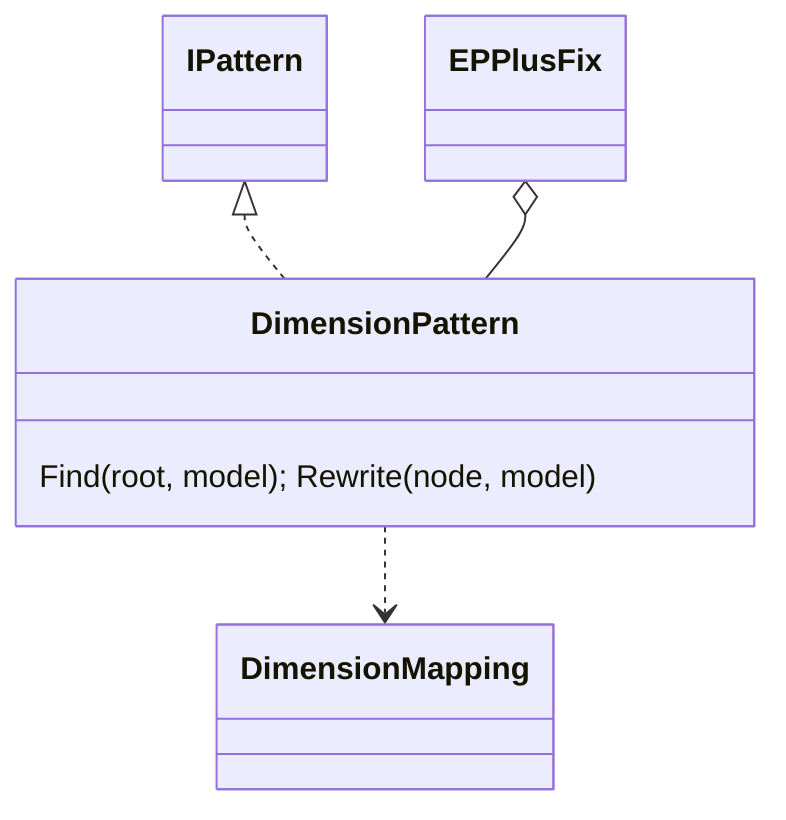

# Models: epplus.dimension

Facts from `src/Unshackle.Core/Fixes/EPPlus/Patterns/DimensionPattern.cs`, `src/Unshackle.Core/Fixes/EPPlus/Patterns/DimensionMapping.cs`, `src/Unshackle.Tests/Core/EPPlus/DimensionHarnessTests.cs`.

## Figure 1: class diagram



## Figure 2: sequence (harness case)

```mermaid
sequenceDiagram
    DimensionHarnessTests->>Fixer: EPPlus program, DimensionPattern only
    Fixer->>DimensionPattern: Find; Rewrite each node
    DimensionPattern-->>Fixer: Fixed(ClosedXML code) or Manual(reason)
    DimensionHarnessTests->>DimensionHarnessTests: translate scaffold (other rows)
    DimensionHarnessTests->>CellCompare: Differences(before, after) == []
    DimensionHarnessTests->>CellCompare: Differences(before, wrong after) != []
```

## Figure 3: decision tree

```mermaid
flowchart TD
    A[S.Dimension on an EPPlus sheet] --> B{.End/.Start then .Row/.Column?}
    B -- yes, plain --> F1[Fixed: S.LastRowUsed().RowNumber() ...]
    B -- yes, ?. --> F2[Fixed: S.LastRowUsed()?.RowNumber() ... null kept]
    B -- no --> M[Manual UnmappedDimension]
```

## See also

- [plan](epplus-dimension-plan.md), [verify](epplus-dimension-verify.md)
