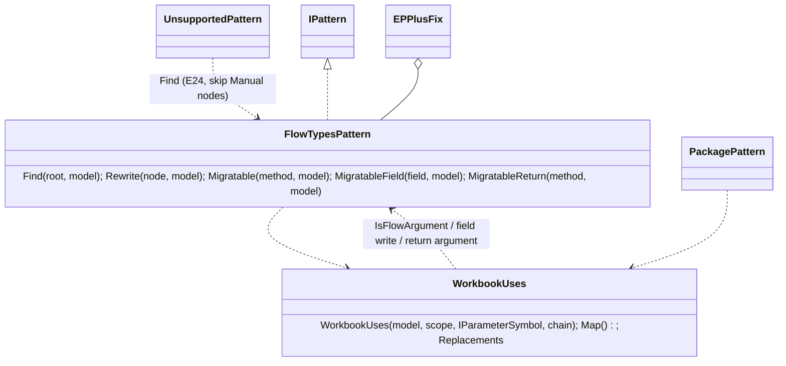
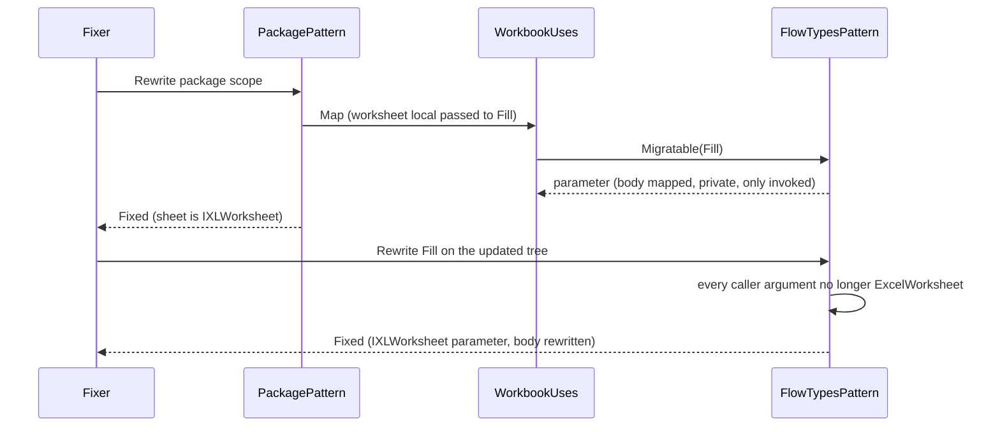
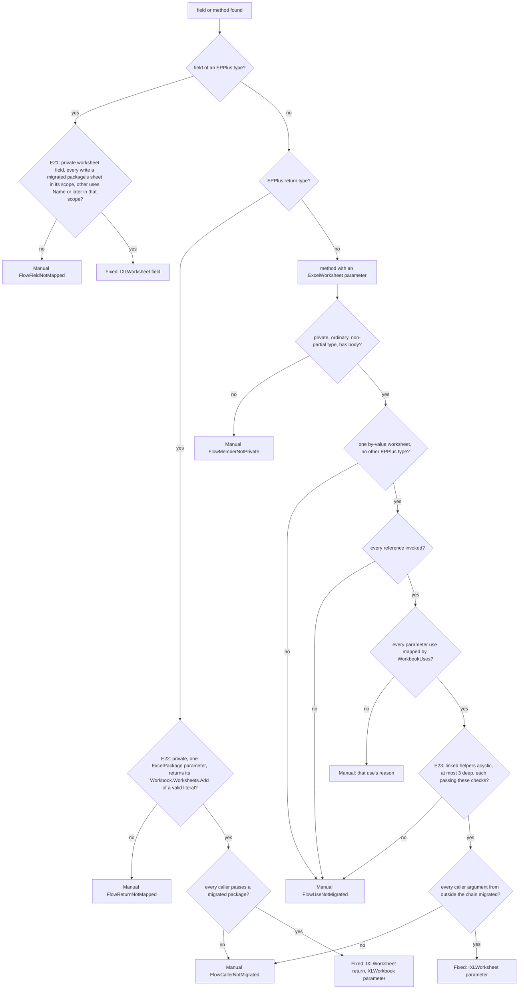

# Models: epplus.flow-types

Facts from `src/Unshackle.Core/Fixes/EPPlus/Patterns/FlowTypesPattern.cs` and `src/Unshackle.Core/Fixes/EPPlus/Patterns/WorkbookUses.cs`.

## Figure 1: class diagram

## Figure 2: sequence (full fix)

## Figure 3: decision tree

## See also

- [plan](epplus-flow-types-plan.md), [verify](epplus-flow-types-verify.md)
