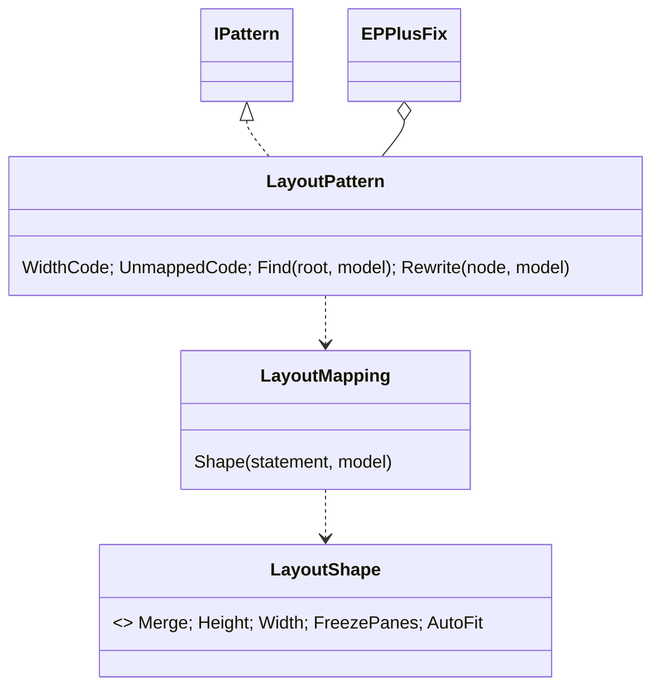

# Models: epplus.layout

Facts from `src/Unshackle.Core/Fixes/EPPlus/Patterns/LayoutPattern.cs`, `LayoutMapping.cs`, `LayoutShape.cs` and
`src/Unshackle.Tests/Core/EPPlus/LayoutHarnessTests.cs`.

## Figure 1: class diagram



## Figure 2: sequence (harness case)

```mermaid
sequenceDiagram
    LayoutHarnessTests->>Fixer: EPPlus program, LayoutPattern only
    Fixer->>LayoutPattern: Find → layout statements; Rewrite each
    LayoutPattern-->>Fixer: Fixed(ClosedXML statement)
    LayoutHarnessTests->>LayoutHarnessTests: translate scaffold (rows 2-4)
    LayoutHarnessTests->>CellCompare: snapshot differences + freeze/height facts == []
    LayoutHarnessTests->>CellCompare: wrong variant != []
```

## Figure 3: decision tree

```mermaid
flowchart TD
    A[statement on an EPPlus range/row/column/view] --> B{shape}
    B -- Merge --> C{= true?}
    C -- yes --> F1[Fixed: R.Merge()]
    C -- no --> MU[Manual UnmappedEPPlusLayout]
    B -- FreezePanes --> D{int literals >= 1?}
    D -- yes --> F2[Fixed: SheetView.Freeze(r-1, c-1)]
    D -- no --> MU
    B -- Height --> F3[Fixed: same text]
    B -- Width --> MW[Manual ColumnWidthDiffers, E8]
    B -- AutoFit --> MA[Manual AutoFitDiffers, E13: font dependent]
```

| Question | Leaf | Proof / test |
| -------- | ---- | ------------ |
| merge, freeze, height | Fixed, harness equal, wrong variant detected | `LayoutHarnessTests` (4 cases) |
| width; auto-fit | Manual `ColumnWidthDiffers`; `AutoFitDiffers` (E13) | `column-width`, `auto-fit-columns`, `UnprovenShape_IsManualAndUnchanged` |
| unmerge, variable freeze | Manual `UnmappedEPPlusLayout` | `unmerge`, `freeze-variable` |

## See also

- [plan](epplus-layout-plan.md), [verify](epplus-layout-verify.md)
