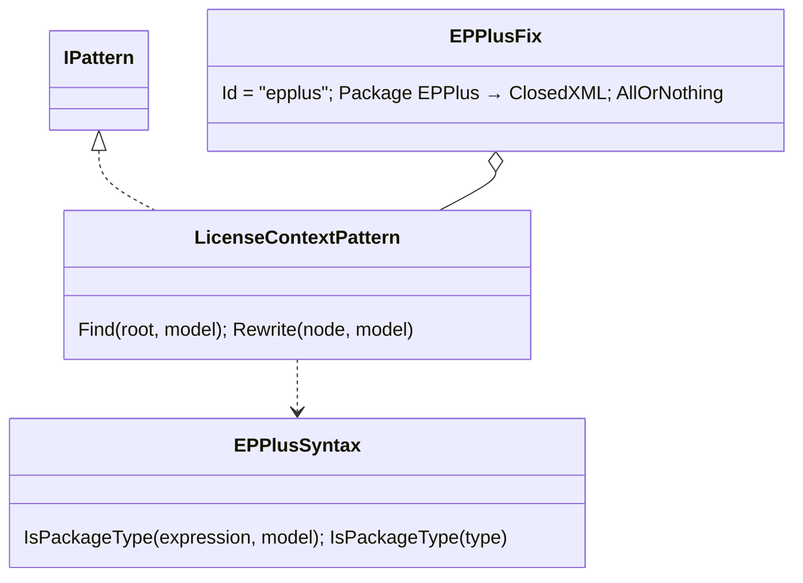
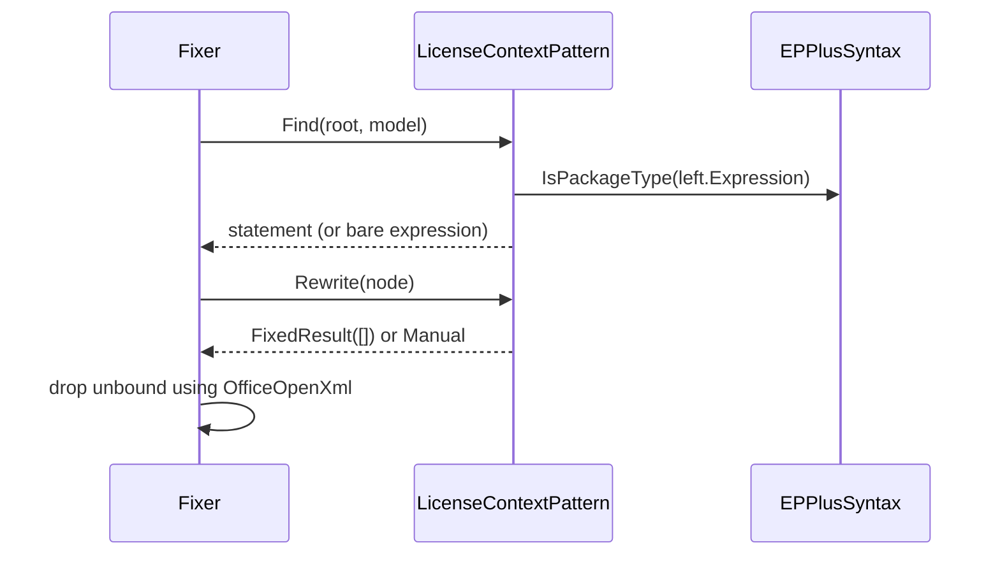

# Models: epplus.license-context

Facts from `src/Unshackle.Core/Fixes/EPPlus/Patterns/LicenseContextPattern.cs` and `EPPlusSyntax.cs`.

## Figure 1: class diagram



| Element | Role |
| ------- | ---- |
| `EPPlusFix` | the fix; runs this pattern first |
| `LicenseContextPattern` | finds licence assignments/calls, removes the statement or reports Manual |
| `EPPlusSyntax` | is this expression the `OfficeOpenXml.ExcelPackage` type (symbol, or name when unresolved) |

## Figure 2: sequence



## Figure 3: decision tree

```mermaid
flowchart TD
    A[expression] --> B{assignment to X.LicenseContext<br/>or X.License.Set*()?}
    B -- no --> N[not found]
    B -- yes --> C{X is OfficeOpenXml.ExcelPackage<br/>or unresolved and named so?}
    C -- no --> N
    C -- yes --> D{statement of its own in a block?}
    D -- yes --> F[Fixed: removed]
    D -- no --> M[Manual: not a statement of its own]
```

| Question | Leaf | Proof / test |
| -------- | ---- | ------------ |
| plain statement | removed | `statement` |
| qualified / EPPlus 8 call | removed | `qualified`, `license-set` |
| expression-bodied, embedded `if` | Manual | `expression-bodied`, `embedded-if` |
| own `ExcelPackage` type | not found | `Fix_OwnTypesNamedLikeEPPlus_NothingFound` |
| EPPlus unresolved | removed (syntax) | `LicenseContextPattern_UnresolvedExcelPackage_MatchedBySyntax` |

## See also

- [plan](epplus-license-context-plan.md), [verify](epplus-license-context-verify.md)
