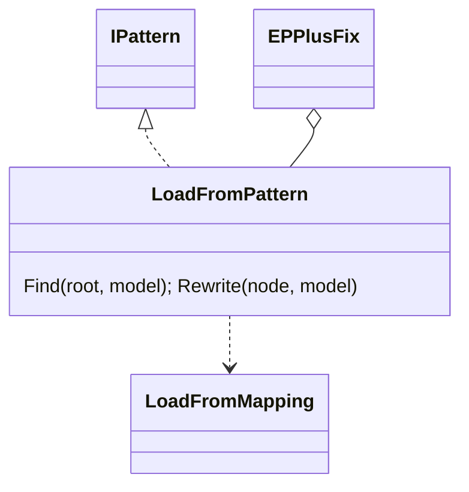

# Models: epplus.load-from

Facts from `src/Unshackle.Core/Fixes/EPPlus/Patterns/LoadFromPattern.cs`, `src/Unshackle.Core/Fixes/EPPlus/Patterns/LoadFromMapping.cs`, `src/Unshackle.Tests/Core/EPPlus/LoadFromHarnessTests.cs`.

## Figure 1: class diagram



## Figure 2: sequence (harness case)

```mermaid
sequenceDiagram
    LoadFromHarnessTests->>Fixer: EPPlus program, LoadFromPattern only
    Fixer->>LoadFromPattern: Find; Rewrite each node
    LoadFromPattern-->>Fixer: Fixed(ClosedXML code) or Manual(reason)
    LoadFromHarnessTests->>LoadFromHarnessTests: translate scaffold (other rows)
    LoadFromHarnessTests->>CellCompare: Differences(before, after) == []
    LoadFromHarnessTests->>CellCompare: Differences(before, wrong after) != []
```

## Figure 3: decision tree

```mermaid
flowchart TD
    A[EPPlus range.LoadFrom...] --> B{LoadFromCollection?}
    B -- no, DataTable --> MU1[Manual UncoveredRuntimeType]
    B -- no, other --> MU2[Manual UnmappedLoadFrom]
    B -- yes --> C{headers or table?}
    C -- yes --> MH[Manual LoadFromHeadersNotMapped]
    C -- no --> D{statement?}
    D -- no --> MU2
    D -- yes --> E{all members covered properties?}
    E -- no --> MU1
    E -- yes --> F[Fixed: range.InsertData(items)]
```

## See also

- [plan](epplus-load-from-plan.md), [verify](epplus-load-from-verify.md)
