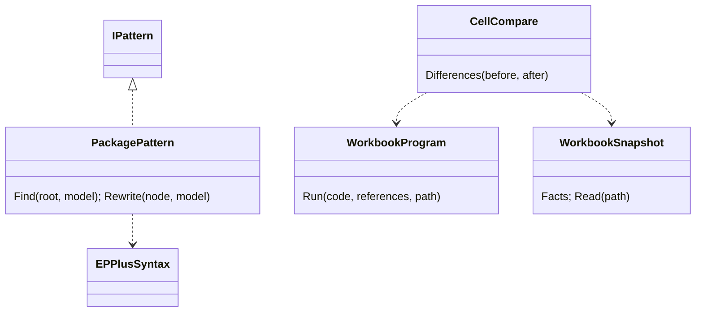
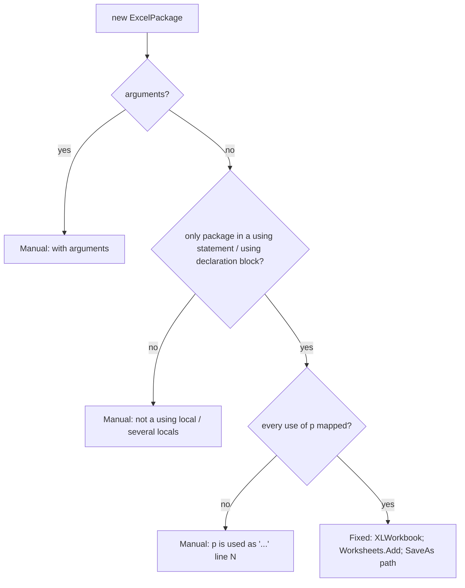

# Models: epplus.package

Facts from `src/Unshackle.Core/Fixes/EPPlus/Patterns/PackagePattern.cs`, `EPPlusSyntax.cs` and the harness in
`src/Unshackle.Tests/Core/EPPlus/` (`WorkbookProgram`, `WorkbookSnapshot`, `CellCompare`).

## Figure 1: class diagram



| Element | Role |
| ------- | ---- |
| `PackagePattern` | finds the package scope, maps every use of the local or reports the first unmapped one |
| `CellCompare` (tests) | compiles and runs before (EPPlus 4.5.3.3) and after (ClosedXML), returns per-fact differences |
| `WorkbookProgram` (tests) | in-memory Roslyn compile, runs the single `public static Write(string path)` |
| `WorkbookSnapshot` (tests) | reopens a saved workbook with ClosedXML and flattens it to facts per cell, sheet and column |

## Figure 2: sequence (proof with harness)

```mermaid
sequenceDiagram
    ProofTests->>Fixer: before.cs with PackagePattern only
    Fixer->>PackagePattern: Find → scope; Rewrite(scope)
    PackagePattern-->>Fixer: Fixed(scope with XLWorkbook)
    ProofTests->>ProofTests: text == after.cs, compiles on ClosedXML
    EPPlusHarnessProofTests->>CellCompare: Differences(before.cs, after.cs)
    CellCompare->>WorkbookProgram: run before on EPPlus 4.5.3.3
    CellCompare->>WorkbookProgram: run after on ClosedXML 0.105.1
    CellCompare->>WorkbookSnapshot: Read both files
    CellCompare-->>EPPlusHarnessProofTests: [] (or the differing facts)
```

## Figure 3: decision tree



| Question | Leaf | Proof / test |
| -------- | ---- | ------------ |
| using statement, mapped uses | Fixed, harness equal | `using-statement` |
| using declaration, explicit type | Fixed, harness equal | `using-declaration` |
| worksheet result used | Manual | `used-worksheet` |
| `GetAsByteArray()` / `SaveAs(Stream)` | Manual | `byte-array`, `Fix_SaveAsStream_ManualAndSolutionUntouched` |
| invalid sheet name | Manual | `invalid-sheet-name` |
| constructor argument | Manual | `existing-file` |
| field / two in one block | Manual | `field`, `Fix_TwoPackagesInOneBlock_Manual` |

## See also

- [plan](epplus-package-plan.md), [verify](epplus-package-verify.md)
