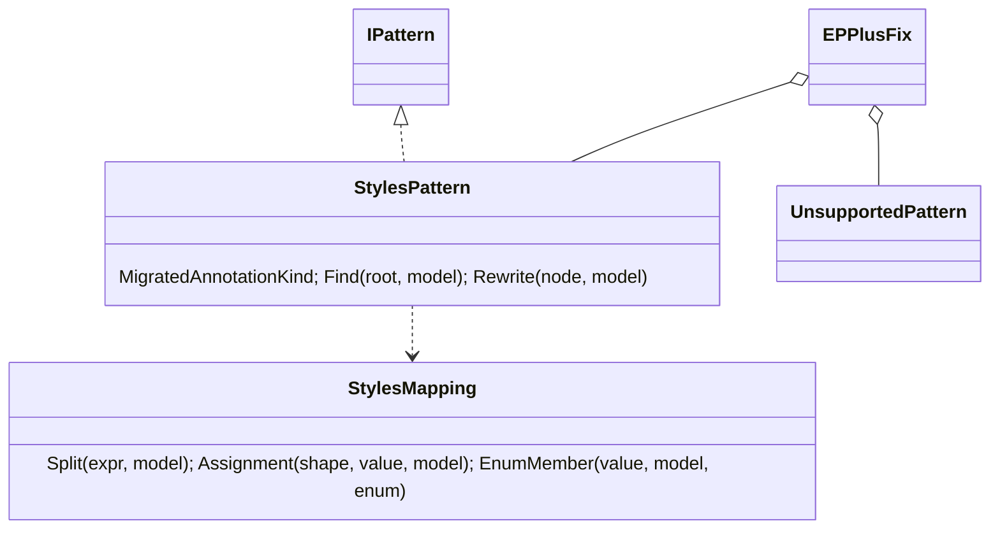
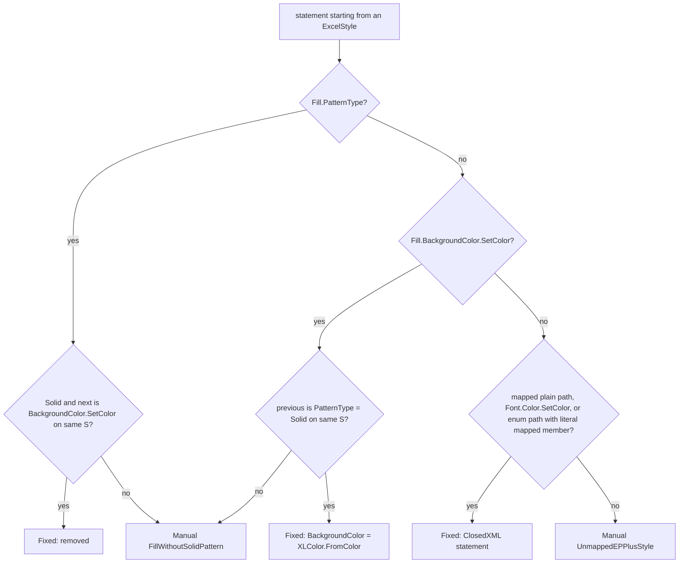

# Models: epplus.styles

Facts from `src/Unshackle.Core/Fixes/EPPlus/Patterns/StylesPattern.cs` and `StylesMapping.cs`, and the harness in
`src/Unshackle.Tests/Core/EPPlus/` (`StylesHarnessTests`, `CellCompare`).

## Figure 1: class diagram



## Figure 2: sequence (harness case)

```mermaid
sequenceDiagram
    StylesHarnessTests->>Fixer: EPPlus program, StylesPattern only
    Fixer->>StylesPattern: Find → style statements; Rewrite each
    StylesPattern-->>Fixer: Fixed(ClosedXML statement, annotated)
    StylesHarnessTests->>StylesHarnessTests: translate scaffold (package, sheet, cell, save)
    StylesHarnessTests->>CellCompare: Differences(before, after) == []
    StylesHarnessTests->>CellCompare: Differences(before, wrong after) != []
```

## Figure 3: decision tree



| Question | Leaf | Proof / test |
| -------- | ---- | ------------ |
| font, number format, wrap, alignment, borders | Fixed, harness equal and wrong-style detected | `StylesHarnessTests` (15 cases) |
| solid fill + colour | Fixed, harness equal | `StylesHarnessTests` fill case |
| pattern without colour | Manual | `fill-without-color`, `FillPatternWithoutColor_IsManual` |
| `UnderLine`, `BorderAround`, variable alignment | Manual | `underline`, `border-around`, `alignment-variable` |

## See also

- [plan](epplus-styles-plan.md), [verify](epplus-styles-verify.md)
