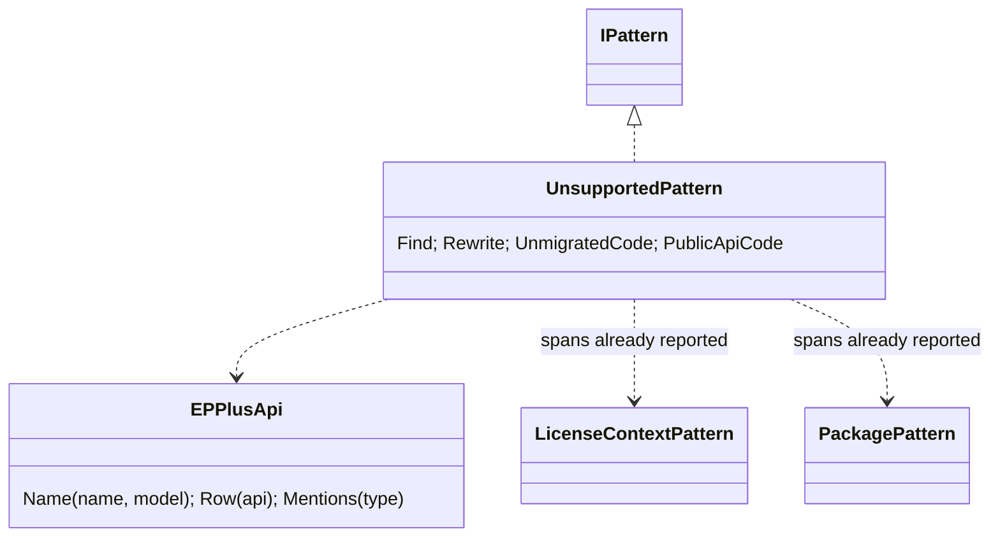
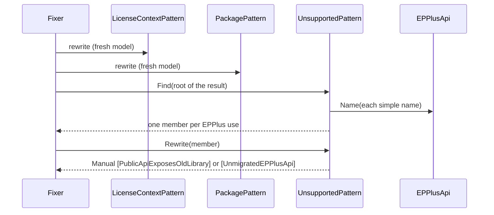
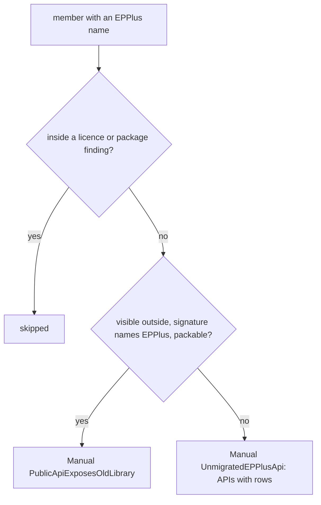

# Models: epplus.unsupported

Facts from `src/Unshackle.Core/Fixes/EPPlus/Patterns/UnsupportedPattern.cs` and `EPPlusApi.cs`.

## Figure 1: class diagram

## Figure 2: sequence

## Figure 3: decision tree

| Question | Leaf | Proof / test |
| -------- | ---- | ------------ |
| cells and values in an internal method | Unmigrated, rows 3/4/5 | `cells` |
| chart | Unmigrated, no row planned | `chart` |
| public signature, library | E6 | `public-api` |
| internal signature / test project | Unmigrated | `internal-api`, `UnsupportedPattern_PublicApiInTestProject_NotE6` |
| unresolved 5+ member | Unmigrated, "(unresolved, EPPlus 5+)" | `UnsupportedPattern_UnresolvedEPPlus5Member_NamedWithItsReceiver` |
| package left Manual | skipped | `Fix_SaveAsStream_ManualAndSolutionUntouched` |

## See also

- [plan](epplus-unsupported-plan.md), [verify](epplus-unsupported-verify.md)
