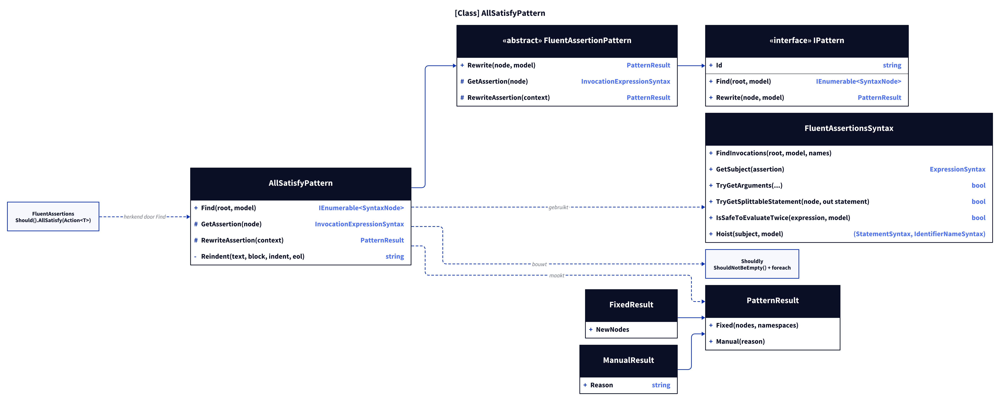
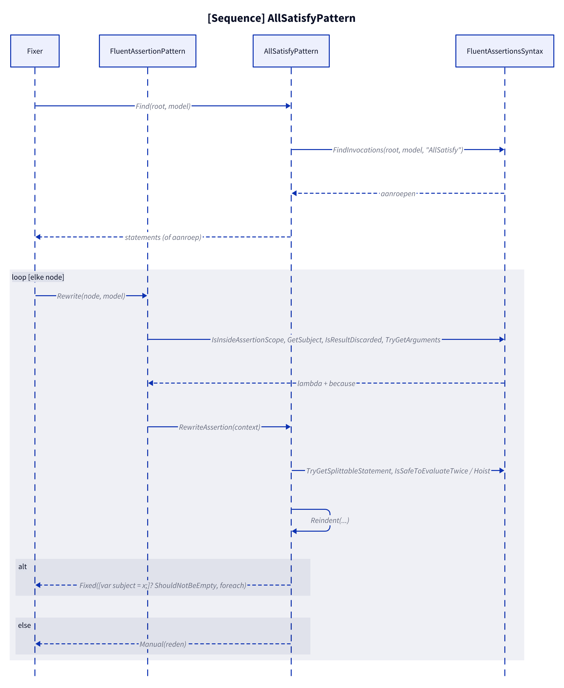
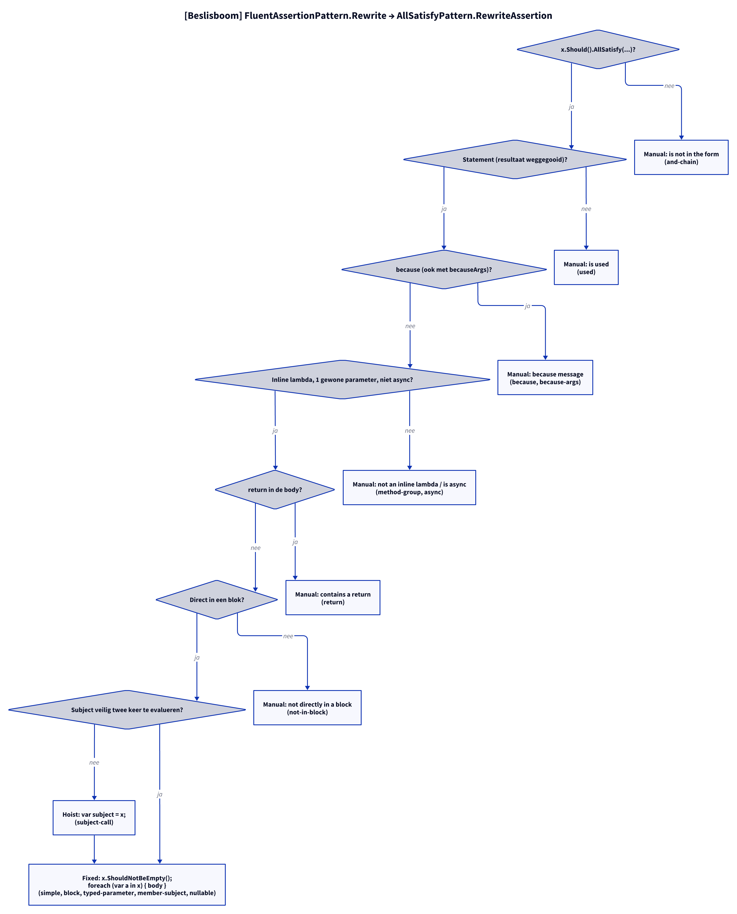

# Modellen: fa.all-satisfy

Feiten uit `src/Unshackle.Core/Fixes/FluentAssertions/Patterns/AllSatisfyPattern.cs`.

## Figuur 1: klassen

**Figure 1.** `AllSatisfyPattern`, zijn contract en de helpers; rechts de FluentAssertions-aanroep die hij herkent en de Shouldly-vorm die hij maakt.

<!-- kingmadoc:diagram img/fa-all-satisfy-modellen-1.d2 -->

| Element | Rol |
| ------- | --- |
| `AllSatisfyPattern` | Erft van `FluentAssertionPattern`; vindt `AllSatisfy` (`Find`, geeft het hele statement terug) en bouwt twee of drie statements (`RewriteAssertion`) |
| `FluentAssertionPattern` | Template Method: `Rewrite` doet scope-, subject-, resultaat- en argumentcontroles en roept dan `RewriteAssertion` aan |
| `FluentAssertionsSyntax` | Gedeelde stappen: aanroepen vinden, onderwerp, `because`-argumenten, `TryGetSplittableStatement`, `Hoist` |
| `Reindent` / `FluentAssertionsSyntax.IsSafeToEvaluateTwice` | Eigen helper voor de inspringing van de loop-body; anders wordt het subject gehoist naar `var subject = x;` |
| `PatternResult` | `Fixed` met twee statements, of `Manual(reden)` |
| FA / Shouldly | `AllSatisfy(Action<T>)` wordt `ShouldNotBeEmpty()` plus `foreach`, want `ShouldAllBe` verwacht een bool-predicate |

## Figuur 2: sequence

**Figure 2.** `Find` verzamelt de statements, `FluentAssertionPattern.Rewrite` → `AllSatisfyPattern.RewriteAssertion` beslist per statement tussen `Fixed` en `Manual`.

<!-- kingmadoc:diagram img/fa-all-satisfy-modellen-2.d2 -->

| Stap | Methode in de code | Wat gebeurt er |
| ---- | ------------------ | -------------- |
| Vinden | `Find` | `FindInvocations` met `AllSatisfy`; bij een statement-ouder wordt het statement de node |
| Gedeeld | `FluentAssertionPattern.Rewrite` | AssertionScope, `GetSubject` (`x.Should()`), resultaat weggegooid, `TryGetArguments` |
| Argumenten | `RewriteAssertion` | Lambda en `because`; een `because` (ook met `becauseArgs`) geeft Manual |
| Controles | `TryGetSplittableStatement`, `IsSafeToEvaluateTwice`, `Hoist`, `Reindent` | Lambda zonder `return`, statement direct in een blok; onveilig subject wordt gehoist; blok wordt opnieuw ingesprongen |
| Resultaat | `PatternResult.Fixed` | Twee statements (drie met hoist); de Fixer geeft het tweede alleen de inspringing |

## Figuur 3: beslisboom

**Figure 3.** Elke vraag in `FluentAssertionPattern.Rewrite` en `RewriteAssertion`; de bladeren zijn de Shouldly-vorm of de Manual-reden.

<!-- kingmadoc:diagram img/fa-all-satisfy-modellen-3.d2 -->

| Blad | Voorwaarde | Proof (`Proofs/FluentAssertions/AllSatisfy/`) |
| ---- | ---------- | --------------------------------------------- |
| Fixed | expressie- of blok-lambda, getypeerde parameter, member-subject, nullable subject | `simple`, `edge-expression-lambda`, `block`, `typed-parameter`, `member-subject`, `nullable` |
| Fixed met hoist | subject met bijwerkingen → `var subject = x;` | `subject-call` |
| Manual "is not in the form" | na `.And` | `and-chain` |
| Manual "is used" | `.And` erna of waarde gebruikt | `used` |
| Manual "because message" | bericht (ook met `becauseArgs`) kan niet in de loop | `because`, `because-args` |
| Manual "not an inline lambda" / "is async" | methodgroep, async lambda | `method-group`, `async` |
| Manual "contains a return" | `return` zou de methode verlaten | `return` |
| Manual "not directly in a block" | `if (...) x.Should()...;` | `not-in-block` |

## Zie ook

- [fa-all-satisfy-plan.md](fa-all-satisfy-plan.md)
- [fa-all-satisfy-verify.md](fa-all-satisfy-verify.md)
- `src/Unshackle.Core/Fixes/FluentAssertions/Patterns/AllSatisfyPattern.cs`
- `src/Unshackle.Tests/Proofs/FluentAssertions/AllSatisfy/`
