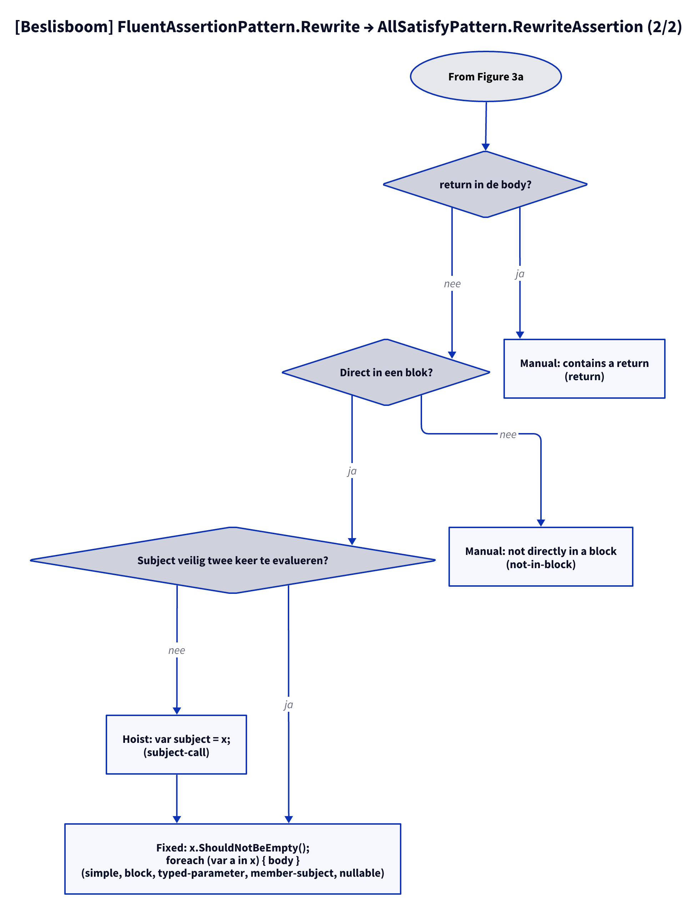

# Models: fa.all-satisfy

Facts from `src/Unshackle.Core/Fixes/FluentAssertions/Patterns/AllSatisfyPattern.cs`.

## Figure 1: classes

**Figure 1.** `AllSatisfyPattern`, its contract and the helpers; on the right the FluentAssertions call it recognizes and the Shouldly form it produces.

<!-- kingmadoc:diagram img/fa-all-satisfy-modellen-1.d2 -->

| Element | Role |
| ------- | ---- |
| `AllSatisfyPattern` | Inherits from `FluentAssertionPattern`; finds `AllSatisfy` (`Find`, returns the whole statement) and builds two or three statements (`RewriteAssertion`) |
| `FluentAssertionPattern` | Template Method: `Rewrite` does the scope, subject, result and argument checks and then calls `RewriteAssertion` |
| `FluentAssertionsSyntax` | Shared steps: finding calls, subject, `because` arguments, `TryGetSplittableStatement`, `Hoist` |
| `Reindent` / `FluentAssertionsSyntax.IsSafeToEvaluateTwice` | Own helper for the indentation of the loop body; otherwise the subject is hoisted to `var subject = x;` |
| `PatternResult` | `Fixed` with two statements, or `Manual(reason)` |
| FA / Shouldly | `AllSatisfy(Action<T>)` becomes `ShouldNotBeEmpty()` plus `foreach`, because `ShouldAllBe` expects a bool predicate |

## Figure 2: sequence

**Figure 2.** `Find` collects the statements, `FluentAssertionPattern.Rewrite` → `AllSatisfyPattern.RewriteAssertion` decides per statement between `Fixed` and `Manual`.

<!-- kingmadoc:diagram img/fa-all-satisfy-modellen-2.d2 -->

| Step | Method in the code | What happens |
| ---- | ------------------ | ------------ |
| Find | `Find` | `FindInvocations` with `AllSatisfy`; with a statement parent the statement becomes the node |
| Shared | `FluentAssertionPattern.Rewrite` | AssertionScope, `GetSubject` (`x.Should()`), result discarded, `TryGetArguments` |
| Arguments | `RewriteAssertion` | Lambda and `because`; a `because` (also with `becauseArgs`) gives Manual |
| Checks | `TryGetSplittableStatement`, `IsSafeToEvaluateTwice`, `Hoist`, `Reindent` | Lambda without `return`, statement directly in a block; unsafe subject is hoisted; block is re-indented |
| Result | `PatternResult.Fixed` | Two statements (three with hoist); the Fixer only gives the second one the indentation |

## Figure 3: decision tree

**Figure 3a.** Every question in `FluentAssertionPattern.Rewrite` and `RewriteAssertion`; the leaves are the Shouldly form or the Manual reason. Split into Figures 3a–3b (at most 12 arrows each).

<!-- kingmadoc:diagram img/fa-all-satisfy-modellen-3.d2 -->

**Figure 3b.** Continuation of Figure 3a from its "Continued in Figure 3b" node.

<!-- kingmadoc:diagram img/fa-all-satisfy-modellen-4.d2 -->

| Leaf | Condition | Proof (`Proofs/FluentAssertions/AllSatisfy/`) |
| ---- | --------- | --------------------------------------------- |
| Fixed | expression or block lambda, typed parameter, member subject, nullable subject | `simple`, `edge-expression-lambda`, `block`, `typed-parameter`, `member-subject`, `nullable` |
| Fixed with hoist | subject with side effects → `var subject = x;` | `subject-call` |
| Manual "is not in the form" | after `.And` | `and-chain` |
| Manual "is used" | `.And` afterwards or value used | `used` |
| Manual "because message" | message (also with `becauseArgs`) cannot go into the loop | `because`, `because-args` |
| Manual "not an inline lambda" / "is async" | method group, async lambda | `method-group`, `async` |
| Manual "contains a return" | `return` would leave the method | `return` |
| Manual "not directly in a block" | `if (...) x.Should()...;` | `not-in-block` |

## See also

- [fa-all-satisfy-plan.md](fa-all-satisfy-plan.md)
- [fa-all-satisfy-verify.md](fa-all-satisfy-verify.md)
- `src/Unshackle.Core/Fixes/FluentAssertions/Patterns/AllSatisfyPattern.cs`
- `src/Unshackle.Tests/Proofs/FluentAssertions/AllSatisfy/`
