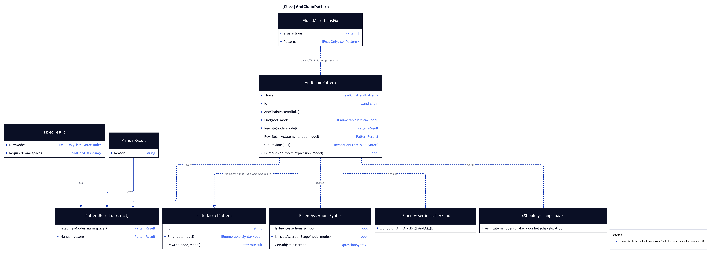
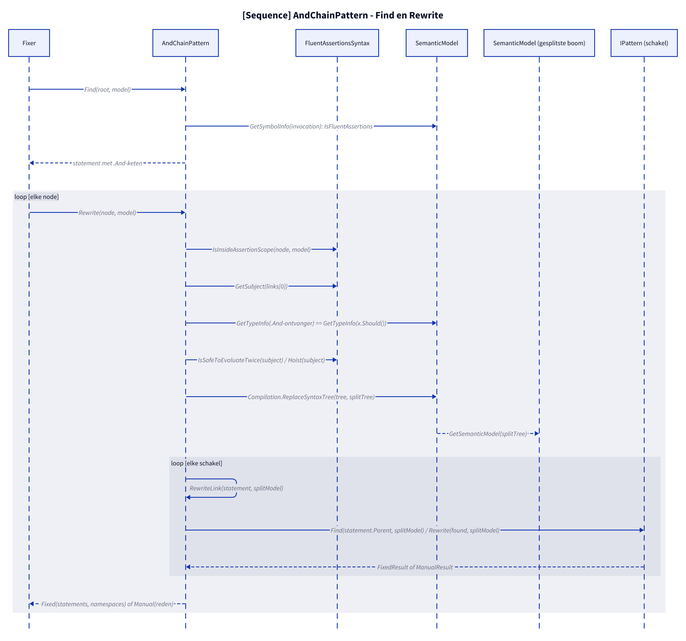
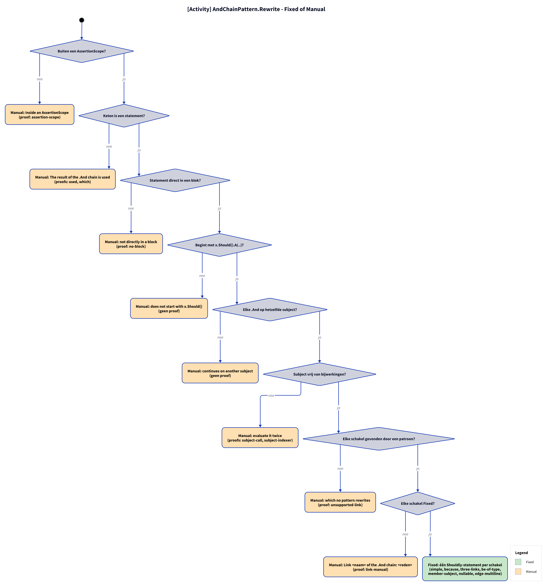
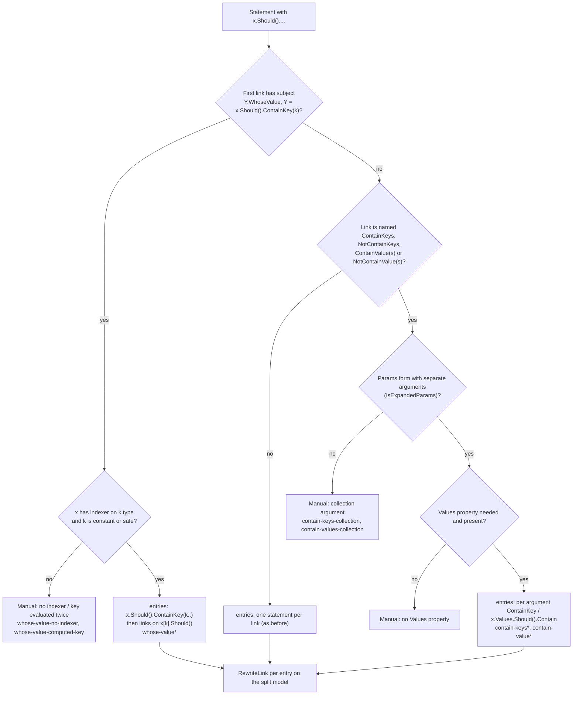

# Models: fa.and-chain

`x.Should().A().And.B();` to one Shouldly statement per link. Facts from `src/Unshackle.Core/Fixes/FluentAssertions/Patterns/AndChainPattern.cs`.

**Figure 1.** Classes around `AndChainPattern`. It is a Composite: it holds the assertion patterns (`FluentAssertionsFix.s_assertions`) and lets them rewrite each link. Omitted: `Fixer`, `IFix` and the usings (see [../modellen/klassen.md](../modellen/klassen.md)).

<!-- kingmadoc:diagram img/fa-and-chain-modellen-1.d2 -->

| Element | Path | Role |
| --- | --- | --- |
| `IPattern` | `src/Unshackle.Core/Abstractions/IPattern.cs` | Contract; also the type of the link patterns |
| `AndChainPattern` | `src/Unshackle.Core/Fixes/FluentAssertions/Patterns/AndChainPattern.cs` | This pattern, Id `fa.and-chain` |
| `FluentAssertionsFix` | `src/Unshackle.Core/Fixes/FluentAssertions/FluentAssertionsFix.cs` | Passes in `s_assertions`; places the pattern before the assertion patterns |
| `FluentAssertionsSyntax` | `src/Unshackle.Core/Fixes/FluentAssertions/FluentAssertionsSyntax.cs` | `IsFluentAssertions`, `IsInsideAssertionScope`, `GetSubject`, `TryGetSplittableStatement`, `IsSafeToEvaluateTwice`, `Hoist` |
| `PatternResult`, `FixedResult`, `ManualResult` | `src/Unshackle.Core/Models/` | Outcome |

**Figure 2.** `Rewrite` splits the chain into separate FA statements, compiles them speculatively (`Compilation.ReplaceSyntaxTree`) and, per statement, lets the first pattern that finds something rewrite it.

<!-- kingmadoc:diagram img/fa-and-chain-modellen-2.d2 -->

| Step | Location | What happens |
| --- | --- | --- |
| Find | `AndChainPattern.Find` | FA invocations on `….And.M(..)` that do not chain further themselves; the statement, otherwise the invocation |
| Checks | `AndChainPattern.Rewrite` | scope, statement, block, `x.Should()` start, `.And` type |
| Split | `AndChainPattern.Rewrite` | subject with side effects first to `var subject = x;` (`Hoist`); then `x.Should().M(args);` per link, with annotation |
| Link | `AndChainPattern.RewriteLink` | `Find` + `Rewrite` of the link patterns on the split model |
| Fixed | `PatternResult.Fixed` | optionally the hoist declaration, the Shouldly statements (a link may yield several statements) + namespaces and warnings of the links |

**Figure 3.** Decision tree of `Rewrite`; proofs in `src/Unshackle.Tests/Proofs/FluentAssertions/AndChain/`.

<!-- kingmadoc:diagram img/fa-and-chain-modellen-3.d2 -->

| Question | If no: Manual reason | Proof |
| --- | --- | --- |
| Outside an AssertionScope? | Inside an AssertionScope | `assertion-scope` |
| Chain is a statement? | The result of the .And chain is used | `used`, `which` |
| Directly in a block? | not directly in a block | `no-block` |
| Starts with `x.Should().A(..)`? | does not start with x.Should() | no proof, guarded in code |
| Every `.And` on the same subject? | continues on another subject | no proof (no compilable FA 7 example found) |
| Subject safe to evaluate twice? | no Manual: hoist to `var subject = x;` | `subject-call`, `subject-indexer`, `subject-call-twice` (Fixed) |
| Link found? | which no pattern rewrites | `unsupported-link` |
| Link Fixed? | Link X of the .And chain: reason | `manual-link` |

## Extension TAAK-171: dictionary assertions that become several statements

**Figure 4.** Which forms the split gained. `Find` also takes a statement that has no `.And` itself but becomes several statements via `IsExpandable`; `Rewrite` builds the list `entries` (one FA statement per outcome) and passes it to the same `RewriteLink` loop.

| Question | If no: outcome | Proof |
| --- | --- | --- |
| Subject is `ContainKey(k).WhoseValue`? | ordinary split | `whose-value*` for yes |
| Indexer and safe key? | Manual | `whose-value-no-indexer`, `whose-value-computed-key` |
| Params form? | Manual | `contain-keys-collection`, `contain-values-collection` |
| Subject safe to evaluate twice? | hoist (`subject`, `subject2`; x counts as subject, `Y.WhoseValue` too) | `contain-keys-subject-call`, `whose-value-subject-call` |

## See also

- [fa-and-chain-plan.md](fa-and-chain-plan.md) - plan
- [fa-and-chain-verify.md](fa-and-chain-verify.md) - verification
- `src/Unshackle.Core/Fixes/FluentAssertions/Patterns/AndChainPattern.cs` - the pattern
- `src/Unshackle.Tests/Proofs/FluentAssertions/AndChain/` - the proofs
- [../README.md](../README.md)
