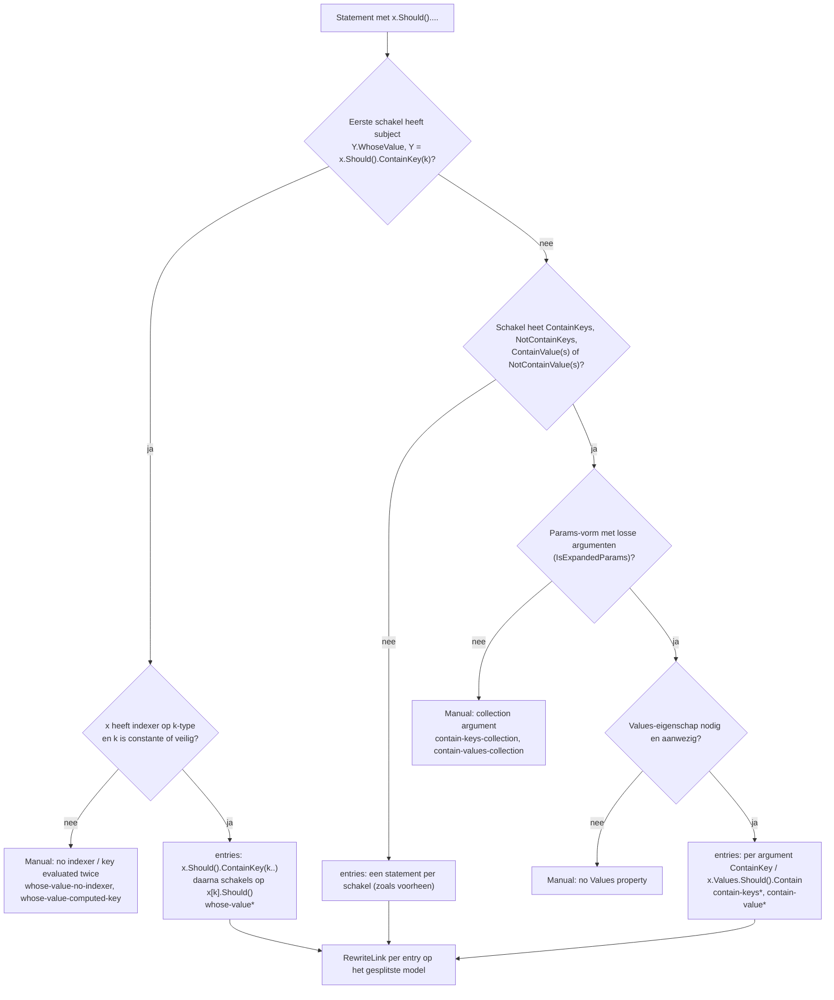

# Modellen: fa.and-chain

`x.Should().A().And.B();` naar één Shouldly-statement per schakel. Feiten uit `src/Unshackle.Core/Fixes/FluentAssertions/Patterns/AndChainPattern.cs`.

**Figure 1.** Klassen rond `AndChainPattern`. Het is een Composite: het houdt de assertion-patronen (`FluentAssertionsFix.s_assertions`) vast en laat die elke schakel herschrijven. Weggelaten: `Fixer`, `IFix` en de usings (zie [../modellen/klassen.md](../modellen/klassen.md)).

<!-- kingmadoc:diagram img/fa-and-chain-modellen-1.d2 -->

| Element | Pad | Rol |
| --- | --- | --- |
| `IPattern` | `src/Unshackle.Core/Abstractions/IPattern.cs` | Contract; ook het type van de schakel-patronen |
| `AndChainPattern` | `src/Unshackle.Core/Fixes/FluentAssertions/Patterns/AndChainPattern.cs` | Dit patroon, Id `fa.and-chain` |
| `FluentAssertionsFix` | `src/Unshackle.Core/Fixes/FluentAssertions/FluentAssertionsFix.cs` | Geeft `s_assertions` mee; zet het patroon vóór de assertion-patronen |
| `FluentAssertionsSyntax` | `src/Unshackle.Core/Fixes/FluentAssertions/FluentAssertionsSyntax.cs` | `IsFluentAssertions`, `IsInsideAssertionScope`, `GetSubject`, `TryGetSplittableStatement`, `IsSafeToEvaluateTwice`, `Hoist` |
| `PatternResult`, `FixedResult`, `ManualResult` | `src/Unshackle.Core/Models/` | Uitkomst |

**Figure 2.** `Rewrite` splitst de keten in losse FA-statements, compileert die speculatief (`Compilation.ReplaceSyntaxTree`) en laat per statement het eerste patroon dat iets vindt herschrijven.

<!-- kingmadoc:diagram img/fa-and-chain-modellen-2.d2 -->

| Stap | Plek | Wat gebeurt er |
| --- | --- | --- |
| Find | `AndChainPattern.Find` | FA-invocations op `….And.M(..)` die zelf niet verder ketenen; het statement, anders de invocation |
| Controles | `AndChainPattern.Rewrite` | scope, statement, blok, `x.Should()`-begin, `.And`-type |
| Splitsen | `AndChainPattern.Rewrite` | subject met bijwerkingen eerst naar `var subject = x;` (`Hoist`); dan `x.Should().M(args);` per schakel, met annotatie |
| Schakel | `AndChainPattern.RewriteLink` | `Find` + `Rewrite` van de schakel-patronen op het gesplitste model |
| Fixed | `PatternResult.Fixed` | eventueel de hoist-declaratie, de Shouldly-statements (een schakel mag meerdere statements geven) + namespaces en warnings van de schakels |

**Figure 3.** Beslisboom van `Rewrite`; proofs in `src/Unshackle.Tests/Proofs/FluentAssertions/AndChain/`.

<!-- kingmadoc:diagram img/fa-and-chain-modellen-3.d2 -->

| Vraag | Bij nee: Manual-reden | Proof |
| --- | --- | --- |
| Buiten een AssertionScope? | Inside an AssertionScope | `assertion-scope` |
| Keten is een statement? | The result of the .And chain is used | `used`, `which` |
| Direct in een blok? | not directly in a block | `no-block` |
| Begint met `x.Should().A(..)`? | does not start with x.Should() | geen proof, bewaakt in code |
| Elke `.And` op hetzelfde subject? | continues on another subject | geen proof (geen compileerbaar FA 7-voorbeeld gevonden) |
| Subject veilig twee keer te evalueren? | geen Manual: hoist naar `var subject = x;` | `subject-call`, `subject-indexer`, `subject-call-twice` (Fixed) |
| Schakel gevonden? | which no pattern rewrites | `unsupported-link` |
| Schakel Fixed? | Link X of the .And chain: reden | `manual-link` |

## Uitbreiding TAAK-171: dictionary-assertions die meerdere statements worden

**Figure 4.** Welke vormen de splitsing erbij kreeg. `Find` neemt ook een statement dat zelf geen `.And` heeft maar via `IsExpandable` meerdere statements wordt; `Rewrite` bouwt de lijst `entries` (een FA-statement per uitkomst) en geeft die aan dezelfde `RewriteLink`-lus.

| Vraag | Bij nee: uitkomst | Proof |
| --- | --- | --- |
| Subject is `ContainKey(k).WhoseValue`? | gewone splitsing | `whose-value*` voor ja |
| Indexer en veilige key? | Manual | `whose-value-no-indexer`, `whose-value-computed-key` |
| Params-vorm? | Manual | `contain-keys-collection`, `contain-values-collection` |
| Subject veilig twee keer te evalueren? | hoist (`subject`, `subject2`; x telt als subject, `Y.WhoseValue` ook) | `contain-keys-subject-call`, `whose-value-subject-call` |

## Zie ook

- [fa-and-chain-plan.md](fa-and-chain-plan.md) - plan
- [fa-and-chain-verify.md](fa-and-chain-verify.md) - verificatie
- `src/Unshackle.Core/Fixes/FluentAssertions/Patterns/AndChainPattern.cs` - het patroon
- `src/Unshackle.Tests/Proofs/FluentAssertions/AndChain/` - de proofs
- [../README.md](../README.md)
