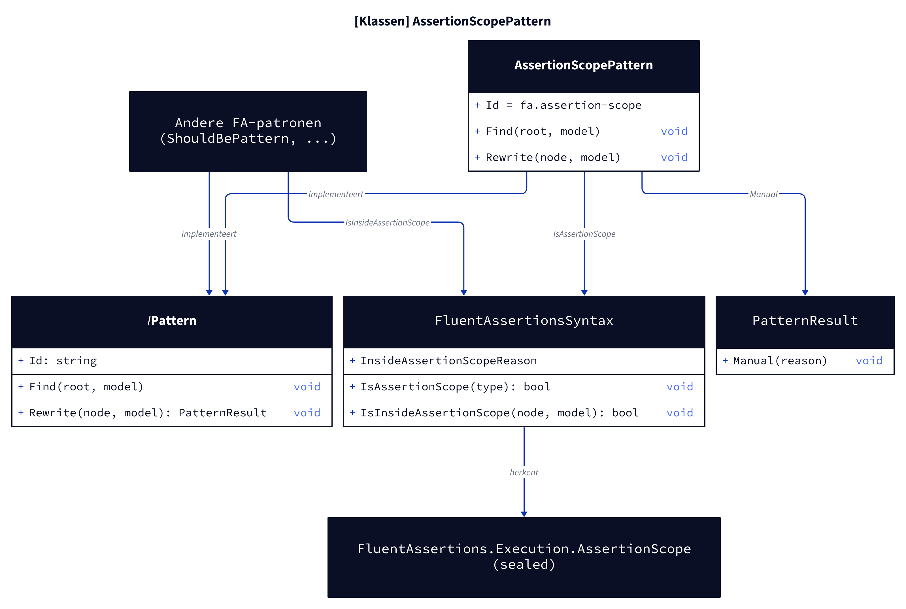
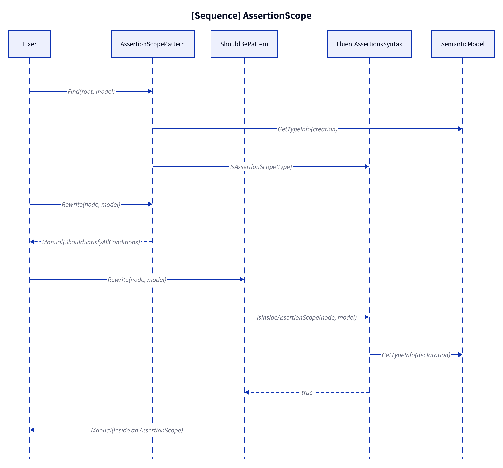
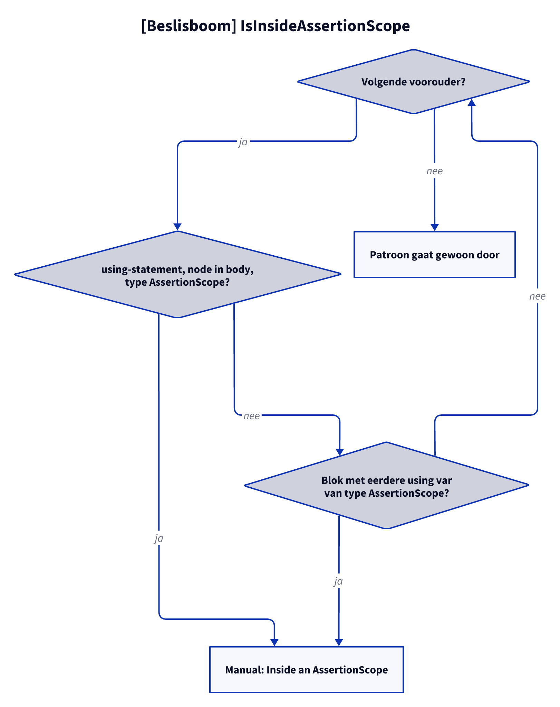

# Modellen: fa.assertion-scope

Feiten uit `src/Unshackle.Core/Fixes/FluentAssertions/Patterns/AssertionScopePattern.cs` en `FluentAssertionsSyntax.IsInsideAssertionScope`.

## Figuur 1: klassen

**Figure 1.** `AssertionScopePattern`, zijn contract en de gedeelde check die alle FA-patronen gebruiken.

<!-- kingmadoc:diagram img/fa-assertion-scope-modellen-1.d2 -->

| Element | Rol |
| ------- | --- |
| `AssertionScopePattern` | Vindt elke `new AssertionScope(...)` (`Find`) en geeft altijd `Manual` (`Rewrite`) |
| `FluentAssertionsSyntax` | `IsAssertionScope(type)` en `IsInsideAssertionScope(node, model)`, plus `InsideAssertionScopeReason` |
| Andere FA-patronen | Roepen `IsInsideAssertionScope` als eerste stap in `Rewrite` aan |
| `PatternResult` | Hier altijd `Manual(reden)` |
| `AssertionScope` | `FluentAssertions.Execution.AssertionScope` (sealed) |

## Figuur 2: sequence

**Figure 2.** De scope zelf en een assertion erbinnen, beide als `Manual`.

<!-- kingmadoc:diagram img/fa-assertion-scope-modellen-2.d2 -->

| Stap | Methode in de code | Wat gebeurt er |
| ---- | ------------------ | -------------- |
| Vinden | `AssertionScopePattern.Find` | Alle `BaseObjectCreationExpressionSyntax` met type `AssertionScope` |
| Scope | `AssertionScopePattern.Rewrite` | `Manual` met advies `ShouldSatisfyAllConditions` |
| Assertion | `<X>Pattern.Rewrite` → `IsInsideAssertionScope` | Voorouders aflopen: `using`-body of blok met eerdere `using var` |
| Type | `SemanticModel.GetTypeInfo` | Declaratie- of expressietype moet `AssertionScope` zijn |

## Figuur 3: beslisboom

**Figure 3.** Vragen van `IsInsideAssertionScope` per voorouder.

<!-- kingmadoc:diagram img/fa-assertion-scope-modellen-3.d2 -->

| Blad | Voorwaarde | Bewijs |
| ---- | ---------- | ------ |
| Manual "Inside an AssertionScope" | body van `using (new AssertionScope())`, ook genest | `ShouldBe/assertion-scope-using-block`, `-nested` |
| Manual "Inside an AssertionScope" | eerder in een omringend blok `using var` scope | `ShouldBe/assertion-scope-using-var` |
| Normaal patroon | geen scope-voorouder | unittest `false`-gevallen |
| Manual "Shouldly has no scope" | de scope-creatie zelf | `AssertionScope/*` |

## Zie ook

- [fa-assertion-scope-plan.md](fa-assertion-scope-plan.md)
- [fa-assertion-scope-verify.md](fa-assertion-scope-verify.md)
- `src/Unshackle.Core/Fixes/FluentAssertions/Patterns/AssertionScopePattern.cs`
- `src/Unshackle.Tests/Proofs/FluentAssertions/AssertionScope/`
