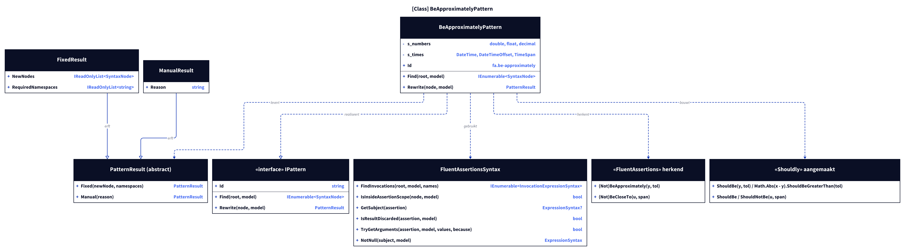
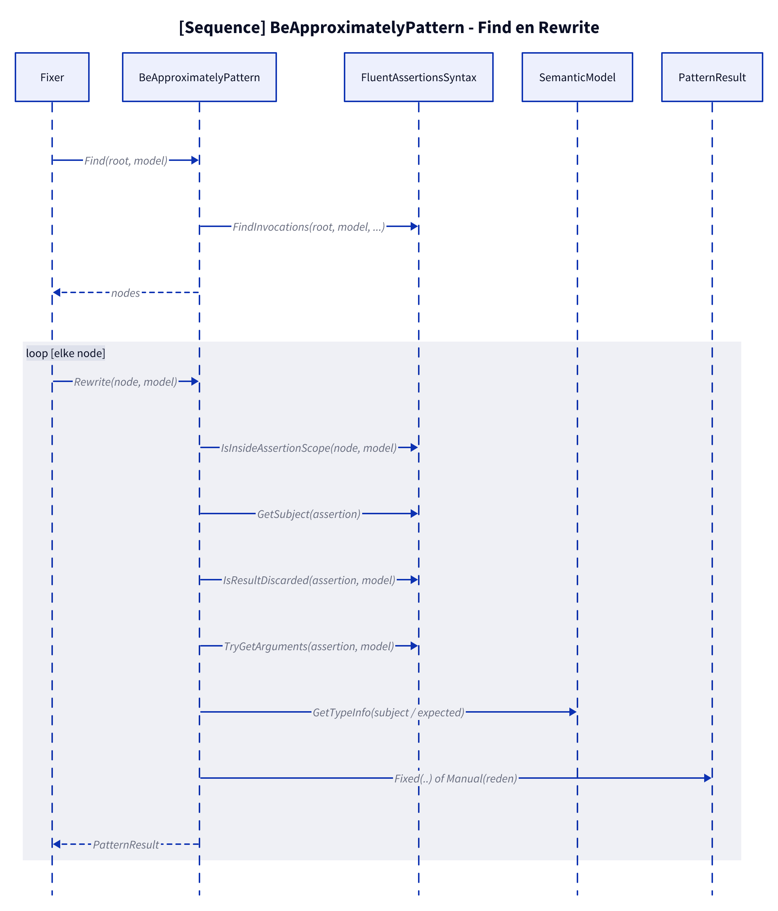
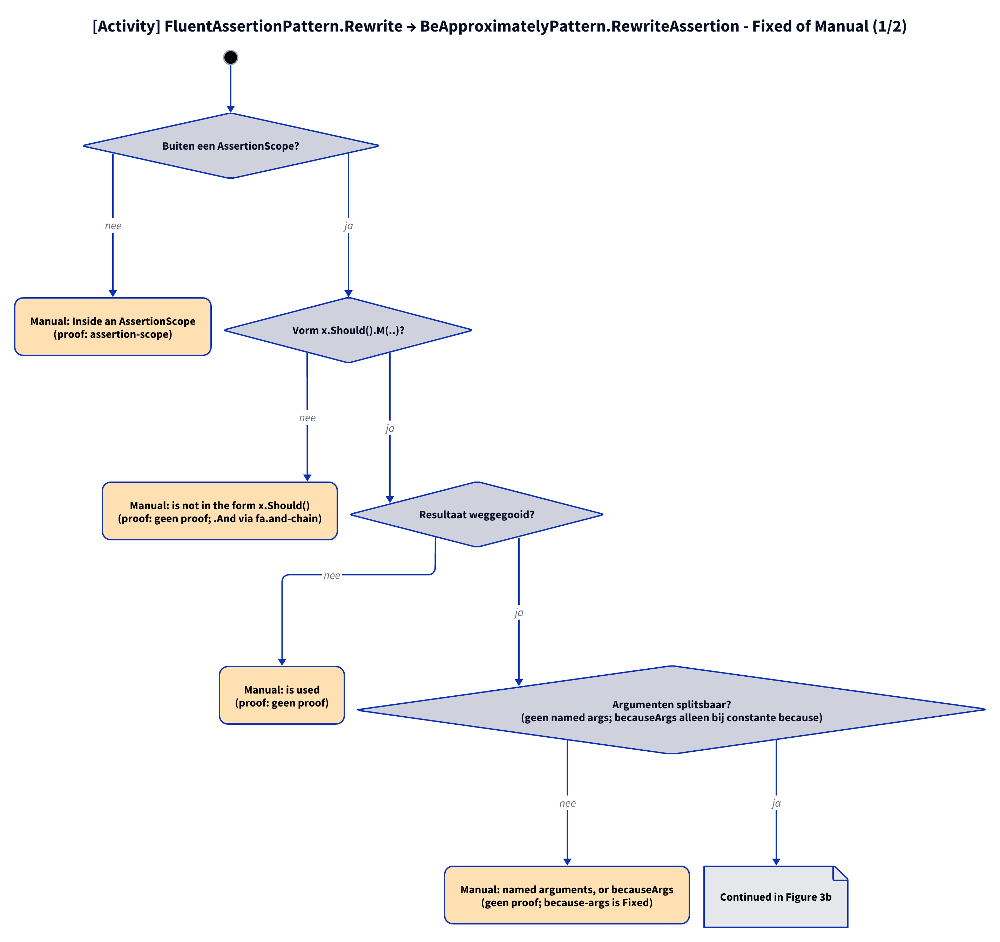
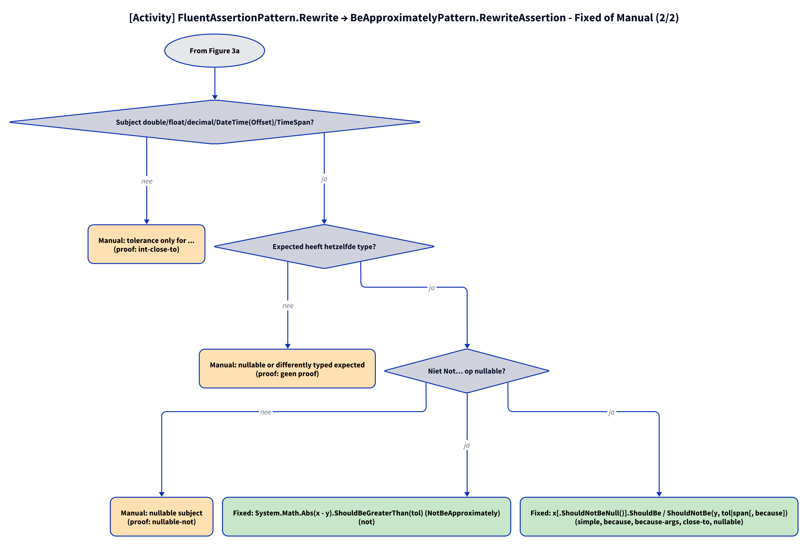

# Models: fa.be-approximately

`x.Should().BeApproximately(y, tol)` and `t.Should().BeCloseTo(u, span)` become `x.ShouldBe(y, tol)`; `NotBeCloseTo` becomes `ShouldNotBe(u, span)`; `NotBeApproximately` becomes `System.Math.Abs(x - y).ShouldBeGreaterThan(tol)`. Facts from `src/Unshackle.Core/Fixes/FluentAssertions/Patterns/BeApproximatelyPattern.cs`.

**Figure 1.** Classes around `BeApproximatelyPattern`. Omitted: `Fixer`, `IFix` and the usings (see [../modellen/klassen.md](../modellen/klassen.md)).

<!-- kingmadoc:diagram img/fa-be-approximately-modellen-1.d2 -->

| Element | Path | Role |
| --- | --- | --- |
| `IPattern` | `src/Unshackle.Core/Abstractions/IPattern.cs` | Contract |
| `BeApproximatelyPattern` | `src/Unshackle.Core/Fixes/FluentAssertions/Patterns/BeApproximatelyPattern.cs` | This pattern, Id `fa.be-approximately` |
| `FluentAssertionsSyntax` | `src/Unshackle.Core/Fixes/FluentAssertions/FluentAssertionsSyntax.cs` | Shared checks and helpers (`TryGetArguments`, `IsSafeReceiver`, `Invoke`) |
| `FluentAssertionPattern` | `src/Unshackle.Core/Fixes/FluentAssertions/FluentAssertionPattern.cs` | Template Method: `Rewrite` does the shared checks and calls `RewriteAssertion` |
| `PatternResult`, `FixedResult`, `ManualResult` | `src/Unshackle.Core/Models/` | Outcome |

**Figure 2.** Order of `Find` and `FluentAssertionPattern.Rewrite` → `BeApproximatelyPattern.RewriteAssertion`.

<!-- kingmadoc:diagram img/fa-be-approximately-modellen-2.d2 -->

| Step | Location | What happens |
| --- | --- | --- |
| Find | `BeApproximatelyPattern.Find` | `FindInvocations` on the FA names |
| Checks | `FluentAssertionPattern.Rewrite` | scope, form, use of the result, arguments (becauseArgs → `string.Format`) |
| Rewrite | `BeApproximatelyPattern.RewriteAssertion` | type of subject and expected, `Not…` on nullable |
| Outcome | `PatternResult.Fixed` / `Manual` | Shouldly call or reason |

**Figure 3a.** Decision tree of `FluentAssertionPattern.Rewrite` → `RewriteAssertion`; proofs in `src/Unshackle.Tests/Proofs/FluentAssertions/BeApproximately/`. Split into Figures 3a–3b (at most 12 arrows each).

<!-- kingmadoc:diagram img/fa-be-approximately-modellen-3.d2 -->

**Figure 3b.** Continuation of Figure 3a from its "Continued in Figure 3b" node.

<!-- kingmadoc:diagram img/fa-be-approximately-modellen-4.d2 -->

| Question | If no: Manual reason | Proof |
| --- | --- | --- |
| Outside an AssertionScope? | Inside an AssertionScope | `assertion-scope` |
| Form x.Should().M(..)? | is not in the form x.Should() | `no proof; .And via fa.and-chain` |
| Result discarded? | is used | `no proof` |
| Arguments splittable (no named args; becauseArgs with constant because)? | named arguments, or becauseArgs whose because is no constant format string | no proof (`because-args` has been Fixed since TAAK-097) |
| Subject double/float/decimal/DateTime(Offset)/TimeSpan? | tolerance only for ... | `int-close-to` |
| Expected has the same type? | nullable or differently typed expected | `no proof` |
| Not Not… on nullable? | nullable subject | `nullable-not` |
| Fixed | `System.Math.Abs(x - y).ShouldBeGreaterThan(tol) (NotBeApproximately)` | not |
| Fixed | `x[.ShouldNotBeNull()].ShouldBe / ShouldNotBe(y, tol|span[, because])`; becauseArgs → `string.Format(CultureInfo.InvariantCulture, because, args)` | simple, because, because-args, close-to, nullable |

## See also

- [fa-be-approximately-plan.md](fa-be-approximately-plan.md) - plan
- [fa-be-approximately-verify.md](fa-be-approximately-verify.md) - verification
- `src/Unshackle.Core/Fixes/FluentAssertions/Patterns/BeApproximatelyPattern.cs` - the pattern
- `src/Unshackle.Tests/Proofs/FluentAssertions/BeApproximately/` - the proofs
- [../README.md](../README.md)
