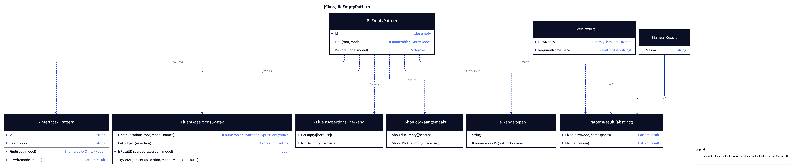
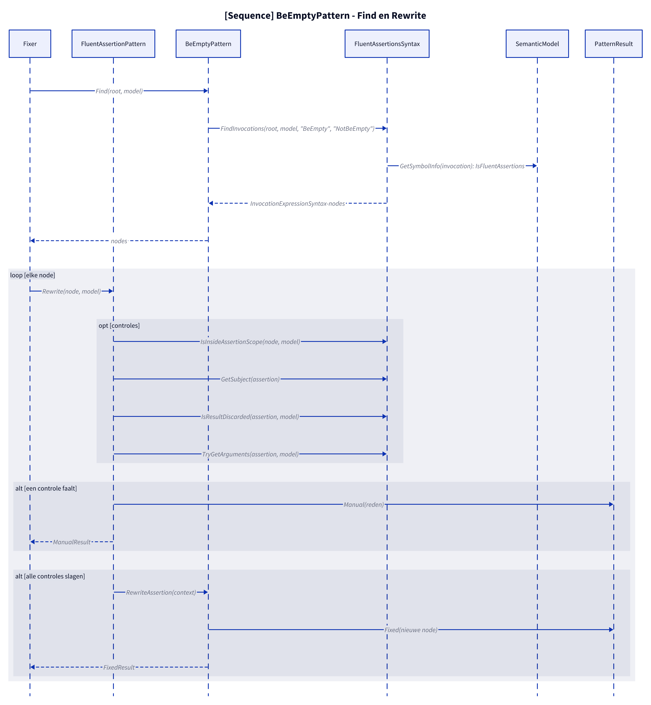
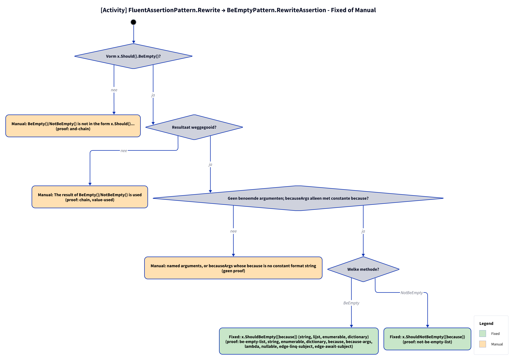

# Models: fa.be-empty

x.Should().BeEmpty() to x.ShouldBeEmpty(). Facts from `src/Unshackle.Core/Fixes/FluentAssertions/Patterns/BeEmptyPattern.cs`.

**Figure 1.** Classes around `BeEmptyPattern`: what it implements, uses and creates. Omitted: `Fixer`, `IFix` and the usings handling (see [../modellen/klassen.md](../modellen/klassen.md)).

<!-- kingmadoc:diagram img/fa-be-empty-modellen-1.d2 -->

| Element | Path | Role |
| --- | --- | --- |
| `IPattern` | `src/Unshackle.Core/Abstractions/IPattern.cs` | Contract: `Find` and `Rewrite` |
| `BeEmptyPattern` | `src/Unshackle.Core/Fixes/FluentAssertions/Patterns/BeEmptyPattern.cs` | This pattern, Id `fa.be-empty` |
| `FluentAssertionsSyntax` | `src/Unshackle.Core/Fixes/FluentAssertions/FluentAssertionsSyntax.cs` | Shared building blocks: `FindInvocations`, `GetSubject`, `IsResultDiscarded`, `TryGetArguments`, `Invoke` |
| `FluentAssertionPattern` | `src/Unshackle.Core/Fixes/FluentAssertions/FluentAssertionPattern.cs` | Template Method: `Rewrite` does the shared checks, `BeEmptyPattern.RewriteAssertion` builds the Shouldly call |
| `PatternResult`, `FixedResult`, `ManualResult` | `src/Unshackle.Core/Models/` | Outcome: `Fixed` with new node(s) and namespaces, or `Manual` with a reason |
| «FluentAssertions» recognized | - | `BeEmpty([because])`; `NotBeEmpty([because])` |
| «Shouldly» created | - | `ShouldBeEmpty([because])`; `ShouldNotBeEmpty([because])` |
| Recognized types | - | `string`; `IEnumerable<T> (also dictionaries)` |

**Figure 2.** `Fixer` calls `Find` and `Rewrite` per node; `FluentAssertionPattern.Rewrite` does the checks via `FluentAssertionsSyntax` and `SemanticModel` and returns `Manual`, or calls `RewriteAssertion` for `Fixed`. Omitted: the replacement of the node and the usings by the `Fixer`.

<!-- kingmadoc:diagram img/fa-be-empty-modellen-2.d2 -->

| Step | Location | What happens |
| --- | --- | --- |
| Find | `BeEmptyPattern.Find` | `FluentAssertionsSyntax.FindInvocations` looks for calls `BeEmpty`, `NotBeEmpty` whose symbol lives in a FluentAssertions namespace |
| Checks | `FluentAssertionPattern.Rewrite` | `IsInsideAssertionScope`; `GetSubject(assertion)`; `IsResultDiscarded(assertion, model)`; `TryGetArguments(assertion, model)` |
| Manual | `PatternResult.Manual` | The first failed check gives a `ManualResult` with a reason (see figure 3) |
| Fixed | `BeEmptyPattern.RewriteAssertion` → `PatternResult.Fixed` | New node; the `Fixer` handles trivia and usings |

**Figure 3.** Decision tree of `FluentAssertionPattern.Rewrite` → `RewriteAssertion`: 3 questions in code order, each leaf names the proof in `src/Unshackle.Tests/Proofs/FluentAssertions/BeEmpty/` that proves it (`<name>.before.cs` with `.after.cs` or `.manual.txt`).

<!-- kingmadoc:diagram img/fa-be-empty-modellen-3.d2 -->

| Question or selector | If no: Manual reason | Proof |
| --- | --- | --- |
| Form x.Should().BeEmpty()? | BeEmpty()/NotBeEmpty() is not in the form x.Should()... | `and-chain` |
| Result discarded? | The result of BeEmpty()/NotBeEmpty() is used | `chain`, `value-used` |
| No named arguments; becauseArgs only with constant because? | named arguments, or becauseArgs whose because is no constant format string | no proof (`because-args` has been Fixed since TAAK-097) |

| Condition | Fixed form | Proofs |
| --- | --- | --- |
| BeEmpty | `x.ShouldBeEmpty([because]) (string, lijst, enumerable, dictionary)` | `be-empty-list`, `string`, `enumerable`, `dictionary`, `because`, `because-args` (`string.Format`), `lambda`, `nullable`, `edge-linq-subject`, `edge-await-subject` |
| NotBeEmpty | `x.ShouldNotBeEmpty([because])` | `not-be-empty-list` |

## See also

- [fa-be-empty-plan.md](fa-be-empty-plan.md) - plan
- [fa-be-empty-verify.md](fa-be-empty-verify.md) - verification
- `src/Unshackle.Core/Fixes/FluentAssertions/Patterns/BeEmptyPattern.cs` - the pattern
- `src/Unshackle.Tests/Proofs/FluentAssertions/BeEmpty/` - the proofs
- [../modellen/pattern-beslissing.md](../modellen/pattern-beslissing.md) - generic decision of a pattern
- [../README.md](../README.md)
