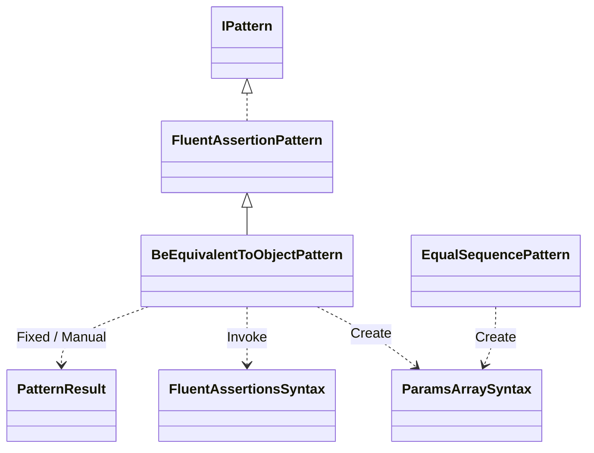
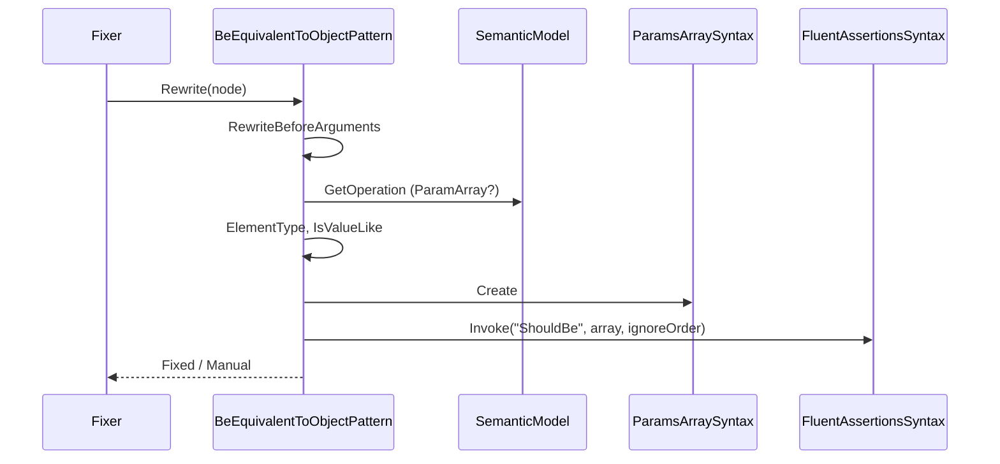
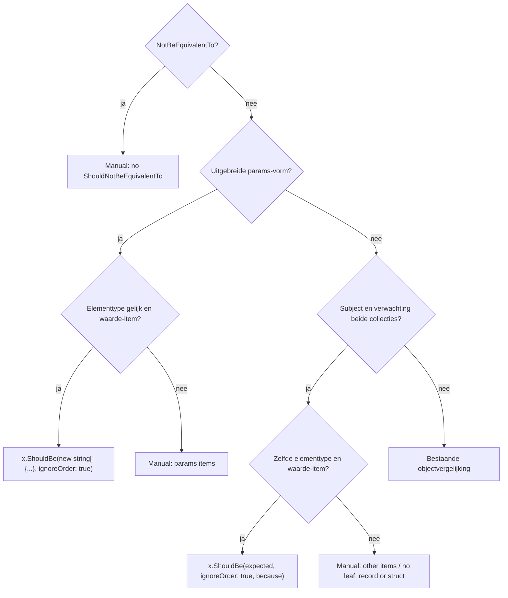

# Modellen: BeEquivalentTo op een collectie

`BeEquivalentTo` op een collectie wordt `ShouldBe(..., ignoreOrder: true)`. Feiten uit `src/Unshackle.Core/Fixes/FluentAssertions/Patterns/BeEquivalentToObjectPattern.cs` en `ParamsArraySyntax.cs`. Diagrammen met de hand in Mermaid (kingmadoc/d2 ontbreken).

**Figure 1.** Klassen.

| Element | Pad | Rol |
| --- | --- | --- |
| `BeEquivalentToObjectPattern` | `src/Unshackle.Core/Fixes/FluentAssertions/Patterns/BeEquivalentToObjectPattern.cs` | `RewriteBeforeArguments` (params) en `RewriteAssertion` (collectie); `IsValueLike`, `ElementType` |
| `ParamsArraySyntax` | `src/Unshackle.Core/Fixes/FluentAssertions/ParamsArraySyntax.cs` | Bouwt `new T[] { ... }` met behoud van regels en commentaar |
| `EqualSequencePattern` | `src/Unshackle.Core/Fixes/FluentAssertions/Patterns/EqualSequencePattern.cs` | Gebruikt dezelfde helper |

**Figure 2.** Volgorde voor de params-vorm.

| Stap | Plek | Wat gebeurt er |
| --- | --- | --- |
| Params? | `RewriteBeforeArguments` | Alleen de uitgebreide vorm (`ArgumentKind.ParamArray`) |
| Waarde-item | `IsValueLike` | Leaf, sealed record, record struct, struct met leaf-leden |
| Array | `ParamsArraySyntax.Create` | `new string[] { "a", "b" }`, meerregelig met komma en commentaar |

**Figure 3.** Beslisboom.

| Vraag | Uitkomst | Proof |
| --- | --- | --- |
| Params, strings | Fixed | `params-strings`, `edge-collection-params`, `params-multi-line` |
| Array als argument | Fixed | `params-array` |
| Waarde-items | Fixed | `collection-ints`, `collection-record`, `collection-struct` |
| Ander elementtype | Manual | `collection-element-types` |
| Class, niet-sealed record, genest | Manual | `collection`, `collection-record-unsealed`, `collection-record-nested` |

## Zie ook

- [fa-be-equivalent-to-collection-plan.md](fa-be-equivalent-to-collection-plan.md)
- [fa-be-equivalent-to-collection-verify.md](fa-be-equivalent-to-collection-verify.md)
- `src/Unshackle.Core/Fixes/FluentAssertions/Patterns/BeEquivalentToObjectPattern.cs`
- `src/Unshackle.Tests/Proofs/FluentAssertions/BeEquivalentToObject/`
