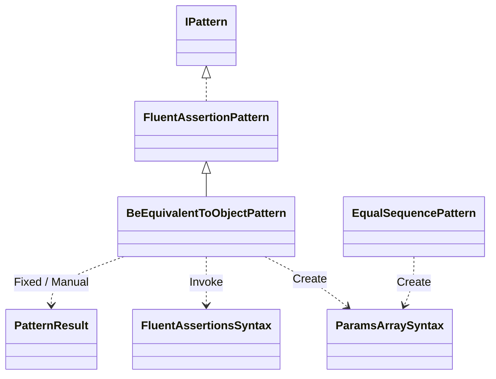
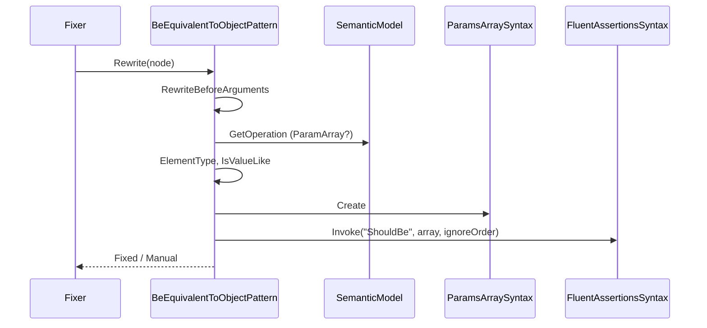
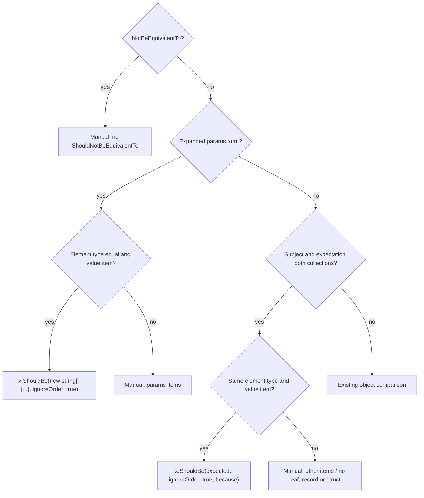

# Models: BeEquivalentTo on a collection

`BeEquivalentTo` on a collection becomes `ShouldBe(..., ignoreOrder: true)`. Facts from `src/Unshackle.Core/Fixes/FluentAssertions/Patterns/BeEquivalentToObjectPattern.cs` and `ParamsArraySyntax.cs`. Diagrams by hand in Mermaid (kingmadoc/d2 missing).

**Figure 1.** Classes.

| Element | Path | Role |
| --- | --- | --- |
| `BeEquivalentToObjectPattern` | `src/Unshackle.Core/Fixes/FluentAssertions/Patterns/BeEquivalentToObjectPattern.cs` | `RewriteBeforeArguments` (params) and `RewriteAssertion` (collection); `IsValueLike`, `ElementType` |
| `ParamsArraySyntax` | `src/Unshackle.Core/Fixes/FluentAssertions/ParamsArraySyntax.cs` | Builds `new T[] { ... }` keeping lines and comments |
| `EqualSequencePattern` | `src/Unshackle.Core/Fixes/FluentAssertions/Patterns/EqualSequencePattern.cs` | Uses the same helper |

**Figure 2.** Sequence for the params form.

| Step | Place | What happens |
| --- | --- | --- |
| Params? | `RewriteBeforeArguments` | Only the expanded form (`ArgumentKind.ParamArray`) |
| Value item | `IsValueLike` | Leaf, sealed record, record struct, struct with leaf members |
| Array | `ParamsArraySyntax.Create` | `new string[] { "a", "b" }`, multi-line with comma and comments |

**Figure 3.** Decision tree.

| Question | Outcome | Proof |
| --- | --- | --- |
| Params, strings | Fixed | `params-strings`, `edge-collection-params`, `params-multi-line` |
| Array as the argument | Fixed | `params-array` |
| Value items | Fixed | `collection-ints`, `collection-record`, `collection-struct` |
| Other element type | Manual | `collection-element-types` |
| Class, non-sealed record, nested | Manual | `collection`, `collection-record-unsealed`, `collection-record-nested` |

## See also

- [fa-be-equivalent-to-collection-plan.md](fa-be-equivalent-to-collection-plan.md)
- [fa-be-equivalent-to-collection-verify.md](fa-be-equivalent-to-collection-verify.md)
- `src/Unshackle.Core/Fixes/FluentAssertions/Patterns/BeEquivalentToObjectPattern.cs`
- `src/Unshackle.Tests/Proofs/FluentAssertions/BeEquivalentToObject/`
