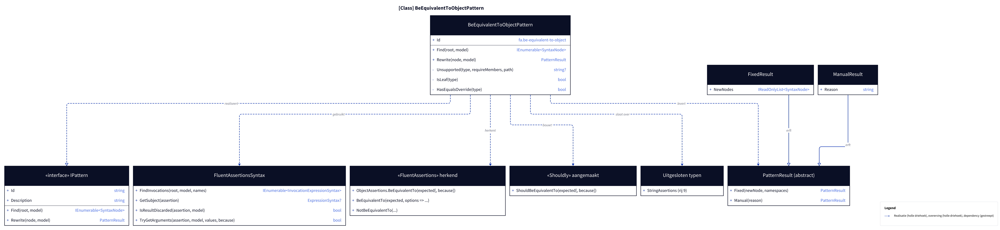
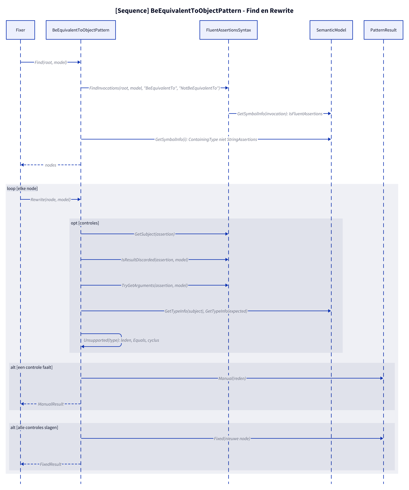
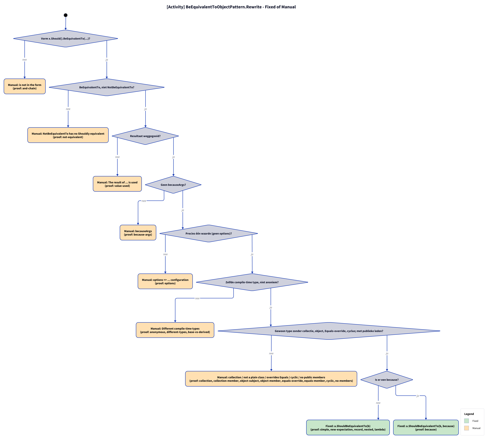

# Modellen: fa.be-equivalent-to-object

obj.Should().BeEquivalentTo(other) naar obj.ShouldBeEquivalentTo(other), alleen voor het zelfde gewone type met eenvoudige leden; al het andere is Manual. Feiten uit `src/Unshackle.Core/Fixes/FluentAssertions/Patterns/BeEquivalentToObjectPattern.cs`.

**Figure 1.** Klassen rond `BeEquivalentToObjectPattern`: wat hij implementeert, gebruikt en aanmaakt. Weggelaten: `Fixer`, `IFix` en de usings-afhandeling (zie [../modellen/klassen.md](../modellen/klassen.md)).

<!-- kingmadoc:diagram img/fa-be-equivalent-to-object-modellen-1.d2 -->

| Element | Pad | Rol |
| --- | --- | --- |
| `IPattern` | `src/Unshackle.Core/Abstractions/IPattern.cs` | Contract: `Find` en `Rewrite` |
| `BeEquivalentToObjectPattern` | `src/Unshackle.Core/Fixes/FluentAssertions/Patterns/BeEquivalentToObjectPattern.cs` | Dit patroon, Id `fa.be-equivalent-to-object`; `Unsupported` loopt over het type en zijn publieke leden |
| `FluentAssertionsSyntax` | `src/Unshackle.Core/Fixes/FluentAssertions/FluentAssertionsSyntax.cs` | Gedeelde bouwstenen: `FindInvocations`, `GetSubject`, `IsResultDiscarded`, `TryGetArguments` |
| `PatternResult`, `FixedResult`, `ManualResult` | `src/Unshackle.Core/Models/` | Uitkomst: `Fixed` met nieuwe node, of `Manual` met reden |
| «FluentAssertions» herkend | - | `BeEquivalentTo(expected[, because])`, met `options =>`, en `NotBeEquivalentTo` |
| «Shouldly» aangemaakt | - | `ShouldBeEquivalentTo(expected[, because])` |
| Uitgesloten typen | - | `StringAssertions` (doet `fa.be-equivalent-to-string`) |

**Figure 2.** `Fixer` roept `Find` en per node `Rewrite` aan; `Rewrite` doet de controles via `FluentAssertionsSyntax` en `SemanticModel` en levert `Fixed` of `Manual`. Weggelaten: het vervangen van de node en de usings door de `Fixer`.

<!-- kingmadoc:diagram img/fa-be-equivalent-to-object-modellen-2.d2 -->

| Stap | Plek | Wat gebeurt er |
| --- | --- | --- |
| Find | `BeEquivalentToObjectPattern.Find` | `FindInvocations` zoekt `BeEquivalentTo`, `NotBeEquivalentTo` in FluentAssertions; `StringAssertions` valt af |
| Vorm en argumenten | `Rewrite` | `GetSubject`, `IsResultDiscarded`, `TryGetArguments` |
| Typen | `Rewrite` | `GetTypeInfo` van subject en verwachting, `SymbolEqualityComparer` |
| Type-onderzoek | `Unsupported` | Collectie, gewoon type, `Equals`-override, cyclus, publieke leden, leden recursief |
| Manual | `PatternResult.Manual` | Eerste mislukte controle geeft `ManualResult` met reden (zie figuur 3) |
| Fixed | `PatternResult.Fixed` | Nieuwe node; trivia en usings regelt de `Fixer` |

**Figure 3.** Beslisboom van `Rewrite`: 8 vragen in de volgorde van de code, elk blad noemt de proof in `src/Unshackle.Tests/Proofs/FluentAssertions/BeEquivalentToObject/` die het bewijst.

<!-- kingmadoc:diagram img/fa-be-equivalent-to-object-modellen-3.d2 -->

| Vraag of selector | Bij nee: Manual-reden | Proof |
| --- | --- | --- |
| Vorm x.Should().BeEquivalentTo(...)? | is not in the form | `and-chain` |
| BeEquivalentTo, niet NotBeEquivalentTo? | no Shouldly equivalent | `not-equivalent` |
| Resultaat weggegooid? | The result of ... is used | `value-used` |
| Geen becauseArgs? | becauseArgs | `because-args` |
| Precies één waarde? | options => ... configuration | `options` |
| Zelfde compile-time type? | Different compile-time types | `anonymous`, `different-types`, `base-vs-derived` |
| Gewoon type, zonder collectie, Equals-override, cyclus? | is a collection / not a plain class / overrides Equals / cyclic / no public members | `collection`, `collection-member`, `object-subject`, `object-member`, `equals-override`, `equals-member`, `cyclic`, `no-members` |

| Voorwaarde | Fixed-vorm | Proofs |
| --- | --- | --- |
| geen because | `a.ShouldBeEquivalentTo(b)` | `simple`, `new-expectation`, `record`, `nested`, `lambda` |
| because | `a.ShouldBeEquivalentTo(b, because)` | `because` |

## Zie ook

- [fa-be-equivalent-to-object-plan.md](fa-be-equivalent-to-object-plan.md) - plan
- [fa-be-equivalent-to-object-verify.md](fa-be-equivalent-to-object-verify.md) - verificatie
- `src/Unshackle.Core/Fixes/FluentAssertions/Patterns/BeEquivalentToObjectPattern.cs` - het patroon
- `src/Unshackle.Tests/Proofs/FluentAssertions/BeEquivalentToObject/` - de proofs
- [../modellen/pattern-beslissing.md](../modellen/pattern-beslissing.md) - generieke beslissing van een pattern
- [../README.md](../README.md)
